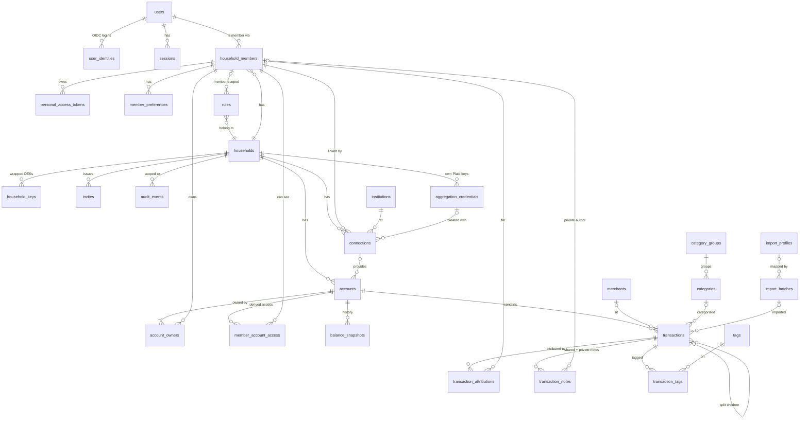

# Core data model (M0–M1)

- Status: Proposed
- Issue: #2
- Implements: [ADR 0002](../adr/0002-postgres-drizzle.md), [ADR 0005](../adr/0005-tenancy-and-trust-model.md), [ADR 0006](../adr/0006-shared-finances-yours-mine-ours.md), [ADR 0008](../adr/0008-plaid-credentials-and-webhooks.md), [ADR 0011](../adr/0011-time-ranges-and-periods.md)

This document defines the tables that M0 (identity, tenancy, security) and M1 (ledger, shared
finances, import) build on. Later milestones (budgets, bills, goals, investments, planning,
receipts, AI) add tables that reference these; they are out of scope here except where a
forward reference shapes a decision.

## 1. Conventions

| Concern | Rule |
|---|---|
| Primary keys | `uuid`, **UUIDv7** generated in the app, which gives time ordering and good index locality. `audit_events` uses `bigint identity` |
| Timestamps | `timestamptz`, stored in UTC. `created_at`/`updated_at` on every mutable table |
| Calendar dates | `date` for transaction dates and balance snapshots (no time component; resolved in household timezone per ADR 0011) |
| Money | `bigint` **minor units** + `char(3)` ISO-4217 currency. Exponent comes from a currency table (USD 2, JPY 0, BHD 3). Never floats |
| Amount sign | **Positive = money in, negative = money out**, from the account holder's view. Provider adapters normalize; Plaid uses the opposite sign |
| Shares | `share_bps int` (basis points, 1–10 000). Sets of shares sum to exactly 10 000, enforced by deferred constraint triggers |
| Quantities/prices | `numeric(28,10)`. Investment tables are M6, so this is listed here for consistency only |
| Enums | Postgres enums for closed sets (account type, role, visibility). `text` + check constraint where values may grow by provider |
| Encrypted columns | Suffix `_enc`, type `bytea`, AES-256-GCM with the household data key (ADR 0005). The key version is embedded in the ciphertext header ([encryption](../security/encryption.md)), so no separate `key_version` column is needed |
| Optimistic concurrency | `version int` + `field_versions jsonb` (`{field: version last changed}`) on user-edited rows (transactions, accounts, rules, budgets). Enables field-level conflict detection: first save wins, and only same-field overlaps conflict ([API conventions §8](api-conventions.md)) |
| Naming | `snake_case`, plural table names, `<table>_id` foreign keys |

## 2. Entity-relationship diagram



## 3. Tables

### 3.1 Identity and tenancy

**`users`**: a login identity; it exists independently of households.

| Column | Type | Notes |
|---|---|---|
| id | uuid PK | |
| email | text UNIQUE | Stored normalized (trimmed, lowercase), so no `citext` extension is needed |
| email_verified_at | timestamptz null | |
| password_hash | text null | argon2id. Null for OIDC-only users |
| totp_secret_enc | bytea null | Encrypted with the **instance** KEK (users aren't household-scoped) |
| is_instance_admin | bool default false | ADR 0005 §2. Grants no household data access |
| disabled_at | timestamptz null | |

**`user_identities`**: OIDC links. `(provider, subject)` UNIQUE, `user_id` FK.

**`sessions`**: `token_hash` (SHA-256; the raw token is only in the cookie), `user_id`, `active_household_id` null, `expires_at` (absolute, 30 days), `last_seen_at` (idle timeout 7 days), `reauthenticated_at` (10-minute window for destructive actions), `ip inet`, `user_agent`.

**`password_reset_tokens`**: `user_id`, `token_hash` (unique), `created_by_user_id` (the instance admin), `expires_at` (24 h), `used_at` (single use). Using a token revokes all of the user's sessions.

**`instance_setup`**: a single row holding the hash of the one-time first-run setup token. Deleted when the first account is created.

**`households`**

| Column | Type | Notes |
|---|---|---|
| id | uuid PK | |
| name | text | |
| base_currency | char(3) | |
| timezone | text | IANA tz, e.g. `America/Chicago` (ADR 0011) |
| week_start | smallint | 0 = Sunday, 1 = Monday |
| fiscal_year_start_month | smallint | 1–12 |
| date_basis | enum `posted`/`authorized` | |
| finance_style | enum `combined`/`hybrid`/`separate` | ADR 0006 §8. Drives defaults and which shared-cost screens show. Never rewrites data |
| status | enum `active`/`disabled`/`deleting` | `deleting` = crypto-shred in progress |

**`household_members`**: the actor for all financial permissions (not `users`).

| Column | Type | Notes |
|---|---|---|
| id | uuid PK | |
| household_id | uuid FK | |
| user_id | uuid FK **null** | Null = a member without a login (e.g. a child tracked for planning). **The schema allows it now, but the API rejects it until that feature ships**, so no migration is needed later. Such members can own accounts and be attributed spending, but can't hold sessions or PATs |
| role | enum `owner`/`member`/`viewer` | Must be `member` when `user_id` is null |
| display_name, color, avatar_url | | Viewer-relative labels use these (ADR 0006 naming) |
| joined_at, left_at | timestamptz | `left_at` set by the separation flow. Rows are kept for history |
| history_from | date | Earliest date of household-shared records this member can see (default: join date). Owners can move it earlier, never later ([ADR 0012](../adr/0012-member-lifecycle.md)) |

UNIQUE `(household_id, user_id) WHERE left_at IS NULL AND user_id IS NOT NULL`.

**`member_guardians`** (ships with #223): `(member_id, guardian_member_id)` PK, `household_id`, `created_at`. Required for every member without a login (≥1 guardian). Guardians get `owner`-level access to the dependent's accounts in `member_account_access`. Guardians must be login members.

**`invites`**: `household_id`, `email` (only an account with this email can accept), `role`, `token_hash`, `invited_by_member_id`, `expires_at` (7 days), `accepted_at`, `accepted_by_user_id`, `revoked_at`. The token is only sent in URL fragments and request bodies, never in paths, so it stays out of logs.

**`household_keys`**: ADR 0005 envelope encryption.

| Column | Type | Notes |
|---|---|---|
| household_id | uuid | PK part |
| version | int | PK part. The newest active version encrypts, any version decrypts |
| wrapped_key | bytea | Data key encrypted by a subkey of the master key |
| master_key_version | int | Which master key wrapped it (master key rotation = re-wrap) |
| retired_at | timestamptz null | |

Deleting all rows for a household is the **crypto-shred**.

**`personal_access_tokens`**: `member_id`, `household_id`, `name`, `token_prefix` (shown in UI), `token_hash`, `scopes text[]` (`read`, `write`), `last_used_at`, `expires_at`, `revoked_at`. Bound to a *member* (ADR 0009).

**`member_preferences`**: `(member_id, key)` PK, `value jsonb`. Holds per-page range defaults (ADR 0011) and UI prefs.

**`audit_events`**: append-only.

| Column | Type | Notes |
|---|---|---|
| id | bigint identity PK | |
| occurred_at | timestamptz | |
| actor_kind | enum `user`/`instance_admin`/`system`/`assistant`/`pat` | |
| actor_user_id, actor_member_id | uuid null | |
| household_id | uuid null | Null for instance-level events |
| action | text | e.g. `transaction.attribution.changed` |
| target_type, target_id | text, uuid | |
| visible_to_household | bool | Drives the owner "activity affecting your household" view and the F6 activity feed |
| metadata | jsonb | **No financial plaintext.** IDs, field names, old/new *category ids*, never notes or amounts of hidden rows |
| ip | inet null | |

Each household's events also carry `seq` and `entry_hash` (a SHA-256 chain), plus `changes_enc` (encrypted before/after values) per [ADR 0013](../adr/0013-tamper-evident-activity-history.md). The app DB role has `INSERT` + `SELECT` only. `UPDATE`/`DELETE` are revoked. Per-transaction edit history (M1) is a filtered view over `audit_events`.

### 3.2 Aggregation

**`institutions`**: global reference data (**not** household-scoped, no RLS): `provider`, `provider_institution_id`, `name`, `logo_url`, `url`.

**`aggregation_credentials`**: household-supplied Plaid keys (ADR 0008): `household_id`, `provider`, `client_id`, `secret_enc`, `env`, `created_by_member_id`, `revoked_at`.

**`connections`**: one per Plaid Item / SimpleFIN token / manual group.

| Column | Type | Notes |
|---|---|---|
| id | uuid PK | |
| household_id | uuid FK | |
| owner_member_id | uuid FK | The member who linked it (ADR 0006 §2) |
| provider | enum `plaid`/`simplefin`/`manual` | File imports don't need a connection |
| institution_id | uuid FK null | |
| credential_set_id | uuid FK null | **Null = instance default keys.** Immutable after creation; switching means re-linking (ADR 0008) |
| provider_item_id | text | UNIQUE per provider |
| access_token_enc | bytea | |
| sync_cursor | text null | Plaid `/transactions/sync` cursor |
| status | enum `ok`/`login_required`/`error`/`disconnected` | |
| last_synced_at, last_error_code | | |
| webhook_enabled | bool | |

### 3.3 Accounts and ownership

**`accounts`**

| Column | Type | Notes |
|---|---|---|
| id | uuid PK | |
| household_id | uuid FK | |
| connection_id | uuid FK null | Null = manual or import-only |
| provider_account_id | text null | UNIQUE `(connection_id, provider_account_id)` |
| name, official_name | text | |
| type | enum `depository`/`credit`/`loan`/`investment`/`property`/`vehicle`/`crypto`/`other` | |
| subtype | text | Provider-specific (checking, 401k, …) |
| currency | char(3) | |
| mask_last4 | char(4) null | Plaintext; shown in UI |
| account_number_enc | bytea null | Full number if ever provided. Never returned by the AI tools |
| visibility | enum `full`/`view_only`/`balance_only`/`private` | ADR 0006 §4. `private` on a joint account in a two-member household is rejected by the API (F2) |
| include_in_net_worth | bool | |
| is_business | bool default false | Default business flag for the account's transactions |
| sort_order | int | |
| notes_enc | bytea null | |
| closed_at | timestamptz null | |
| version | int | |

**`account_owners`**: `(account_id, member_id)` PK, `share_bps`. A deferred trigger enforces **≥1 owner** and **Σ share_bps = 10 000** per account at commit.

**`member_account_access`**: a **derived** table maintained by triggers on `accounts.visibility`, `account_owners`, and `household_members`. It is the single lookup RLS uses (§4).

| Column | Type | Notes |
|---|---|---|
| member_id | uuid | PK part |
| account_id | uuid | PK part |
| household_id | uuid | |
| level | enum `owner`/`full`/`view_only`/`balance_only` | No row = cannot see the account |

**`balance_snapshots`**: `(account_id, as_of)` PK, `household_id`, `balance_minor`, `available_minor` null, `credit_limit_minor` null, `source` enum `provider`/`computed`/`manual`. One row per account per day (end of day). Net-worth history and range charts read only this table (ADR 0011).

### 3.4 Currency

**`currencies`**: global reference data: `code char(3)` PK, `exponent smallint`, `symbol`, `name`.

**`fx_rates`**: global, no RLS: `(rate_date, base, quote)` PK, `rate numeric(28,12)`, `source`. Filled daily by a worker job from a pluggable `FxRateProvider` (ADR 0004 pattern; e.g. ECB reference rates, which are free).

**Strategy: store original, convert when reading.**
- Every amount is stored only in its own currency (account currency, plus the optional `foreign_*` original).
- Reports, budgets, and net worth convert to the household `base_currency` at query time by joining `fx_rates` on the row's date (balances use the snapshot date, transactions the effective date). Missing dates fall back to the most recent prior rate.
- Changing `households.base_currency` is instant, with no rewrite.
- There is **no** stored base-currency column. If profiling ever shows conversion as a bottleneck, a per-household materialized rollup can be added without changing the source of truth.
- The API returns both the native amount and the converted amount (with the rate date used), so the UI can show "€42.00 (≈ $45.80)".

### 3.5 Transactions

**`transactions`**

| Column | Type | Notes |
|---|---|---|
| id | uuid PK | |
| household_id | uuid FK | |
| account_id | uuid FK | Who **paid** (ADR 0006 §3) |
| parent_id | uuid FK null | Set on split children |
| has_splits | bool | True on a split parent. **Aggregates only count rows with `has_splits = false`** |
| amount_minor | bigint | Signed (see §1) |
| currency | char(3) | |
| posted_date | date null | Null while pending |
| authorized_date | date | |
| pending | bool | |
| original_description | text | Raw from provider/import. Untrusted (prompt-injection surface, ADR 0009) |
| display_name | text | After merchant cleanup and rename rules |
| merchant_id | uuid FK null | |
| category_id | uuid FK null | Null = uncategorized |
| review_status | enum `needs_review`/`reviewed` | |
| reviewer_member_id | uuid FK null | Assigned reviewer |
| excluded | bool | Hidden from reports and budgets |
| transfer_group_id | uuid null | Links both legs of a transfer |
| is_settlement | bool | Marks settle-up transfers (M3 forward reference) |
| is_business | bool null | Null = inherit from the account. Explicit true/false overrides it. Business reports filter on the effective value |
| foreign_amount_minor | bigint null | Original amount when the provider converted a foreign purchase (e.g. €42.00 on a USD card) |
| foreign_currency | char(3) null | |
| source | enum `provider`/`import`/`manual` | |
| provider_transaction_id | text null | |
| provider_pending_id | text null | Plaid's link from posted → pending, used to carry edits over |
| import_batch_id | uuid FK null | |
| dedupe_key | text null | For imports (§5) |
| deleted_at | timestamptz null | Tombstone (§6) |
| version | int | |

The effective date for ranges is `posted_date` or `authorized_date`, per `households.date_basis`. This is materialized as a generated column `effective_date` so it can be indexed.

**`transaction_notes`**: two kinds of note (decided in #2 review).

| Column | Type | Notes |
|---|---|---|
| id | uuid PK | |
| household_id | uuid FK | |
| transaction_id | uuid FK | |
| author_member_id | uuid FK null | **Null = the shared note.** Otherwise a private note owned by that member |
| body_enc | bytea | |
| updated_by_member_id | uuid FK | Shown on shared notes ("edited by Alex") |

- **Shared note:** one per transaction (partial UNIQUE `(transaction_id) WHERE author_member_id IS NULL`). Visible to **everyone who can see the transaction**, including via attribution (F1).
- **Private note:** one per member per transaction (partial UNIQUE `(transaction_id, author_member_id) WHERE author_member_id IS NOT NULL`). Visible only to its author.
- The AI assistant, acting as a member, sees the shared note and that member's private notes.
- Account notes (`accounts.notes_enc`) stay single and shared, following the account's visibility.

**`transaction_attributions`**: `(transaction_id, member_id)` PK, `share_bps`. **No rows = inherit** from `account_owners`. Split children carry their own rows. Σ = 10 000 is enforced like `account_owners`.

**`merchants`**: `household_id`, `name`, `normalized_key` (UNIQUE per household), `logo_url`.

**`category_groups`**: `household_id`, `name`, `kind` enum `income`/`fixed`/`flexible`/`non_monthly`/`savings`/`transfer`, `sort_order`.

**`categories`**: `household_id`, `group_id`, `name`, `icon`, `system_key` text null (`uncategorized`, `transfer`, `settlement`; these can't be deleted), `archived_at`, `sort_order`.

**`tags`** (`household_id`, `name`, `color`) + **`transaction_tags`** (`transaction_id`, `tag_id`) PK.

**`rules`**

| Column | Type | Notes |
|---|---|---|
| id | uuid PK | |
| household_id | uuid FK | |
| scope_member_id | uuid FK null | Null = household-wide. Otherwise it applies only to accounts that member owns |
| name | text | |
| priority | int | Lower runs first |
| conditions | jsonb | Validated by a zod schema in `packages/shared` (merchant/description/amount/account/category matchers) |
| actions | jsonb | Rename, recategorize, tag, set attribution, mark reviewed, exclude, split, … |
| enabled | bool | |
| created_by_member_id | uuid | |
| version | int | |

**`import_profiles`** (`household_id`, `name`, `format`, `mapping jsonb`) and **`import_batches`** (`household_id`, `account_id`, `member_id`, `format` enum `csv`/`ofx`/`qfx`/`monarch`, `filename`, `row_count`, `profile_id`, `reverted_at`). Reverting a batch soft-deletes its transactions.

## 4. Row-level security

### 4.1 Database roles
| Role | RLS | Used by |
|---|---|---|
| `fiscus_owner` | Bypass (owns the tables) | Migrations only |
| `fiscus_app` | **Enforced** | API and worker, for all normal work |
| `fiscus_maintenance` | `BYPASSRLS` | A short allow-list of jobs: crypto-shred, KEK re-wrap, backups. Every use is audit-logged |
| `fiscus_definer` | `BYPASSRLS`, NOLOGIN, **read-only** on 3 tables | Owns the SECURITY DEFINER functions (`fiscus_context_valid`, `fiscus_find_invite`), so a bug in one can never write data |

### 4.2 Session context
Every transaction opened by `fiscus_app` sets:
```sql
SET LOCAL app.household_id = '<uuid>';
SET LOCAL app.member_id    = '<uuid>';   -- or '' for system context
SET LOCAL app.system       = 'off';      -- 'on' only in worker jobs acting for the whole household
```
`SET LOCAL` scopes to the transaction, which keeps it safe with connection pooling. If the
settings are missing, policies evaluate to false and the query returns **nothing**. It fails closed.

### 4.3 Policies
1. **Household isolation** (every household-scoped table):
   `USING (household_id = current_setting('app.household_id', true)::uuid)`.
2. **Account visibility** (`accounts`, `balance_snapshots`, `connections`):
   ```sql
   app.system = 'on'
   OR EXISTS (SELECT 1 FROM member_account_access a
              WHERE a.member_id = current_setting('app.member_id')::uuid
                AND a.account_id = <row>.account_id)
   ```
   `balance_only` passes this check, because balances are visible at that level.
3. **Transaction visibility** (`transactions`, `transaction_attributions`, `transaction_tags`):
   ```sql
   app.system = 'on'
   OR EXISTS (SELECT 1 FROM member_account_access a
              WHERE a.member_id = :me AND a.account_id = t.account_id
                AND a.level IN ('owner','full','view_only'))
   OR EXISTS (SELECT 1 FROM transaction_attributions ta          -- F1: attribution shares it
              WHERE ta.transaction_id = t.id AND ta.member_id = :me)
   ```
   A transaction visible only through attribution has an `account_id` that the caller can't
   resolve, because the `accounts` row is filtered. The API **must not serialize `account_id` in that case**
   and shows the paying member instead (F1). The permissions matrix (#3) specifies this.
4. **Notes** (`transaction_notes`): shared note → visible if the transaction is visible (policy 3). Private note → `author_member_id = :me` only.
5. **Rules**: household-wide rules are visible to all members. Member-scoped rules are visible only to their member.
6. **Writes** use the same predicates in `WITH CHECK`. Write *authorization*, such as who may edit
   attribution (F6), is enforced in the domain layer and specified in #3. RLS guarantees only that
   you can't touch what you can't see.

### 4.3a As built (#19)
- Context accessors `fiscus_household()`, `fiscus_member()`, `fiscus_user()` read the settings (empty → NULL, so a missing context matches nothing).
- **`fiscus_context_valid()`** (SECURITY DEFINER, owned by **`fiscus_definer`**, a BYPASSRLS role that can only **read** `households`, `household_members`, and `invites`) checks that the context's member is an **active member of the context's household belonging to the context's user**, or that it's a system job. Every household policy requires it, evaluated once per statement as `(SELECT fiscus_context_valid())`. An application bug that sets the wrong household therefore still sees nothing.
- `households` and `household_members` also allow a **user branch** (`user_id = fiscus_user()`), so a user can list their own memberships across households without a household context.
- **`fiscus_find_invite(token_hash)`** (SECURITY DEFINER) is the single sanctioned cross-household read: at most one live invite for a token.
- `audit_events`: instance-level rows (no household) plus the context household's rows.
- `runMaintenanceJob()` is the only way to use `fiscus_maintenance`. It accepts only allow-listed jobs and records each run in the audit log first.
- A test lists every table with a `household_id` column and fails if any lacks ENABLE + FORCE RLS and a policy.

### 4.4 Why a derived access table
Evaluating ownership and visibility joins per row would make every transaction query slow.
`member_account_access` reduces the check to one indexed lookup. It is small (members × accounts)
and is only rewritten when ownership, visibility, or membership changes.

## 5. Identity and dedupe for incoming transactions

| Source | Identity | Rule |
|---|---|---|
| Plaid / SimpleFIN | `provider_transaction_id` | UNIQUE `(account_id, provider_transaction_id) WHERE provider_transaction_id IS NOT NULL`. Upserts on sync |
| Pending → posted | `provider_pending_id` | When a posted row arrives referencing a pending id, copy user edits (category, tags, notes, attribution, review state) from the pending row, then tombstone the pending row |
| File import | `dedupe_key` = hash(account_id, date, amount_minor, normalized description, **occurrence index**) | The occurrence index distinguishes two identical coffees on the same day. UNIQUE per account where `source = 'import'`. The dedupe preview shows collisions before commit |
| Import vs provider overlap | Fuzzy match (same account, amount, date ±3 days) | Flagged in the import preview, never silently dropped |

## 6. Deletion policy

| Entity | Policy | Why |
|---|---|---|
| Provider-sourced transaction deleted by the user | **Soft delete** (`deleted_at`) | The tombstone keeps `provider_transaction_id`, so the next sync won't resurrect it |
| Manual transaction | Soft delete, then purged after 30 days | Undo window |
| Imported batch | Revert = soft delete of all its rows | |
| Account | `closed_at` (keeps history). Hard delete only via explicit "delete account and history", which cascades | |
| Member leaves | `left_at` set. Ownership and attribution rows retained for history; separation flow reassigns (ADR 0006 §9) | |
| Household | `status = deleting` → **crypto-shred** (delete `household_keys`) → async hard delete of all rows | Old backups become unreadable for encrypted fields (ADR 0005) |
| Audit events | Retained. Metadata contains no financial plaintext. Events for a deleted household are purged after 90 days | |

## 7. Indexes (primary query paths)

| Table | Index | Serves |
|---|---|---|
| transactions | `(household_id, effective_date DESC, id DESC) WHERE deleted_at IS NULL AND has_splits = false` | Main list and range reports |
| transactions | `(account_id, effective_date DESC)` | Account register |
| transactions | `(household_id, category_id, effective_date)` | Category reports, budgets |
| transactions | `(household_id, merchant_id, effective_date)` | Merchant reports, recurring detection |
| transactions | `(household_id) WHERE review_status = 'needs_review'` | Review queue |
| transactions | `(parent_id)` | Splits |
| transactions | GIN `pg_trgm` on `display_name`, `original_description` | Search |
| transactions | UNIQUE `(account_id, provider_transaction_id)` partial | Sync upsert |
| transaction_attributions | `(member_id, transaction_id)` | RLS F1 branch, "Mine"/"Ours" spending lens |
| member_account_access | PK `(member_id, account_id)` | Every RLS check |
| balance_snapshots | PK `(account_id, as_of)` | Net worth and balance charts |
| transaction_notes | `(transaction_id)` | Load notes with a transaction |
| fx_rates | PK `(rate_date, base, quote)` | Conversion join |
| audit_events | `(household_id, occurred_at DESC)`, `(target_type, target_id)` | Activity feed, transaction history |

## 8. Encrypted columns summary

`users.totp_secret_enc` (instance KEK) · `aggregation_credentials.secret_enc` ·
`connections.access_token_enc` · `accounts.account_number_enc` · `accounts.notes_enc` ·
`transaction_notes.body_enc`. Receipt files and conversation history are encrypted the same way when
they arrive in M9/M10.

**Consequence:** notes are **not searchable in SQL**. Search covers names and descriptions. Note
search, if wanted, decrypts within an already-filtered result set.

## 9. Forward references (not designed here)
- **M3:** `budgets`, `budget_allocations`, `split_policies`, `settlement_entries`, `funding_targets`. They reference `household_members`, `categories`, `transactions` (`is_settlement`).
- **M4:** `recurring_series`, `notification_channels`, `notification_rules`. They reference `merchants`, `accounts`, members.
- **M6:** `securities`, `holdings`, `lots`, `investment_transactions`, `prices`. They reference `accounts` and use `numeric(28,10)`.
- **M10:** `change_sets` will reference `audit_events`, and undo replays the inverse operations.

## 10. Decisions from review (#2)
1. **Members without logins:** a later feature. `household_members.user_id` is nullable now so it needs no migration, and the API rejects it until the feature ships.
2. **Notes:** two kinds. A shared note is visible to anyone who can see the transaction, including via attribution. A private note is visible only to its author (`transaction_notes`).
3. **Business flag:** included now (`accounts.is_business`, `transactions.is_business` override).
4. **Multi-currency:** required. Store the original amount and convert at read time via `fx_rates`. No stored base-currency amounts. The multi-currency ticket moves to P1.
5. **Manual transaction purge window:** 30 days.
