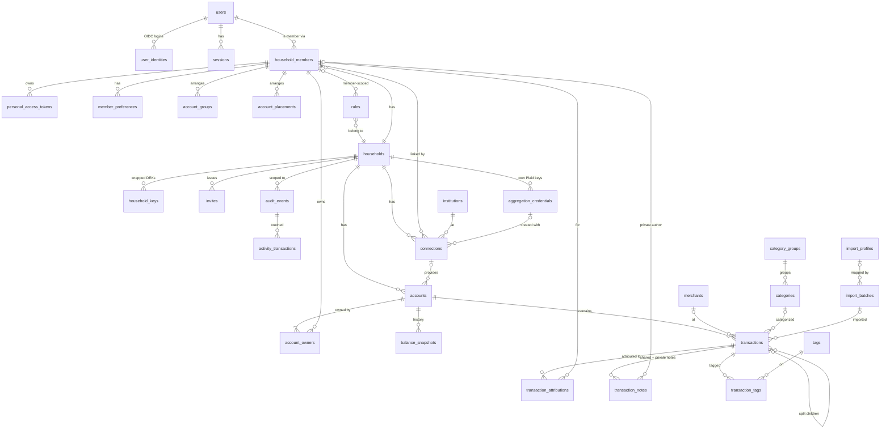

# Core data model (M0–M1)

- Status: Proposed
- Issue: #2
- Implements: [ADR 0002](../adr/0002-postgres-drizzle.md), [ADR 0005](../adr/0005-tenancy-and-trust-model.md), [ADR 0006](../adr/0006-shared-finances-yours-mine-ours.md), [ADR 0008](../adr/0008-plaid-credentials-and-webhooks.md), [ADR 0011](../adr/0011-time-ranges-and-periods.md)

This document defines the tables that M0 (identity, tenancy, security) and M1 (ledger, shared
finances, import) build on. Later milestones (budgets, bills, goals, investments, planning,
receipts, AI) add tables that reference these; they are out of scope here except where a
forward reference shapes a decision.

## 1. Conventions

| Concern | Rule |
|---|---|
| Primary keys | `uuid`, **UUIDv7** generated in the app, which gives time ordering and good index locality. `audit_events` uses `bigint identity` |
| Timestamps | `timestamptz`, stored in UTC. `created_at`/`updated_at` on every mutable table |
| Calendar dates | `date` for transaction dates and balance snapshots (no time component; resolved in household timezone per ADR 0011) |
| Money | `bigint` **minor units** + `char(3)` ISO-4217 currency. Exponent comes from a currency table (USD 2, JPY 0, BHD 3). Never floats |
| Amount sign | **Positive = money in, negative = money out**, from the account holder's view. Provider adapters normalize; Plaid uses the opposite sign |
| Shares | `share_bps int` (basis points, 1–10 000). Sets of shares sum to exactly 10 000, enforced by deferred constraint triggers |
| Quantities/prices | `numeric(28,10)`. Investment tables are M6, so this is listed here for consistency only |
| Enums | Postgres enums for closed sets (account type, role, visibility). `text` + check constraint where values may grow by provider |
| Encrypted columns | Suffix `_enc`, type `bytea`, AES-256-GCM with the household data key (ADR 0005). The key version is embedded in the ciphertext header ([encryption](../security/encryption.md)), so no separate `key_version` column is needed |
| Optimistic concurrency | `version int` + `field_versions jsonb` (`{field: version last changed}`) on user-edited rows (transactions, accounts, rules, budgets). Enables field-level conflict detection: first save wins, and only same-field overlaps conflict ([API conventions §8](api-conventions.md)) |
| Naming | `snake_case`, plural table names, `<table>_id` foreign keys |

## 2. Entity-relationship diagram



## 3. Tables

### 3.1 Identity and tenancy

**`users`**: a login identity; it exists independently of households.

| Column | Type | Notes |
|---|---|---|
| id | uuid PK | |
| email | text UNIQUE | Stored normalized (trimmed, lowercase), so no `citext` extension is needed |
| email_verified_at | timestamptz null | |
| password_hash | text null | argon2id. Null for OIDC-only users |
| totp_secret_enc | bytea null | Encrypted with the **instance** KEK (users aren't household-scoped) |
| is_instance_admin | bool default false | ADR 0005 §2. Grants no household data access |
| disabled_at | timestamptz null | |

**`user_identities`**: OIDC links. `(provider, subject)` UNIQUE, `user_id` FK.

**`sessions`**: `token_hash` (SHA-256; the raw token is only in the cookie), `user_id`, `active_household_id` null, `expires_at` (absolute, 30 days), `last_seen_at` (idle timeout 7 days), `reauthenticated_at` (10-minute window for destructive actions), `ip inet`, `user_agent`.

**`password_reset_tokens`**: `user_id`, `token_hash` (unique), `created_by_user_id` (the instance admin), `expires_at` (24 h), `used_at` (single use). Using a token revokes all of the user's sessions.

**`instance_setup`**: a single row holding the hash of the one-time first-run setup token. Deleted when the first account is created.

**`instance_settings`** (#400): `key` (text PK), `value` (jsonb), `updated_at`, `updated_by_user_id` (FK users, null on delete). One row per setting an instance admin has changed; the registry in `@fiscus/shared` (`INSTANCE_SETTINGS`) defines each setting, its schema and its default, and a missing or no-longer-valid row reads as the default. `fiscus_app` (and so the worker) may only read it: an admin's change goes through `fiscus_set_instance_setting()` (§4.3c), and is on the instance activity chain with its old and new values. Settings never hold secrets.

**`households`**

| Column | Type | Notes |
|---|---|---|
| id | uuid PK | |
| name | text | |
| base_currency | char(3) | |
| timezone | text | IANA tz, e.g. `America/Chicago` (ADR 0011) |
| week_start | smallint | 0 = Sunday, 1 = Monday |
| fiscal_year_start_month | smallint | 1–12 |
| date_basis | enum `posted`/`authorized` | |
| finance_style | enum `combined`/`hybrid`/`separate` | ADR 0006 §8. Drives defaults and which shared-cost screens show. Never rewrites data |
| status | enum `active`/`disabled`/`deleting` | `deleting` = crypto-shred in progress |

**`household_members`**: the actor for all financial permissions (not `users`).

| Column | Type | Notes |
|---|---|---|
| id | uuid PK | |
| household_id | uuid FK | |
| user_id | uuid FK **null** | Null = a member without a login (e.g. a child tracked for planning). **The schema allows it now, but the API rejects it until that feature ships**, so no migration is needed later. Such members can own accounts and be attributed spending, but can't hold sessions or PATs |
| role | enum `owner`/`member`/`viewer` | Must be `member` when `user_id` is null |
| display_name, color, avatar_url | | Viewer-relative labels use these (ADR 0006 naming) |
| joined_at, left_at | timestamptz | `left_at` set by the separation flow. Rows are kept for history |
| history_from | date | Earliest date of household-shared records this member can see (default: join date). Owners can move it earlier, never later ([ADR 0012](../adr/0012-member-lifecycle.md)) |

UNIQUE `(household_id, user_id) WHERE left_at IS NULL AND user_id IS NOT NULL`.

**`member_guardians`** (ships with #223): `(member_id, guardian_member_id)` PK, `household_id`, `created_at`. Required for every member without a login (≥1 guardian). Guardians get `owner`-level access to the dependent's accounts (`fiscus_account_access()` will include them). Guardians must be login members.

**`invites`**: `household_id`, `email` (only an account with this email can accept), `role`, `token_hash`, `invited_by_member_id`, `expires_at` (7 days), `accepted_at`, `accepted_by_user_id`, `revoked_at`. The token is only sent in URL fragments and request bodies, never in paths, so it stays out of logs.

**`household_keys`**: ADR 0005 envelope encryption.

| Column | Type | Notes |
|---|---|---|
| household_id | uuid | PK part |
| version | int | PK part. The newest active version encrypts, any version decrypts |
| wrapped_key | bytea | Data key encrypted by a subkey of the master key |
| master_key_version | int | Which master key wrapped it (master key rotation = re-wrap) |
| retired_at | timestamptz null | |

Deleting all rows for a household is the **crypto-shred**.

**`personal_access_tokens`**: `member_id`, `household_id`, `name`, `token_prefix` (shown in UI), `token_hash`, `scopes text[]` (`read`, `write`), `last_used_at`, `expires_at`, `revoked_at`. Bound to a *member* (ADR 0009).

**`member_preferences`**: `(member_id, key)` PK, `value jsonb`. Holds per-page range defaults (ADR 0011) and UI prefs.

**`audit_events`**: append-only.

| Column | Type | Notes |
|---|---|---|
| id | bigint identity PK | |
| occurred_at | timestamptz | |
| actor_kind | enum `user`/`instance_admin`/`system`/`assistant`/`pat` | |
| actor_user_id, actor_member_id | uuid null | |
| household_id | uuid null | Null for instance-level events |
| action | text | e.g. `transaction.attribution.changed` |
| target_type, target_id | text, uuid | |
| visible_to_household | bool | Drives the owner "activity affecting your household" view and the F6 activity feed |
| metadata | jsonb | **No financial plaintext.** IDs, field names, old/new *category ids*, never notes or amounts of hidden rows |
| ip | inet null | |

Each household's events also carry `seq` and `entry_hash` (a SHA-256 chain), plus `changes_enc` (encrypted before/after values) per [ADR 0013](../adr/0013-tamper-evident-activity-history.md). The app DB role has `INSERT` + `SELECT` only. `UPDATE`/`DELETE` are revoked. `hash_version` (smallint, default 1) says how `entry_hash` was computed, and version 2 entries also store their `leaf`, SHA-256 of the canonical entry, which history proofs are made of (#264). A check constraint ties the two: version 1 has no leaf, version 2 has a 32-byte one.

**`activity_transactions`**: append-only, which transactions each household event touched (#46, migrations `0044`, `0045`): `household_id`, `seq` (the event's position in the household's chain), `transaction_id`, PK `(household_id, transaction_id, seq)`. Each transaction's history (TXN-11) is the events linked to it. The links are needed because bulk edits, rules, imports, and sync batches name their transactions only inside the encrypted `changes`, one event per account. `HouseholdActivity.record({ transactionIds })` writes them in the same transaction as the event, and every change to a transaction passes its ids. No foreign keys: links outlive purged transactions, as events do. A link is visible to whoever can see its transaction, and can only name a transaction its writer can see. The event is still filtered by its own policy, so a transaction seen only through attribution (F1) shows nothing about the account it was paid from. The app role has `INSERT` + `SELECT` only.

### 3.2 Aggregation

The provider interface these tables serve, and the conformance suite every adapter passes, are in [aggregation](aggregation.md). Built in #78 (migrations `0036`, `0037`).

**`institutions`**: global reference data (**not** household-scoped, no RLS): `provider`, `provider_institution_id` (UNIQUE with `provider`), `name`, `url`. No logo: showing one would need the provider's image host in the Content-Security-Policy.

**`aggregation_credentials`**: household-supplied Plaid keys (ADR 0008, #83): `household_id`, `provider` (`plaid` only), `client_id`, `secret_enc` (encrypted with the household key, bound to the row; emptied once no connection needs it), `env`, `created_by_member_id`, `revoked_at`. At most one active set (`revoked_at` null) per household, kept by the api under an advisory lock: replacing keys revokes the old set, which still serves the connections made with it. Rows stay for the connections that name them. Readable in the household (members connecting a bank use the household's keys; the api never returns the secret, HH-08), changed by household owners or the worker. See [aggregation](aggregation.md) §6a.

**`connections`**: one per Plaid Item or SimpleFIN access URL. File imports and manual accounts don't need one.

| Column | Type | Notes |
|---|---|---|
| id | uuid PK | `(household_id, id)` UNIQUE, the target of composite foreign keys |
| household_id | uuid FK | |
| owner_member_id | uuid FK | The member who linked it (ADR 0006 §2); `(household_id, owner_member_id)` references `household_members` |
| provider | text + check `plaid`/`simplefin` | |
| institution_id | uuid FK null | |
| credential_set_id | uuid FK null | **Null = the server's keys.** `(household_id, credential_set_id)` references `aggregation_credentials`. Immutable after creation; switching means re-linking (ADR 0008) |
| provider_item_id | text | UNIQUE `(provider, provider_item_id)` |
| provider_env, provider_client_id | text null | The Plaid environment and client id the Item was made with (#82) |
| status | text + check `setup`/`ok`/`login_required`/`error`/`disconnected` | `setup` until owners and visibility are confirmed: visible only to its owner, never synced (D4) |
| last_error_code | text null | The provider's code, never its message (untrusted text) |
| first_failed_at | timestamptz null | Start of the current run of failures (the 3-day rule, D10) |
| last_synced_at, next_sync_at | timestamptz null | `next_sync_at` is when the worker next syncs it; null = never |
| lease_until | timestamptz null | Held by a worker until then (`fiscus_claim_due_connections`) |
| historical_complete | bool | The provider says all older history has arrived |
| webhook_enabled, new_accounts_available | bool | Plaid (#82, #84) |
| disconnect_requested | bool | Disconnected, and the worker still has to end it at the provider and delete its secret (D14) |
| sync_cursor | text null | Plaid `/transactions/sync` cursor |
| replaces_connection_id | uuid null | The connection this one moves to other Plaid keys (#83, D15): confirming it takes over that one's accounts and ends it. Same household (composite foreign key) |

**`connection_secrets`**: `connection_id` PK, `household_id` (composite FK to `connections`, cascading), `secret_enc`: the access token or access URL, encrypted with the household key, with associated data binding it to `connection_secrets.secret_enc` and the connection id. Kept apart from `connections` so that RLS can let only the connection's owner and the worker read it: other members, household owners included, can't read even the ciphertext. Never returned, logged, or in activity metadata.

`accounts.sync_from` (date) is the first day sync asks for (D6). `accounts.connection_id` gets its foreign key to `connections` by `(household_id, connection_id)` a release later, as a new constraint ([upgrades](upgrades.md) §3): the previous release's api tests set connection ids that name no connection, and must still pass on this schema. Until then, an account pointing at a connection elsewhere shows nothing of it, since a connection is visible only in its own household.

**`sync_holds`** (#80, migrations `0049`, `0050`): synced transactions held as possible duplicates (bank connections walkthrough D7). One looks like a transaction already in its account without matching it exactly: the same amount and currency within 3 days, in one that isn't the provider's, where the exact one-to-one match didn't apply. It waits here, outside the ledger, so totals don't count it twice. Columns: `household_id`, `connection_id` and `account_id` (composite FKs, cascading), `provider_transaction_id` (UNIQUE with `account_id`), `provider_pending_id`, and the bank's transaction as sync would insert it (`amount_minor`, `currency`, `posted_date`, `authorized_date`, `original_description`, `display_name`, `foreign_amount_minor`, `foreign_currency`), plus `candidate_ids uuid[]` (the closest few when it was held; checked again when shown and decided). Later syncs keep it as the bank last said it and drop it when the bank removes it. Only the account's owners see or change it (TXN-13): "different" adds the transaction and rebuilds the account's balances, which only owners may do.

**Who sees and changes them (RLS, migration `0037`).**
- A connection is visible to its owner, and to anyone who sees at least one of its accounts through `fiscus_account_access()` (ACC-02), except in `setup`, when only its owner sees it. Only its owner, or the worker in system context, inserts, changes, or deletes it.
- `connection_secrets`: the connection's owner and the worker only, for reads and writes.
- **Disconnecting** (D14, ACC-03) goes through `fiscus_disconnect_connection(id)` (steward): its owner may, or a household owner once its owner has left. It sets `disconnected` and `disconnect_requested`, and clears `connection_id` on its accounts, including ones the caller doesn't own, which keep their history and `provider_account_id` for relinking. The worker then calls the provider's `remove` and deletes the secret.
- **Scheduling** is in Postgres: the worker claims due connections with `fiscus_claim_due_connections(limit, lease)` (§4.3c).

### 3.3 Accounts and ownership

**`accounts`**

| Column | Type | Notes |
|---|---|---|
| id | uuid PK | |
| household_id | uuid FK | |
| connection_id | uuid FK null | Null = manual or import-only. Cleared on disconnecting (D14) |
| provider_account_id | text null | UNIQUE `(connection_id, provider_account_id)`. Kept on disconnecting, for relinking |
| sync_from | date null | The first day sync asks the provider for (D6) |
| name, official_name | text | |
| type | enum `depository`/`credit`/`loan`/`investment`/`property`/`vehicle`/`crypto`/`other` | |
| subtype | text | Provider-specific (checking, 401k, …) |
| currency | char(3) | |
| mask_last4 | char(4) null | Plaintext; shown in UI |
| account_number_enc | bytea null | Full number if ever provided. Never returned by the AI tools |
| visibility | enum `full`/`view_only`/`balance_only`/`private` | ADR 0006 §4. `private` on a joint account in a two-member household is rejected by the API (F2) |
| balance_mode | enum `transactions`/`value` | Bank-style accounts follow transactions; assets (house, car) are valued by hand ([accounts and visibility §5](accounts-and-visibility.md#5-balances)) |
| include_in_net_worth | bool | |
| is_business | bool default false | Default business flag for the account's transactions |
| sort_order | int | The household's default order. Each member's own order is in `account_placements` (#48) |
| notes_enc | bytea null | |
| closed_at | timestamptz null | |
| version | int | |

**`account_groups`** and **`account_placements`**: how a member arranges their accounts list (#48). Private to that member under RLS, like `member_preferences`, so an arrangement never changes anyone's access.
- `account_groups`: `id`, `household_id`, `member_id`, `name` (1–60 characters), `sort_order`.
- `account_placements`: `(member_id, account_id)` PK, `household_id`, `group_id` null, `sort_order`. With no group, the account stays in its type's section, in the member's order. Deleting a group clears only `group_id` (`ON DELETE SET NULL (group_id)`), so its accounts go back to their sections.
- A placement is kept while the account is hidden from its member, so the account comes back where they put it.
- The accounts list orders by the member's groups, then their placements, then `accounts.sort_order`, then name.

**`account_owners`**: `(account_id, member_id)` PK, `household_id`, `share_bps`. Deferred triggers enforce **≥1 owner** and **Σ share_bps = 10 000** per account at commit. Owners must be active, non-viewer members, and a member who owns accounts can't become a viewer or leave until they're handed over.

**Access** (who sees which account, at what level) is computed per statement by the read-only
function `fiscus_account_access()`, not stored. It replaced the planned trigger-maintained
`member_account_access` table ([accounts and visibility §3](accounts-and-visibility.md#3-enforcing-visibility-in-the-database)).
Levels, lowest first: `balance_only` < `view_only` < `full` < `owner`. Private accounts a member
doesn't own are absent.

Children of `accounts` (`account_owners`, `balance_snapshots`) use **composite foreign keys**
`(household_id, account_id)`, and owners reference `(household_id, member_id)`, so no row can
point across households.

**`account_owner_periods`** (#447, migrations `0055`, `0056`): who owned an account before its current owners. `(account_id, valid_until, member_id)` PK, `household_id`, `share_bps`, `valid_from` date null (null: from the account's beginning), `valid_until` date (the first day the next owners count from). A transaction with no attribution of its own is for whoever owned its account on its effective date: `fiscus_owners_on(account, date)` returns the period covering the date, else today's `account_owners`. Changing owners "from today" (the default except in Combined households) closes the current owners into a period ending today; "including its history" deletes the account's periods. Visible with the account, written by whoever may change its owners, like `account_owners`. Who can **see** an account still follows today's owners alone; only spending views (attribution, "Paid by", "Transfer to") read the history.

**`balance_snapshots`**: `(account_id, as_of)` PK, `household_id`, `balance_minor`, `available_minor` null, `credit_limit_minor` null, `source` enum `provider`/`computed`/`manual`. One row per account per day (end of day). Net-worth history and range charts read only this table (ADR 0011).

Which source a day has (#86, `@fiscus/ledger`):
- **`provider`**: what the bank reported, written by each sync (`writeProviderBalances`), with the available balance and credit limit. Dated by the provider's balance date in the household's time zone, never after today there; a later sync that day replaces it, as it does an entered or computed balance for that day.
- **`manual`**: entered by hand or imported (Monarch balances). Anchors: never overwritten by a computed balance.
- **`computed`**: rebuilt from transactions and anchors for accounts in `transactions` mode ([transactions §2](transactions.md)). For a bank-connected account, only **before its first `provider` snapshot**, from its own (imported or manual) transactions and entered balances, so linking an account keeps the history it had (D5); synced transactions never compute a balance. From the first provider snapshot on, the bank's balances win and carry forward between syncs. Once disconnected (D14), its balance follows its transactions again from the last provider snapshot.

An account's current balance (`balance` in the api) is its latest snapshot; for a connected account, its latest `provider` snapshot, so a broken connection shows the date the bank last reported (D12).

**`account_liabilities`** (#86, migrations `0038`, `0039`): a card's or loan's details from the provider (Plaid's `/liabilities/get`; SimpleFIN has none). `account_id` PK, `household_id` (composite FK to `accounts`, cascading), `apr_bps` int null, `minimum_payment_minor` bigint null (positive), `next_due_date` date null, `last_statement_balance_minor` bigint null (Fiscus's sign: owed is negative), `last_statement_date` date null, `updated_at`. Written by each sync for tracked `credit` and `loan` accounts (`writeProviderLiabilities`), replacing the last sync's. Visible at `owner` and `full` access only (RLS through `fiscus_account_access()`); written by owners or the worker. The api returns it as `liabilities` on the account itself, and leaves the field out below `full` access.

### 3.4 Currency

**`currencies`**: global reference data: `code char(3)` PK, `exponent smallint`, `symbol`, `name`.

**`fx_rates`**: global, no RLS: `(rate_date, base, quote)` PK, `rate numeric(28,12)`, `source`. Filled daily by a worker job from a pluggable `FxRateProvider` (ADR 0004 pattern; e.g. ECB reference rates, which are free).

**Strategy: store original, convert when reading.**
- Every amount is stored only in its own currency (account currency, plus the optional `foreign_*` original).
- Reports, budgets, and net worth convert to the household `base_currency` at query time by joining `fx_rates` on the row's date (balances use the snapshot date, transactions the effective date). Missing dates fall back to the most recent prior rate.
- Changing `households.base_currency` is instant, with no rewrite.
- There is **no** stored base-currency column. If profiling ever shows conversion as a bottleneck, a per-household materialized rollup can be added without changing the source of truth.
- The API returns both the native amount and the converted amount (with the rate date used), so the UI can show "€42.00 (≈ $45.80)".

### 3.5 Transactions

**`transactions`**

| Column | Type | Notes |
|---|---|---|
| id | uuid PK | |
| household_id | uuid FK | |
| account_id | uuid FK | Who **paid** (ADR 0006 §3) |
| parent_id | uuid FK null | Set on split children |
| has_splits | bool | True on a split parent. **Aggregates only count rows with `has_splits = false`** |
| amount_minor | bigint | Signed (see §1) |
| currency | char(3) | |
| posted_date | date null | Null while pending. As the bank or file reports it; sync may update it |
| authorized_date | date | As reported; sync may update it |
| date_override | date null | **The date a member set** ("move to another day"). Null = use the reported date. Sync and imports never write it (#281) |
| pending | bool | |
| original_description | text | Raw from provider/import. Untrusted (prompt-injection surface, ADR 0009) |
| display_name | text | After merchant cleanup and rename rules |
| merchant_id | uuid FK null | |
| category_id | uuid FK null | Null = uncategorized |
| review_status | enum `needs_review`/`reviewed` | |
| reviewer_member_id | uuid FK null | Assigned reviewer |
| excluded | bool | Hidden from reports and budgets |
| transfer_group_id | uuid null | Links both legs of a transfer |
| is_settlement | bool | Marks settle-up transfers (M3 forward reference) |
| is_business | bool null | Null = inherit from the account. Explicit true/false overrides it. Business reports filter on the effective value |
| foreign_amount_minor | bigint null | Original amount when the provider converted a foreign purchase (e.g. €42.00 on a USD card) |
| foreign_currency | char(3) null | |
| source | enum `provider`/`import`/`manual` | |
| provider_transaction_id | text null | |
| provider_pending_id | text null | On a posted transaction that was pending: the pending one's provider id (§5) |
| provider_removed_at | timestamptz null | Set with `deleted_at` when the bank removed it (sync), so a removed pending row can still become its posted one; a row a person deleted never comes back (§5) |
| import_batch_id | uuid FK null | |
| dedupe_key | text null | For imports (§5) |
| deleted_at | timestamptz null | Tombstone (§6) |
| version | int | |

The effective date for ranges, budgets, and reports is `date_override` if set, else `posted_date` or `authorized_date` per `households.date_basis` (a pending row falls back to `authorized_date`). It's materialized as a generated column `effective_date` so it can be indexed.

**Changing a transaction's date** (#281) sets `date_override` and never touches the reported dates:
- **Sync can't undo it.** Providers keep updating `posted_date`/`authorized_date`; the override wins.
- **The UI says so:** the date shows as edited with the bank's date beside it ("Bank date: Sep 30"), and **Reset to bank date** clears the override.
- **Manual transactions** use the same column, so every source behaves alike.
- It's an ordinary user edit: recorded in activity history with before/after values, covered by `field_versions` (first save wins), and carried from pending to posted (§5).
- Budgets and reports are computed at read time, so moving a transaction across a month boundary moves it between months immediately. What happens when it moves into an **already-settled** settle-up period is decided in M3; the proposal is that closed statements stay fixed and the change shows as an adjustment in the next one.

**`transaction_notes`**: two kinds of note (decided in #2 review).

| Column | Type | Notes |
|---|---|---|
| id | uuid PK | |
| household_id | uuid FK | |
| transaction_id | uuid FK | |
| author_member_id | uuid FK null | **Null = the shared note.** Otherwise a private note owned by that member |
| body_enc | bytea | |
| updated_by_member_id | uuid FK | Shown on shared notes ("edited by Alex") |

- **Shared note:** one per transaction (partial UNIQUE `(transaction_id) WHERE author_member_id IS NULL`). Visible to **everyone who can see the transaction**, including via attribution (F1).
- **Private note:** one per member per transaction (partial UNIQUE `(transaction_id, author_member_id) WHERE author_member_id IS NOT NULL`). Visible only to its author.
- The AI assistant, acting as a member, sees the shared note and that member's private notes.
- Account notes (`accounts.notes_enc`) stay single and shared, following the account's visibility.

**`transaction_attributions`**: `(transaction_id, member_id)` PK, `share_bps`. **No rows = inherit** from `account_owners`. Split children carry their own rows. Σ = 10 000 is enforced like `account_owners`.

**`merchants`**: `household_id`, `name`, `normalized_key` (UNIQUE per household), `logo_url`.

**`category_groups`**: `household_id`, `name`, `kind` enum `income`/`fixed`/`flexible`/`non_monthly`/`savings`/`transfer`, `sort_order`.

**`categories`**: `household_id`, `group_id`, `name`, `icon`, `system_key` text null (`uncategorized`, `transfer`, `settlement`; these can't be deleted), `archived_at`, `sort_order`.

**`tags`** (`household_id`, `name`, `color`) + **`transaction_tags`** (`transaction_id`, `tag_id`) PK.

**`rules`**

| Column | Type | Notes |
|---|---|---|
| id | uuid PK | |
| household_id | uuid FK | |
| member_id | uuid FK null | Null = the household's. Otherwise that member's own (#58): only they see it, and it runs only on accounts they own, after the household's rules ([imports §3](imports.md)). Composite FK to `household_members` (cascade); deleted when they leave (RULE-07, a trigger, since leaving sets `left_at`) |
| name | text | |
| position | int | Lower runs first, within the household's rules or within one member's |
| conditions | jsonb | Validated by a zod schema in `packages/shared` (merchant/description/amount/account/category matchers) |
| actions | jsonb | Rename, recategorize, tag, set attribution, mark reviewed, exclude, split, … |
| enabled | bool | |
| author_member_id | uuid | Whose access it acts with (RULE-05): its creator, or whoever last edited it. A member's own rule is always theirs (`member_id = author_member_id`) |
| version | int | |

**`import_profiles`** (`household_id`, `name`, `format`, `mapping jsonb`) and **`import_batches`** (`household_id`, `account_id`, `member_id`, `format` enum `csv`/`ofx`/`qfx`/`monarch`, `filename`, `row_count`, `profile_id`, `reverted_at`). Reverting a batch soft-deletes its transactions.

### 3.6 Budgets

Budgets (#98, migrations `0053`, `0054`; [budgeting walkthrough](walkthroughs/budgeting.md) §1). Months are stored as `date`s on the first of the month, which a check enforces. What a month shows (spent, left, rollover, ready to assign) is computed from these tables and the transactions when it's read, never stored (walkthrough D13). The engine and the strategy interface are in `@fiscus/domain` (`budget.ts`).

**`budgets`**: `household_id`, `member_id` null (null for the household's budget, Ours; otherwise the member whose own it is, Mine), `starts_month`, plus `version`/`field_versions`. UNIQUE NULLS NOT DISTINCT `(household_id, member_id)`: one Ours per household, one Mine per member. A member's own is visible only to them and the worker (BUD-02), and is deleted when they leave (BUD-05, a trigger, since leaving sets `left_at`).

**`budget_strategies`**: `(budget_id, from_month)` PK, `household_id`, `strategy` enum `category`/`zero_based`/`percentage`/`flex`, `settings jsonb` (the strategy's own, read by its `settings()`). A month runs under the last row starting on or before it, so switching adds a row and earlier months keep their strategy (D14).

**`budget_amounts`**: `(budget_id, month, category_id)` PK, `household_id`, `amount_minor` (≥ 0, household currency), `version`, `updated_at`. One amount per category per month, whatever the strategy: a limit, an assignment, a fixed cost. A month with no rows repeats the last month that has some (`amountsFor`); changing an amount in such a month copies that month's amounts first.

**`budget_categories`**: `(budget_id, category_id)` PK, `household_id`, `rollover` bool, `bucket` text null (50/30/20, D10), `yearly_minor` null (non-monthly, D12). How the budget treats a category in every month.

All three tables under `budgets` have composite FKs to it and to `categories`, cascading, and are visible exactly when their budget is.

## 4. Row-level security

### 4.1 Database roles
| Role | RLS | Used by |
|---|---|---|
| `fiscus_owner` | Bypass (owns the tables) | Migrations only |
| `fiscus_app` | **Enforced** | The API, for all its work. `app.system` is ignored for it (#376) |
| `fiscus_worker` | **Enforced** | The worker. A member of `fiscus_app`, so the same privileges, but the only login that system context works for |
| `fiscus_maintenance` | `BYPASSRLS` | A short allow-list of jobs: crypto-shred, KEK re-wrap, backups. Every use is audit-logged |
| `fiscus_definer` | `BYPASSRLS`, NOLOGIN, **read-only** | Owns the SECURITY DEFINER functions that read (`fiscus_context_valid`, `fiscus_find_invite`, `fiscus_household_chain`, …), so a bug in one can never write data |
| `fiscus_steward` | `BYPASSRLS`, NOLOGIN, column-level writes | Owns the few definer functions that write (`fiscus_create_household`, `fiscus_join_household`, `fiscus_reassign_category`), each checking the context it's called in (§4.3c) |

### 4.2 Session context
Every transaction opened by `fiscus_app` or `fiscus_worker` sets:
```sql
SET LOCAL app.household_id = '<uuid>';
SET LOCAL app.member_id    = '<uuid>';   -- or '' for system context
SET LOCAL app.system       = 'off';      -- 'on' only in worker jobs acting for the whole household;
                                         -- honored only for a session logged in as fiscus_worker
```
`SET LOCAL` scopes to the transaction, which keeps it safe with connection pooling. If the
settings are missing, policies evaluate to false and the query returns **nothing**. It fails closed.

### 4.3 Policies
1. **Household isolation** (every household-scoped table):
   `USING (household_id = current_setting('app.household_id', true)::uuid)`.
2. **Account visibility** (`accounts`, `account_owners`, `balance_snapshots`; `account_liabilities` at `owner` and `full` only; `sync_holds` at `owner` only; `connections` as in §3.2):
   ```sql
   account_id IN (SELECT account_id FROM fiscus_account_access())
   ```
   `balance_only` passes this check, because balances are visible at that level. Writes require `level = 'owner'`.
3. **Transaction visibility** (`transactions`, `transaction_attributions`, `transaction_tags`):
   ```sql
   t.account_id IN (SELECT account_id FROM fiscus_account_access()
                    WHERE level IN ('owner','full','view_only'))
   OR EXISTS (SELECT 1 FROM transaction_attributions ta          -- F1: attribution shares it
              WHERE ta.transaction_id = t.id AND ta.member_id = :me)
   ```
   A transaction visible only through attribution has an `account_id` that the caller can't
   resolve, because the `accounts` row is filtered. The API **must not serialize `account_id` in that case**
   and shows the paying member instead (F1). The permissions matrix (#3) specifies this.
4. **Notes** (`transaction_notes`): shared note → visible if the transaction is visible (policy 3). Private note → `author_member_id = :me` only.
5. **Rules**: household-wide rules are visible to all members. Member-scoped rules are visible only to their member, and to system context (bank sync); a restrictive policy (migration 0039) adds this to the household one.
6. **Writes** use the same predicates in `WITH CHECK`. Write *authorization*, such as who may edit
   attribution (F6), is enforced in the domain layer and specified in #3. RLS guarantees only that
   you can't touch what you can't see.

### 4.3a As built (#19)
- Context accessors `fiscus_household()`, `fiscus_member()`, `fiscus_user()` read the settings (empty → NULL, so a missing context matches nothing).
- **`fiscus_context_valid()`** (SECURITY DEFINER, owned by **`fiscus_definer`**, a BYPASSRLS role that can only **read** `households`, `household_members`, and `invites`) checks that the context's member is an **active member of the context's household belonging to the context's user**, or that it's a system job. Every household policy requires it, evaluated once per statement as `(SELECT fiscus_context_valid())`. An application bug that sets the wrong household therefore still sees nothing.
- `households` and `household_members` also allow a **user branch** (`user_id = fiscus_user()`), so a user can list their own memberships across households without a household context.
- **`fiscus_find_invite(token_hash)`** (SECURITY DEFINER) is the single sanctioned cross-household read: at most one live invite for a token.
- `audit_events`: instance-level rows (no household) plus the context household's rows.
- `runMaintenanceJob()` is the only way to use `fiscus_maintenance`. It accepts only allow-listed jobs and records each run in the audit log first.
- A test lists every table with a `household_id` column and fails if any lacks ENABLE + FORCE RLS and a policy.

### 4.3c System context is the worker's (#271, #376)
RLS guards against application bugs that set the wrong context. Against SQL that reaches the
database some other way (an injection bug), it holds only if that SQL can't claim to be a system
job. So `fiscus_is_system()` is true only when `app.system = 'on'` **and** the session logged in as
`fiscus_worker` (`session_user`, which neither `SET ROLE` nor SECURITY DEFINER changes), and the
API never sets it (an architecture test checks). What the API used it for is a definer function
each, which checks its context (below).

This came in two steps (expand, then contract: [upgrades](upgrades.md) §1.3). 0.3.0 (#271, migration
`0028`) added the worker's login and the definer functions, and moved the API onto them; the next
release (#376, `0029`) stopped honoring system context for anyone else, once no supported API
relied on it. Rolling back past 0.3.0 after that means restoring the pre-upgrade backup.


| Function | Owner | For | Checks |
|---|---|---|---|
| `fiscus_create_household(...)` | steward | Creating a household and its owner | A new household id and a user in context; an existing id fails on the key |
| `fiscus_join_household(token_hash, colors)` | steward | Accepting an invite | The token, live, for the context's household, and the user's email is the invited one |
| `fiscus_category_in_use(category)`, `fiscus_reassign_category(from, to)` | definer, steward | Deleting a category whose transactions the caller can't all see | A valid member context; to move, an owner or member, between the household's own categories |
| `fiscus_household_chain()` | definer | Verifying the activity history (ADR 0013) | A valid member context; the API reports only intact or not |
| `fiscus_household_chain_leaves(after, until, limit)` | definer | History proofs (ADR 0013, #264): `(seq, entry_hash, leaf, hash_version)` only, hidden events included | A valid member context; the API returns only leaves and the head (accounts-and-visibility §6) |
| `fiscus_household_key(household, version)` | definer | FieldCrypto's key reads | None: keys are wrapped with the master key, which is never in the database |
| `fiscus_set_instance_setting(key, value)` | steward | An instance admin changing an instance setting (#400); returns the old value for the audit entry | The context's user is an enabled instance admin, outside any household, and the session isn't the worker's |
| `fiscus_admin_bank_stats()` | definer | Server → Bank connections (#400): connections across the instance as counts only (by provider and whose Plaid keys, by status, and the last 24 hours' syncs), never naming a household, institution or connection (D16) | The context's user is an enabled instance admin, outside any household, and the session isn't the worker's |
| `fiscus_claim_due_connections(limit, lease)` | steward | The worker's sync queue (#78): due connections (`ok`, `error` backing off through `next_sync_at`, and disconnected ones still to end at the provider; never `setup` or `login_required`) in active households, `FOR UPDATE SKIP LOCKED`, leased; `(connection_id, household_id)` only | The session logged in as `fiscus_worker`; anyone else gets nothing |
| `fiscus_disconnect_connection(connection)` | steward | Disconnecting (D14, ACC-03), which lets go of accounts the caller may not own | The connection's owner, or a household owner once its owner has left, in a valid member context; or the worker |

Creating and joining make the membership, then the transaction sets `app.member_id` to it and does
the rest as that member. Parameterized queries remain the defense against injection itself.

### 4.3b As built (M1 Phase 1)
- **`fiscus_account_access()`** (SECURITY DEFINER, owned by the read-only `fiscus_definer`) returns `(account_id, level)` for the context member, or every account at `owner` for system context (the worker's, §4.3c).
- Policies use it in an uncorrelated `IN (SELECT …)`, which Postgres runs **once per statement** as a hashed subplan. A test checks the plan.
- `fiscus_can_manage_owners(account)` lets owners, system jobs, or the creator of a not-yet-owned account change `account_owners`.
- `audit_events` rows with an `account_id` are visible only to members who can see that account.

### 4.4 Why access is computed, not stored
The original plan was a `member_account_access` table maintained by triggers. Computing access per
statement leaves nothing to drift out of sync, and it keeps the definer role read-only. A
household has tens of accounts, so the per-statement query is cheap. If profiling ever shows
otherwise, the function can be backed by a table without changing any policy.

## 5. Identity and dedupe for incoming transactions

| Source | Identity | Rule |
|---|---|---|
| Plaid / SimpleFIN | `provider_transaction_id` | UNIQUE `(account_id, provider_transaction_id) WHERE provider_transaction_id IS NOT NULL`. Upserts on sync |
| Pending → posted | `provider_pending_id` | **Promoted in place** (#88): when a posted row arrives naming a pending id (Plaid's `pending_transaction_id`), the pending row becomes the posted one: `provider_transaction_id` is set to the posted id, `provider_pending_id` to the old pending id, `pending = false`, and the bank's amount, dates and text. Every edit (category, name, tags, notes, attribution, review state, **date override**), transfer link and history entry stays attached, with nothing copied. This holds whether the removal of the pending id comes before, with, or after the posted row, in one sync or across two; a pending row the bank removed comes back as its posted one, a row a person deleted takes the posted id and stays deleted. Fallback, when a separate posted row already exists: its edits fill in what the pending row lacks (tags add up), its shared note and history move over, and the copy is tombstoned. Without a link (SimpleFIN): a pending row gone from the synced window is promoted to the one new posted row on the same account with the same amount within 5 days; anything ambiguous, or a changed amount (a tip), leaves the pending row tombstoned with its edits and the posted one new. Rules don't re-run on promotion; transfer detection does. Pending rows can't be split |
| File import | `dedupe_key` = hash(account_id, **reported** date, amount_minor, normalized description, **occurrence index**) | The occurrence index distinguishes two identical coffees on the same day. UNIQUE per account where `source = 'import'`. The dedupe preview shows collisions before commit |
| Import vs provider overlap | Fuzzy match (same account, amount, reported date ±3 days) | Flagged in the import preview, never silently dropped |

## 6. Deletion policy

| Entity | Policy | Why |
|---|---|---|
| Provider-sourced transaction deleted by the user | **Soft delete** (`deleted_at`) | The tombstone keeps `provider_transaction_id`, so the next sync won't resurrect it |
| Manual transaction | Soft delete, then purged after 30 days | Undo window |
| Imported batch | Revert = soft delete of all its rows | |
| Account | `closed_at` (keeps history). Hard delete only via explicit "delete account and history", which cascades | |
| Member leaves | `left_at` set. Ownership and attribution rows retained for history; separation flow reassigns (ADR 0006 §9) | |
| Household | `status = deleting` → **crypto-shred** (delete `household_keys`) → async hard delete of all rows | Old backups become unreadable for encrypted fields (ADR 0005) |
| Audit events | Retained. Metadata contains no financial plaintext. Events for a deleted household are purged after 90 days | |

## 7. Indexes (primary query paths)

| Table | Index | Serves |
|---|---|---|
| transactions | `(household_id, effective_date DESC, id DESC) WHERE deleted_at IS NULL AND has_splits = false` | Main list and range reports |
| transactions | `(account_id, effective_date DESC)` | Account register |
| transactions | `(household_id, category_id, effective_date)` | Category reports, budgets |
| transactions | `(household_id, merchant_id, effective_date)` | Merchant reports, recurring detection |
| transactions | `(household_id) WHERE review_status = 'needs_review'` | Review queue |
| transactions | `(parent_id)` | Splits |
| transactions | GIN `pg_trgm` on `display_name`, `original_description` | Search |
| transactions | UNIQUE `(account_id, provider_transaction_id)` partial | Sync upsert |
| transaction_attributions | `(member_id, transaction_id)` | RLS F1 branch, "Mine"/"Ours" spending lens |
| account_owners | `(member_id)` | Access computation ("which accounts do I own?") |
| balance_snapshots | PK `(account_id, as_of)` | Net worth and balance charts |
| transaction_notes | `(transaction_id)` | Load notes with a transaction |
| fx_rates | PK `(rate_date, base, quote)` | Conversion join |
| audit_events | `(household_id, occurred_at DESC)`, `(target_type, target_id)` | Activity feed |
| activity_transactions | PK `(household_id, transaction_id, seq)` | Transaction history |

## 8. Encrypted columns summary

`users.totp_secret_enc` (instance KEK) · `aggregation_credentials.secret_enc` ·
`connection_secrets.secret_enc` · `accounts.account_number_enc` · `accounts.notes_enc` ·
`transaction_notes.body_enc`. Receipt files and conversation history are encrypted the same way when
they arrive in M9/M10.

**Consequence:** notes are **not searchable in SQL**. Search covers names and descriptions. Note
search, if wanted, decrypts within an already-filtered result set.

## 9. Forward references (not designed here)
- **M3:** `split_policies`, `settlement_entries`, `funding_targets`. They reference `household_members`, `categories`, `transactions` (`is_settlement`). Budgets are in §3.6.
- **M4:** `recurring_series`, `notification_channels`, `notification_rules`. They reference `merchants`, `accounts`, members.
- **M6:** `securities`, `holdings`, `lots`, `investment_transactions`, `prices`. They reference `accounts` and use `numeric(28,10)`.
- **M10:** `change_sets` will reference `audit_events`, and undo replays the inverse operations.

## 10. Decisions from review (#2)
1. **Members without logins:** a later feature. `household_members.user_id` is nullable now so it needs no migration, and the API rejects it until the feature ships.
2. **Notes:** two kinds. A shared note is visible to anyone who can see the transaction, including via attribution. A private note is visible only to its author (`transaction_notes`).
3. **Business flag:** included now (`accounts.is_business`, `transactions.is_business` override).
4. **Multi-currency:** required. Store the original amount and convert at read time via `fx_rates`. No stored base-currency amounts. The multi-currency ticket moves to P1.
5. **Manual transaction purge window:** 30 days.
