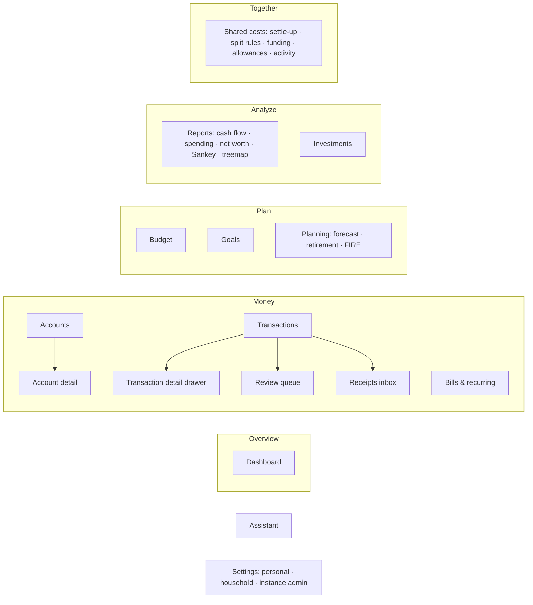

# Information architecture and navigation

- Status: Proposed
- Issue: #230
- Builds on: [ADR 0006](../adr/0006-shared-finances-yours-mine-ours.md) (lens, finance styles), [ADR 0011](../adr/0011-time-ranges-and-periods.md) (time ranges), [ADR 0012](../adr/0012-member-lifecycle.md) (membership), [API conventions](api-conventions.md)
- Feeds: #30 (web shell), #233 (wireframes), #234 (onboarding)

How Fiscus is organized: what the sections are, where global controls live, how it adapts to
phones, and how finance styles change what people see. Goal: Monarch-level clarity with a few
more concepts (shared costs, planning, receipts, assistant) that don't crowd the everyday path.

## 1. Principles
1. **The everyday path is three clicks or fewer:** see where I stand → review new transactions →
   check the budget.
2. **One mental model everywhere:** every data page has the same header (title · time range ·
   lens · actions), the same list + detail pattern, and the same empty states.
3. **Show only what this household uses.** Finance style and household size hide sections a
   household doesn't need (single person: no lens and no Shared costs; Combined: no settle-up).
4. **Household-scoped URLs.** Everything about money lives under `/h/:householdId/…`, mirroring
   the API (`/api/v1/households/:householdId/…`). Links are bookmarkable and never ambiguous for
   people in several households.
5. **Neutral, viewer-relative language:** *Mine · [name]'s · Ours* (ADR 0006).

## 2. Sitemap



| Section | Path | Contains | Milestone |
|---|---|---|---|
| **Dashboard** | `/h/:id` | Net worth, cash flow, budget summary, upcoming bills, review count, recent transactions (customizable later) | M1/M7 |
| **Accounts** | `/h/:id/accounts` | Grouped by type, balances and sparklines; detail shows history, ownership, visibility, connection health | M1 |
| **Transactions** | `/h/:id/transactions` | The register: filters, search, bulk edit, splits, attribution, notes. Tabs: *All · Needs review · Receipts* | M1/M9 |
| **Bills & recurring** | `/h/:id/recurring` | Calendar and list of upcoming bills, subscriptions, credit card due dates | M4 |
| **Budget** | `/h/:id/budget` | Month view (period stepper), strategy-specific UI, shared and personal budgets | M3 |
| **Goals** | `/h/:id/goals` | Savings and debt-payoff goals, progress, contributions | M5 |
| **Planning** | `/h/:id/planning` | Cash-flow forecast, long-term plans and scenarios, retirement, FIRE | M8 |
| **Reports** | `/h/:id/reports/:report` | Cash flow, spending, income, net worth, Sankey, treemap, saved reports | M7 |
| **Investments** | `/h/:id/investments` | Holdings, performance, allocation, equity compensation | M6 |
| **Shared costs** | `/h/:id/shared` | Who-owes-whom, settle-up history, split policies, joint-account funding, allowances, activity feed | M3 |
| **Assistant** | panel everywhere, `/h/:id/assistant` for full screen | AI chat and change-set review (ADR 0009) | M10 |
| **Settings** | `/settings/…`, `/h/:id/settings/…`, `/admin/…` | See §6 | M0+ |

Placement decisions:
- **Receipts** are a tab of Transactions, not a top-level section: a receipt is evidence for a
  transaction, and the inbox is where unmatched ones wait.
- **Needs review** is a tab with a count badge on the nav item: the main daily task deserves a
  visible number.
- **Shared costs** is the neutral name for the yours/mine/ours money between members. It covers
  couples and roommates (ADR 0012); "Ours" stays as a lens value.
- **Planning** groups forecast, retirement, and FIRE under one roof, so long-term thinking isn't
  scattered.

## 3. Navigation chrome

### Desktop (≥ 1024 px): sidebar + page header

```
┌──────────────────────┬──────────────────────────────────────────────────────────────────┐
│ [▢] Our Home      ▾  │  Transactions                     [Last 30 days ▾] [Mine|Alex|Ours|All] [+ Add] │
│──────────────────────│──────────────────────────────────────────────────────────────────│
│ ⌂  Dashboard         │  [All] [Needs review • 12] [Receipts • 3]        🔍 Search  ⚲ Filters │
│                      │  ─────────────────────────────────────────────────────────────── │
│ MONEY                │  Sep 30  Trader Joe's        Groceries      Ours   −$84.12    ▸  │
│ ▣  Accounts          │  Sep 29  Shell               Auto: Fuel     Mine   −$41.03    ▸  │
│ ⇄  Transactions  12  │  Sep 29  Paycheck            Income         Alex  +$2,410.00  ▸  │
│ ⟳  Bills & recurring │  …                                                               │
│                      │                                                                  │
│ PLAN                 │                                                ┌───────────────┐ │
│ ◔  Budget            │                                                │ detail drawer │ │
│ ◎  Goals             │                                                │ (opens over   │ │
│ ↗  Planning          │                                                │  the list)    │ │
│                      │                                                └───────────────┘ │
│ ANALYZE              │                                                                  │
│ ▤  Reports           │                                                                  │
│ ◢  Investments       │                                                                  │
│                      │                                                                  │
│ TOGETHER             │                                                                  │
│ ⚖  Shared costs   $42│                                                                  │
│──────────────────────│                                                                  │
│ ✦  Assistant    ⌘J   │                                                                  │
│ ⚙  Settings          │                                                                  │
│ (A) Anthony       ▾  │                                                                  │
└──────────────────────┴──────────────────────────────────────────────────────────────────┘
```

- **Household switcher** (top of sidebar): shows the current household. Opens a menu of your
  memberships with role badges, plus *Create household*. Hidden when you belong to one household
  (it then reads as a plain title).
- **Section groups** (Money · Plan · Analyze · Together) keep a long nav scannable. Badges: review
  count on Transactions, your net settle-up balance on Shared costs.
- **User menu** (bottom): profile, appearance (light/dark/system), sessions, sign out.
- **Collapsible** to icons (remembered per member).

### Page header (every data page)
`Title · [time range] · [lens] · [compare] · [primary action]`
- **Time range** (ADR 0011): per page, defaulting to the member's remembered choice, with an
  optional "sync across pages" preference. Pages without time (Settings, Goals list) omit it.
- **Lens** (ADR 0006): *Mine · [partner name] · Ours · All*, segmented for 2 members and a dropdown
  for 3+. It is **global** (it persists as you move between pages) because it answers "whose money
  am I looking at?". It is shown in the header (not hidden in the sidebar) so it's always obvious
  which view you're in. Hidden for single-member households and the Combined style (which defaults
  to *All*). Settings pages ignore it.
- **Primary action:** contextual (*Add transaction*, *New goal*, *Upload receipt*).

### Global tools
- **Command palette** (`⌘K` / `Ctrl+K`): jump to any page, search transactions and merchants,
  run actions ("categorize selected as…", "switch household"). Fastest path for power users,
  invisible to others.
- **Assistant** (`⌘J` / `Ctrl+J`): opens a right-side panel with the current page as context
  ("explain this report"). Full-screen at `/h/:id/assistant`. Hidden when AI is off (ADR 0009).
- **Notifications** (bell, M4): bills due, sync errors, consent requests, integrity warnings
  (ADR 0013). Integrity failures also show a persistent banner.

### Phone (< 768 px): bottom tabs + "More"

```
┌──────────────────────────────┐
│ Our Home ▾        [Ours ▾] ✦ │  ← household, lens, assistant
│ Transactions   [30 days ▾]   │
│ [All] [Review 12] [Receipts] │
│──────────────────────────────│
│ Trader Joe's      −$84.12  ▸ │
│ Groceries · Ours · Sep 30    │
│ Shell             −$41.03  ▸ │
│ Auto: Fuel · Mine · Sep 29   │
│ …                        (+) │  ← add / snap receipt
│──────────────────────────────│
│  ⌂     ⇄12     ◔     ▣    ≡  │
│ Home  Txns  Budget Accts More│
└──────────────────────────────┘
```

- **Five bottom tabs:** Dashboard, Transactions (with review badge), Budget, Accounts, More. **Roommates** households get Shared costs in place of Accounts.
- **More** opens a sheet with the remaining sections and Settings.
- **Detail views** are full-screen pushes with a back button, instead of drawers.
- **Floating "+"** on Transactions: add manually, or **snap a receipt** with the camera (#233/M9).
- Tablet (768–1023 px): collapsed icon sidebar plus full page header.

## 4. Page patterns
| Pattern | Used by | Behavior |
|---|---|---|
| **List + detail drawer** | Transactions, Accounts, Bills, Receipts | The list keeps scroll position; the drawer is deep-linkable (`?txn=<id>`); `Esc` closes; `j`/`k` move between rows |
| **Report page** | Reports, Planning, Investments, Dashboard cards | Header controls → chart → breakdown table → export; drill-down opens filtered Transactions |
| **Period page** | Budget, Shared costs statements | Period stepper `‹ September 2026 ›` instead of a range dropdown |
| **Settings page** | All settings | Left sub-nav, forms with first-save-wins conflict messages (API conventions §8) |
| **Empty state** | Everything | Explains the section in one sentence, with the single next action ("Link an account", "Import a CSV") |

## 5. How finance style and household size shape navigation
| | Single member | Combined | Hybrid | Separate | Roommates |
|---|---|---|---|---|---|
| Lens switcher | hidden | hidden (All) | shown | shown | shown |
| Shared costs section | hidden | hidden | shown | shown, badge | shown, **first in nav** |
| Budget default | personal | one shared budget | shared + personal | personal first | personal (shared bills in Shared costs) |
| Dashboard emphasis | standard | household totals | mine + ours | mine | my balance with roommates, shared bills |
| Net worth | mine | combined | per member + combined | mine (+ balance-only of others) | mine only |

Members can re-enable any hidden section individually (ADR 0006 §8 per-feature overrides).

## 6. Settings hierarchy
```
/settings                        Personal (follows you across households)
  ├ Profile                       name, email, avatar
  ├ Security                      password, 2FA, passkeys, sessions, SSO links, access tokens
  ├ Notifications                 channels and rules for you
  ├ Preferences                   appearance, default ranges, AI opt-out
  └ My privacy                    every account you own and who can see it (ADR 0006)

/h/:id/settings                  Household (owners edit; others mostly read)
  ├ General                       name, currency, time zone, fiscal year, finance style
  ├ Members & invites             roles, invites, guardians, remove (with departure preview)
  ├ Shared costs                  split policies, funding targets, allowances
  ├ Categories & tags
  ├ Rules
  ├ Connections                   bank links, household Plaid keys, sync health
  ├ AI                            assistant on/off, provider, write tools
  ├ Activity                      tamper-evident history, integrity status (ADR 0013)
  └ Data                          export, leave / move out, departure protection, delete household

/admin                           Instance admin only (metadata, never financial data)
  ├ Users  ├ Households  ├ Signup & SSO  ├ Providers  ├ Webhooks  ├ Usage  └ Audit
```

The admin area uses its own sidebar and a distinct header color, so an admin always knows they
are in the instance context rather than a household (permissions §2).

## 7. Routes
| Route | Notes |
|---|---|
| `/setup`, `/login`, `/signup`, `/invite`, `/reset-password` | Public; tokens only in fragments (`#token=`) |
| `/` | Redirects to the last used household, onboarding (#234) if none, or `/admin` for admin-only accounts |
| `/h/:householdId/…` | All money pages; `lens`, `range`, `granularity`, `compare` in the query string (ADR 0011) |
| `/settings/…`, `/admin/…` | Personal and instance settings |

## 8. Accessibility and keyboard
- Landmarks (`nav`, `main`, `aside`), a skip-to-content link, visible focus, and full keyboard
  operation of the sidebar, lens, range, and drawers.
- Shortcuts: `⌘K` palette, `⌘J` assistant, `g` then `t`/`b`/`a`/`d` to jump between sections,
  `/` focuses search, `?` lists shortcuts.
- Amounts never rely on color alone (sign and label too), per the style guide (#231).

## 9. Decisions from review (#230)
1. Section name: **Shared costs**. "Ours" remains a lens value.
2. The lens lives in the **page header**, next to the time range.
3. Phone tabs for **Roommates** households: Dashboard · Transactions · Budget · **Shared costs** · More (Accounts moves into More). Other styles keep Accounts.
4. **Command palette and keyboard shortcuts ship in v1**, as part of the web shell (#30).
