# Walkthrough: bank connections (design, M2)

This designs bank connections before they're built (#338). It covers connecting a bank with
Plaid or SimpleFIN, choosing which accounts to track and linking them to accounts already in
Fiscus, the first sync, connections that break, refreshing, and the admin's settings. Monarch is
the reference: what to keep, and what Fiscus should do better.

When the features ship, this is updated to match the built screens and becomes their user guide,
as the [core ledger walkthrough](core-ledger.md) did.

**About the screens.** They're static HTML prototypes in [`bank-sync/prototypes/`](bank-sync/prototypes/),
styled with the app's tokens. Each is labeled as a prototype, and they show what Fiscus should
do, not what it does yet. The household is the same invented one as the core ledger walkthrough:
the Riveras, Alex and Sam. The banks (Harbor Credit Union, Summit Card, Meridian Brokerage) are
invented too. To regenerate the images after editing a prototype, see
[`bank-sync/prototypes/README.md`](bank-sync/prototypes/README.md).

Decisions are numbered (**D1**, **D2**, …) and collected [at the end](#decisions), with the
issues they shape.

---

## 1. Two ways to connect

**Add account** gains two entries above the existing ones.

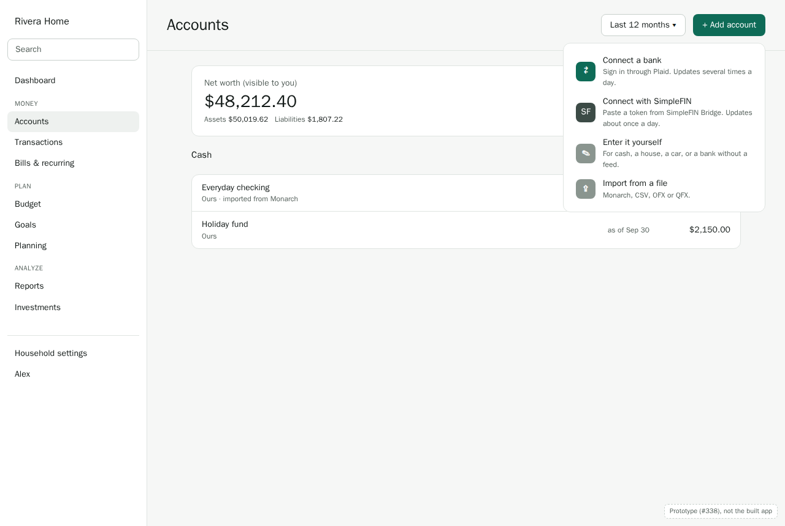

| | Plaid | SimpleFIN Bridge |
|---|---|---|
| Who it's for | Most people. Covers most US and Canadian banks | People who'd rather not use Plaid, or whose server has no Plaid keys |
| Cost | The server's Plaid account (the operator pays per connected bank), or a household's own keys (ADR 0008) | A small yearly fee each household pays SimpleFIN directly |
| How you sign in | In **Plaid Link**, Plaid's own window, opened from Fiscus | At bridge.simplefin.org, which gives you a one-time setup token to paste into Fiscus |
| How fresh | Every 4 hours by default, sooner with webhooks; "Refresh now" any time | About once a day: the Bridge itself refreshes daily, and allows about 24 requests a day |
| Fixing a broken sign-in | In Fiscus, through Plaid Link's update mode | At the Bridge; then Fiscus picks it up on its next refresh |

**D1. Both providers in M2, behind one interface.** `AggregationProvider` (#78) is designed
against both from the start: Plaid (#79–#82) first, then SimpleFIN (#91), which moves up from P2.
Two real providers keep the interface honest, and SimpleFIN gives every self-hoster a free way
to try sync.

**D2. Plaid's handshake is Plaid Link.** Fiscus never builds its own bank sign-in. The flow:
1. The api asks Plaid for a `link_token` (`/link/token/create`).
2. The web app opens Plaid Link with it. Link's script comes from Plaid's CDN, and Link runs in
   Plaid's iframe.
3. You sign in to your bank inside Link. Link hands back a `public_token`.
4. The api exchanges it for an `access_token` (`/item/public_token/exchange`), stored encrypted
   with the household key, and fetches the accounts.

Re-auth uses the same Link in update mode, with a `link_token` made for the existing Item.

**This needs a deliberate change to the Content-Security-Policy** (#378), which today allows
scripts, frames and requests only from Fiscus's own origin. Link needs `script-src` and
`frame-src` for `https://cdn.plaid.com`, and `connect-src` for Plaid's api hosts. The change goes
in the PR that adds Link (#79), with the threat model's T4 row updated. Ideally the exceptions
apply only where Link is used, not on every page: worth checking whether nginx can send a wider
policy only for the connect flow's route, or whether Link has to be allowed app-wide.

**D3. SimpleFIN's setup token is claimed once, by the server.** The token is a one-time claim
URL. Fiscus claims it as soon as it's pasted, stores the resulting access URL encrypted with the
household key (like a Plaid access token), and never shows it again. A token that was already
used gets a clear error: "This token has been used. Create a new one at the Bridge."

---

## 2. Connecting

| Plaid: before Link opens | SimpleFIN: paste the token |
|---|---|
| 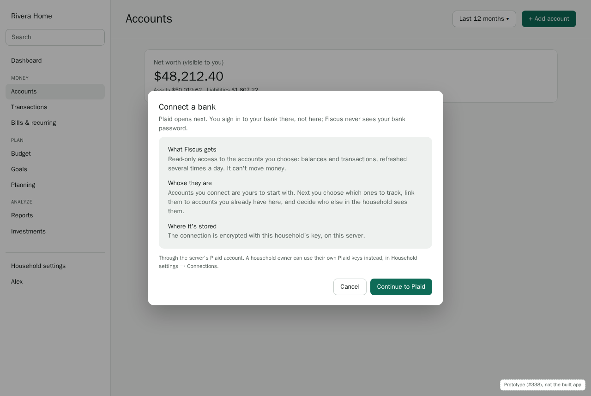 | 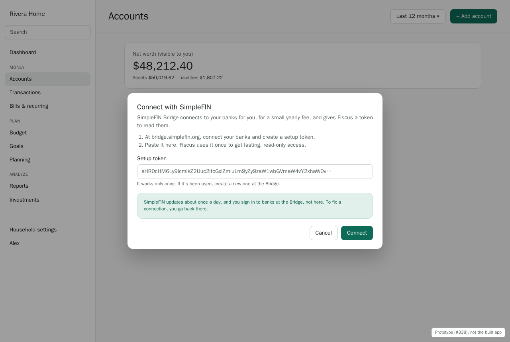 |

The step before Plaid Link answers three questions people have about connecting a bank: what
Fiscus can see, whose the accounts become, and where the connection is kept. It says plainly that
the sign-in happens at Plaid, not in Fiscus, and that Fiscus can't move money.

**Keep (as Monarch does).** Choosing a bank, signing in, and seeing accounts appear should take a minute.

**Do better.**
- **D4. Settle who will see it before anything syncs.** In a shared household, connecting your
  own card shouldn't show its transactions to everyone, even briefly, while you get round to
  changing its sharing. The connecting member owns the new accounts (ACC-01),
  and they start private, whatever the household's finance style (manual accounts start from
  it, ADR 0006 §8). You confirm owners and visibility on the next step, before anything syncs.
- Viewers can't connect banks (ACC-01): the menu entries don't show for them.

---

## 3. Choosing accounts, and linking them to ones you have

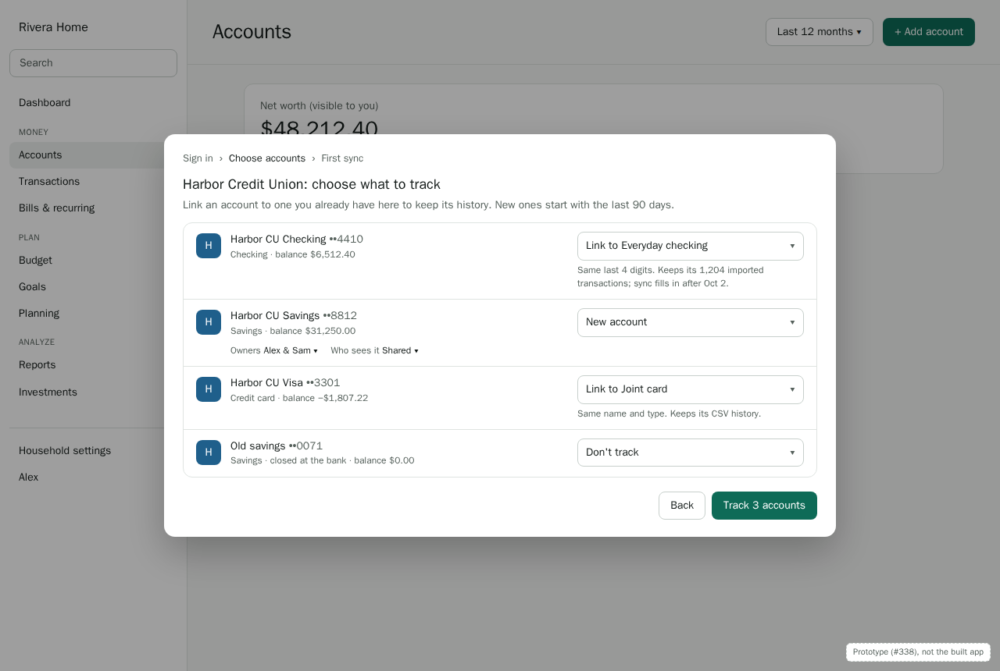

Each account the bank offers gets one choice:
- **Link to an existing account.** Suggested when one of your accounts has the same last 4 digits
  and a compatible type (as OFX import matches, #74), or failing that the same name. Its history
  stays, and sync takes over from where that history ends.
- **New account**, with owners and who sees it.
- **Don't track.** Offered for accounts closed at the bank, and anything you'd rather leave out.
  You can track it later from the connection's settings.

**D5. Linking keeps imported history; sync fills in after it.** Most people arrive with history
from a Monarch export or bank files. Linking a connected account to that account, instead of
creating a second one, is the main reason this step exists. The alternative, a second synced
account beside the imported one, leaves duplicate accounts and transactions to clean up.

**D6. How far back a new account starts.** New accounts ask the provider for 90 days (Plaid's
default; SimpleFIN gives what the Bridge has, usually 90 days). Linked accounts ask from a week
before their history ends, so the overlap can be matched (§4). Plaid can return up to 24 months
on request: an option on this step ("Bring in up to 2 years"), off by default, since the
operator pays the same either way but the first sync takes longer.

**Phone.** One account per row, the choice under it.

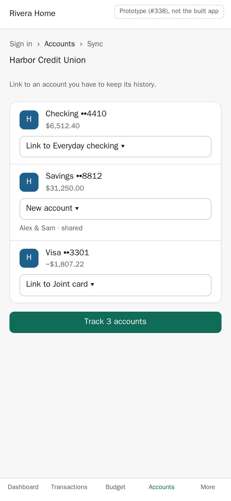

---

## 4. The first sync

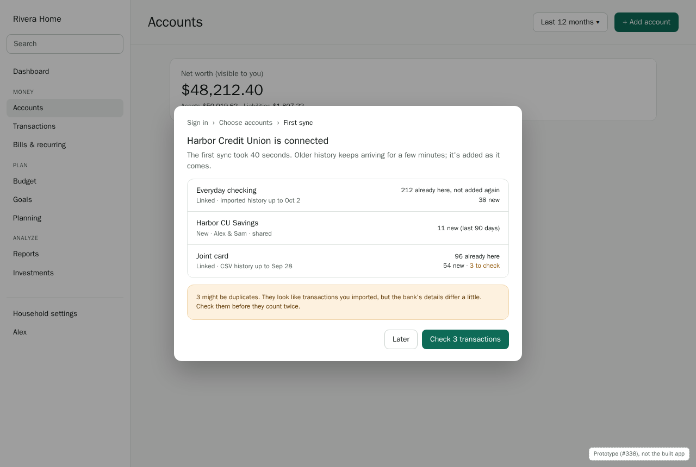

What arrives, per account:
- **Already here:** synced transactions that match ones you imported (the same amount within a
  few days, the overlap matching from imports, `imports.md` §4). They aren't added again.
- **New:** everything else, marked **needs review** as imports are.
- **To check:** synced transactions that look like an imported one but differ (another date,
  another name). These aren't guessed at: you decide.

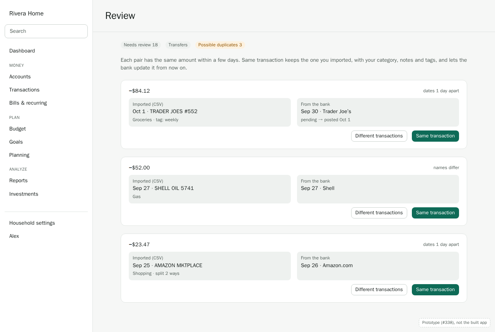

**D7. "Same transaction" keeps yours.** When you say a pair is the same, Fiscus keeps the
imported transaction, with your category, notes, tags, splits and attribution, and records the
provider's id on it, so later syncs update that transaction instead of adding one. "Different
transactions" keeps both. Possible duplicates get their own tab in Review, next to Transfers,
and count toward the review badge until they're decided.

**D8. Pending transactions show, and edits carry over.** Synced transactions can be pending. They
show with a "Pending" badge, count toward balances as the bank does, and can be categorized and
noted like any other. When the posted transaction arrives, your edits move to it (#47, #88,
data model §5's pending → posted rule).

**D9. Rules run on synced transactions, as on imports.** The same rules, in the same order, with
the same author's reach. Which rules apply to whose accounts is #58 (member-scoped rules), moved
into M2 for this reason.

**The wait.** Plaid's first sync returns recent transactions in seconds, and older history over
the next minutes (`HISTORICAL_UPDATE`). The summary says so, and the accounts list shows
"Syncing…" on accounts still filling in. Nothing blocks you meanwhile.

---

## 5. Day to day: freshness and "Refresh now"

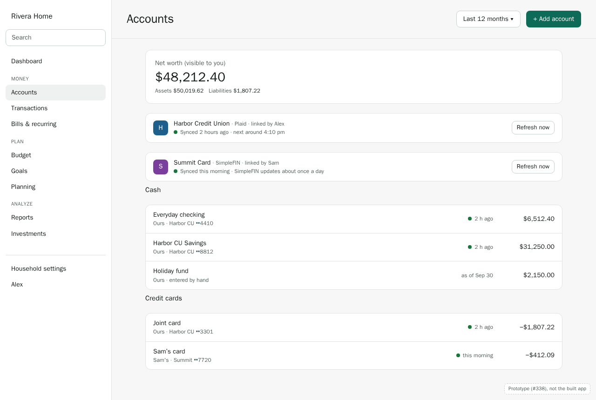

- Each connection gets a line at the top of Accounts: the bank, the provider, who linked it, when
  it last synced, and when the next sync is due. **Refresh now** is there and in Household
  settings → Connections.
- Each account row shows how fresh its balance is: "2 h ago" for synced accounts, "as of Sep 30"
  for ones you update by hand.

**D10. Refresh limits differ by provider, and the UI says so.**
- Plaid: "Refresh now" at most once every 15 minutes per connection (`/transactions/refresh`
  costs extra on some Plaid plans; the admin can turn it off).
- SimpleFIN: refreshes are capped at one every 6 hours (the Bridge allows about 24 requests a
  day, and itself updates only daily). The button explains rather than pretending: "SimpleFIN
  updates about once a day. Last update this morning."

---

## 6. When a connection breaks

| Alex linked it: the fix is theirs | Sam sees it too, but can't fix it |
|---|---|
| 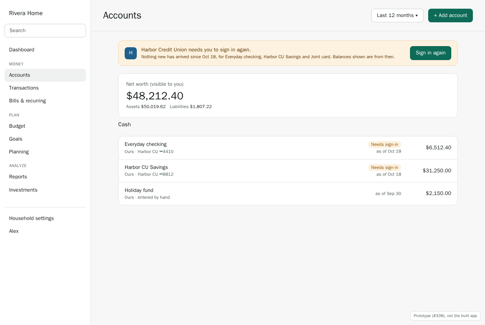 | 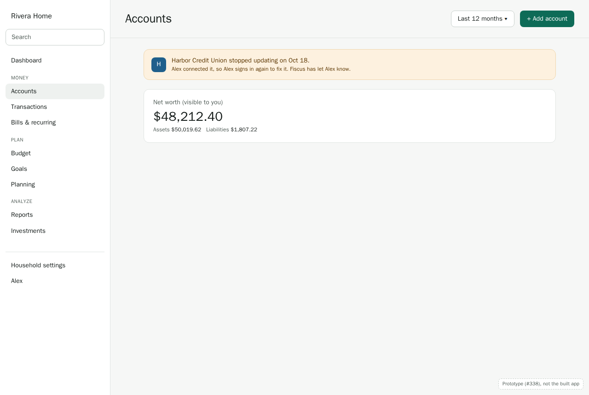 |

Two kinds of trouble:
- **Needs sign-in** (`ITEM_LOGIN_REQUIRED`, an expired consent, a changed password). Only you can
  fix it, by signing in again.
- **Not working** (the bank or provider errors). Fiscus keeps retrying with backoff; there may be
  nothing to do but wait. After 3 days of failures, the connection says so and offers
  "Disconnect" as a way out.

**D11. The person who linked it fixes it; everyone who sees its accounts is told.** Re-auth and
disconnecting belong to the connection's owner (ACC-03). Others who see its accounts see the
banner too, with whose it is, because their balances are stale as well: "Alex connected it, so
Alex signs in again to fix it." If the owner has left the household, any household owner may
disconnect it (ACC-03).

**D12. Stale balances say how stale.** A broken connection's accounts show "as of Oct 18", not
the last-synced balance as if it were current, and the banner names the accounts affected.
A warning icon alone is easy to miss; the date says what it means.

**D13. Telling people.** In M2, the banner on Accounts and the dashboard, and a badge on the
account rows, are the whole story. Emails and push notifications for a broken connection come
with notifications in M4 (#127's "sync failure" rule), and are wired to the same status.

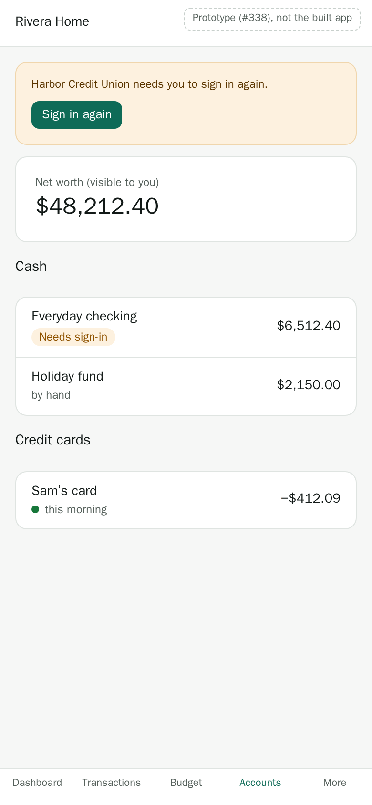

---

## 7. Managing connections

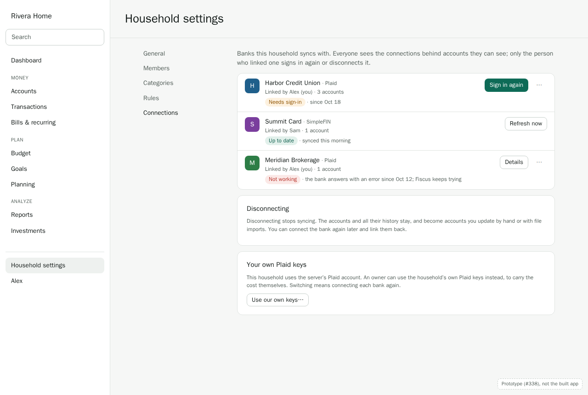

Household settings → **Connections** lists every connection behind accounts you can see: the
bank, the provider, who linked it, how many accounts, its status, and what you can do.

**D14. Disconnecting keeps everything.** Disconnecting stops syncing and deletes the stored
access, but the accounts and all their history stay, as accounts you update by hand or with
files. Reconnecting later offers to link them back (§3). There is no "delete the accounts too"
shortcut: deleting an account is its own, deliberate step (ACC-09). For Plaid, disconnecting
calls `/item/remove`, so the operator stops paying for it.

**D15. Your own Plaid keys, and what switching costs.** The card at the bottom is ADR 0008's
household override. Switching between the server's keys and your own means connecting each bank
again, because a Plaid connection belongs to one Plaid account. The dialog behind the button
says so before anything changes, and offers to walk through each bank in turn (#83).

---

## 8. The admin's view

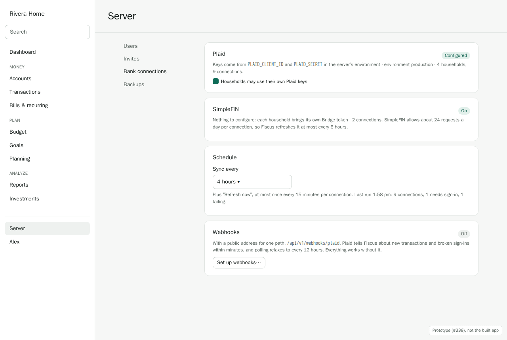

The instance admin's **Server** page (#22) gets a **Bank connections** section:
- **Plaid:** whether keys are configured (from the environment: `PLAID_CLIENT_ID`,
  `PLAID_SECRET`, `PLAID_ENV`), the environment (sandbox or production), how many households and
  connections use them, and whether households may bring their own keys.
- **SimpleFIN:** on or off. There's nothing else to configure: each household brings its own
  token.
- **Schedule:** how often to sync (default 4 hours), and the last run's results as counts.
- **Webhooks:** off by default; setting them up explains the one public path they need (ADR 0008).
  When on, their health: last received, verification failures, connections without a webhook
  (#84, #85).

**D16. The admin sees counts, never content.** No balances, accounts, or transactions appear
here, only how many connections exist and how they're doing (ADR 0005: the admin console is
metadata only).

**D17. Sandbox for tests, production for real banks.** CI and e2e tests use Plaid's sandbox
(fake banks, free) and a stubbed SimpleFIN server; nothing in the test suite touches a real bank.
The admin page shows the environment prominently, so a server on sandbox keys isn't mistaken
for one syncing real money.

---

## Decisions

| # | Decision | Shapes |
|---|---|---|
| D1 | Plaid and SimpleFIN both in M2, behind one interface; SimpleFIN moves up | #78, #91 |
| D2 | Plaid Link does the handshake; the CSP gains narrow exceptions for it | #79, threat model T4 |
| D3 | A SimpleFIN setup token is claimed once, by the server; the access URL is stored encrypted | #91 |
| D4 | Owners and visibility are confirmed before anything syncs | #79 |
| D5 | Linking to an existing account keeps its history; sync fills in after it | #78, #79 |
| D6 | New accounts start 90 days back (optionally 2 years); linked ones a week before their history ends | #80 |
| D7 | Possible duplicates are a Review tab; "Same transaction" keeps your imported one | #80 |
| D8 | Pending transactions show and carry edits to the posted one | #47, #88 |
| D9 | Rules run on synced transactions as on imports | #80, #58 |
| D10 | Refresh limits per provider, explained in the UI | #81, #91 |
| D11 | The linker fixes a connection; everyone who sees its accounts is told | #81, ACC-03 |
| D12 | Stale balances show their date | #81, #86 |
| D13 | Banners and badges in M2; emails and push with M4 | #89, #127 |
| D14 | Disconnecting keeps accounts and history | #78, ACC-09 |
| D15 | Switching to your own Plaid keys means reconnecting, said up front | #83 |
| D16 | The admin sees counts, never content | #22, #85 |
| D17 | Sandbox and a stubbed SimpleFIN for tests | #79, #91 |

## Open questions

- **CSP scope for Plaid Link (D2).** App-wide exceptions are simplest; route-scoped ones are
  tighter. Decide when building #79.
- **How long "Not working" lasts before it's an error you're asked to act on.** 3 days is a guess;
  Plaid's own guidance and real failures should set it.
- **Investment accounts** (#87). Holdings and investment transactions aren't designed here; they
  get their own walkthrough with M6, and M2 syncs only their balances.
