# Walkthrough: bills, recurring and notifications (design, M4)

This designs bills, recurring payments and notifications before they're built (#340). It covers:
- what a recurring series is;
- how Fiscus finds them in your history, and how you confirm them;
- making any transaction recurring yourself, such as a paycheck;
- what's coming up, as a list and a calendar, and what's been paid;
- who looks after a bill, and their reminders;
- notification channels and rules;
- the weekly recap.

Monarch is the reference: what to keep, and what Fiscus should do better.

When the features ship, this is updated to match the built screens and becomes their user guide,
as the [core ledger walkthrough](core-ledger.md) did.

**About the screens.** They're static HTML prototypes in
[`bills/prototypes/`](bills/prototypes/), styled with the app's tokens. Each one:
- is labeled as a prototype, and shows what Fiscus should do, not what it does yet;
- uses the same invented household as the earlier walkthroughs: the Riveras, Alex and Sam, a
  **Hybrid** household (ADR 0006 §8) seen by Alex;
- is set on Thursday, November 12, 2026.

The payments agree from screen to screen. The banks, employers and billers (Harbor Credit Union,
Brightline Labs, County Schools, Lakeside Power, and so on) are invented. To regenerate the images
after editing a prototype, see [`bills/prototypes/README.md`](bills/prototypes/README.md).

Decisions are numbered (**D1**, **D2**, …) and collected [at the end](#decisions), with the
issues they shape.

**Simple by default.** Most people should only ever confirm what Fiscus found, and see what's
coming. Schedules, matching windows, reminders and channels all have sensible defaults; they're
there when someone goes looking for them.

---

## 1. What a recurring series is

A **recurring series** is a payment that comes at a steady pace: a bill, a subscription, a
paycheck, or a transfer you make every month. Each one has:

| | What it is | Example |
|---|---|---|
| **Matches** | The account, the merchant, or both, and an amount: any, at least, at most, or between | Lakeside Power, from Everyday checking, any amount |
| **Kind** | Bill, subscription, income, or transfer | Bill |
| **Schedule** | How often, and on which day | Monthly, around the 24th |
| **Expected** | An estimate of the next one, from the payments so far | About $131 |
| **Category** | The category its payments get | Utilities |
| **Who looks after it** | For a bill: the member who gets its reminders. For income: who it's for | Sam |

Each time a payment is due is an **occurrence**: expected on a date, then **paid** (a transaction
matched it), **late**, or **skipped**.

**What it matches and what it expects are separate.** What it matches decides which payments
count, and is plain enough to read and change: like a rule's conditions. What it expects is only
an estimate, for totals and reminders. A paycheck that's smaller on the 15th, because
an HSA contribution comes out of that one only, a commission that changes every month, a power
bill that's higher in winter: each is one series with an amount condition wide enough for it
("between $2,300 and $2,700", "at least $1,000", "any amount"), and an estimate that follows what
actually came in.

**D1. One kind of thing for bills, subscriptions, income and transfers.** They differ only in
their wording and defaults: income says "received" instead of "paid", and has a "for" instead of
someone who looks after it. One model (#118) keeps detection, matching and the calendar the same
for all of them. The kind decides where it shows: subscriptions get a total of their own, income
is added up separately from bills, and transfers can be hidden from the upcoming list.

**D2. Schedules people actually have.**
- Every week, or every 2 weeks, on a weekday.
- **Twice a month**, on two days (the 1st and the 15th, or the 15th and the last day, for many
  paychecks).
- Every month, on a day or on the last day; every 2, 3 or 6 months; every year.
- Custom: every N days, weeks or months.

Each schedule says what happens when its day falls on a weekend: **the Friday before** (most
paychecks), **the Monday after** (many bills), or **that day**. Fiscus doesn't keep a holiday
calendar. A payment a day early, before a bank holiday, is still matched (§5).

---

## 2. Finding them in your history

The first time **Bills & recurring** opens, Fiscus has already looked through your history. It
does again after each import and sync.

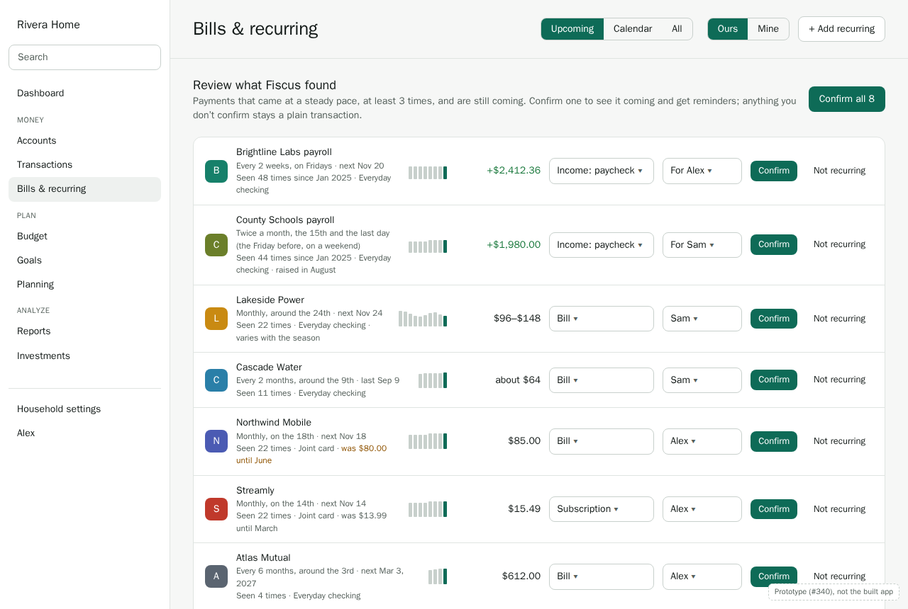

Each suggestion shows its schedule, how many times it's been seen, its amounts as small bars,
and what kind it seems to be. Before confirming, you can change its kind, and who looks after it
or who it's for. **Not recurring** puts it away. **Confirm all** is there for a first visit with
many suggestions.

**Keep (as Monarch does).** Finding recurring payments on its own, and asking you to confirm them
rather than deciding for you.

**Do better.**
- **D3. Fiscus finds them itself, from all your history.** Plaid offers recurring detection, but
  it only sees Plaid-connected accounts, and only as far back as Plaid has. Most households arrive
  with years of imported history (Alex and Sam since January 2025; some households, a decade),
  and some use SimpleFIN or update accounts by hand. Detection runs in the worker over the
  household's own transactions, the same way for every account (#119).
- **D4. What counts as found.**
  - Payments to or from the same payee (its merchant, or failing that its cleaned-up name), in
    the same direction, through the same account.
  - At least 3 of them, at a steady pace that matches a schedule from D2. For yearly ones, 2
    years running.
  - **Still coming:** the last one is no more than one and a half cycles ago. A subscription that
    stopped two years ago isn't suggested. With years of history, the alternative is pages of
    old, ended payments to dismiss.
  - **The amount it proposes:** when the payments stay within 5% of each other, "about" that
    amount, matched within 5%. Otherwise "between" the lowest and highest seen, with a margin, or
    "any amount" when they're all over the place. You can change it before confirming, as with a
    rule. A price change that sticks (Northwind Mobile, $80 to $85 since June) moves the amount,
    and is noted.
  - Not suggested: spending that's frequent but not steady (groceries, gas), and transfers
    between your own accounts that are already linked as transfers, unless they're steady (the
    $200 a month to Holiday fund is).
- **D5. Suggestions are reviewed here, not in Review.** Review is for transactions, one by one.
  A recurring suggestion is about a series of them, and needs a schedule and a person, so it
  lives on Bills & recurring, with a count on the page and a banner when new ones are found.
  **Not recurring** is remembered for that payee and account, so the same suggestion doesn't come
  back. A different schedule later (a new subscription to the same service) is suggested again.

**Phone.** One suggestion at a time, with its amounts, kind and person, and Confirm or Not
recurring at the bottom, where a thumb is.

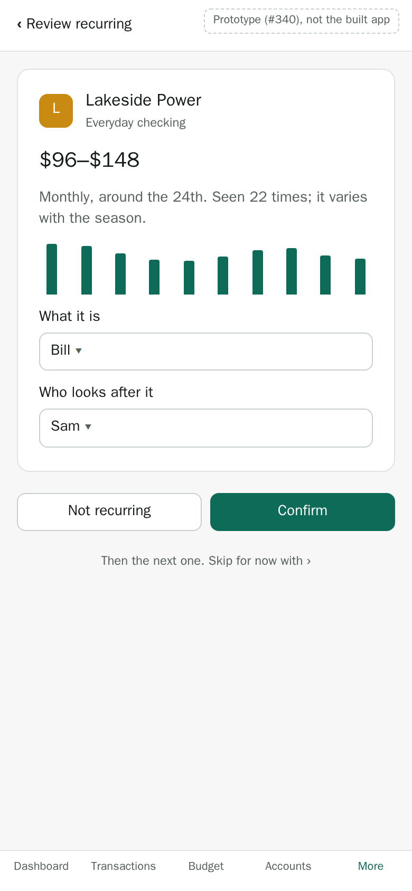

---

## 3. Making one yourself: a paycheck

Anything Fiscus didn't find can be made recurring from a transaction. In the transaction's
drawer or its menu: **Make recurring…**

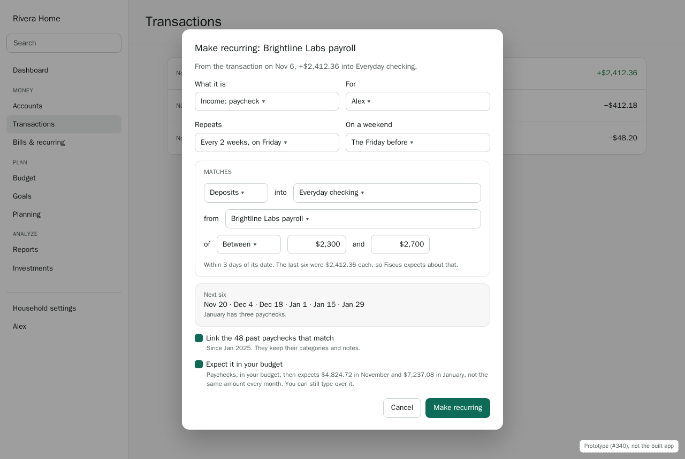

The dialog starts from that transaction: its payee, account, amount and category. It guesses the
schedule from earlier payments like it, shows the next six dates, and links the past payments
that fit.

**D6. Any transaction can start a series, and its past payments come with it.** Linking them is
what gives a new series its history and its "seen 48 times", and lets Fiscus estimate the next
amount. They keep their categories, notes and splits. **+ Add recurring** on the page does the
same without a transaction to start from, for a bill that hasn't been paid yet.

**D7. Recurring stays apart from the budget.** A series is for knowing what's coming and being
reminded: it never sets or changes a budget's amounts, which stay the ones you typed. The
budget counts what actually came in and went out, as before; Bills & recurring shows what's
expected. They meet only in what you read: the weekly recap shows both (§8).

---

## 4. What's coming up

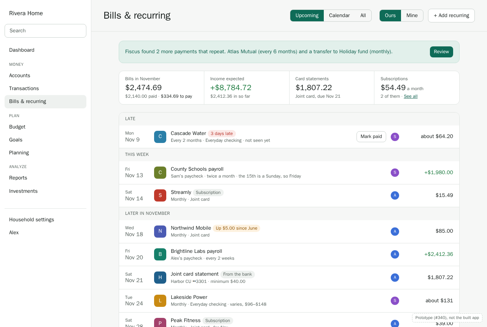

**Bills & recurring** opens on **Upcoming**:
- **Totals for the month:** bills paid and to pay, income expected and received, card
  statements, and subscriptions a month.
- **The list:** late first, then this week, then the rest of the month. Each row shows the
  payee, its schedule and account, who looks after it, and what it expects: exact for a payment
  that's always the same, otherwise "about".
- **Paid this month** sits at the end, folded.

**Calendar** shows the same occurrences by day. **All** lists every series, active and ended,
for editing.

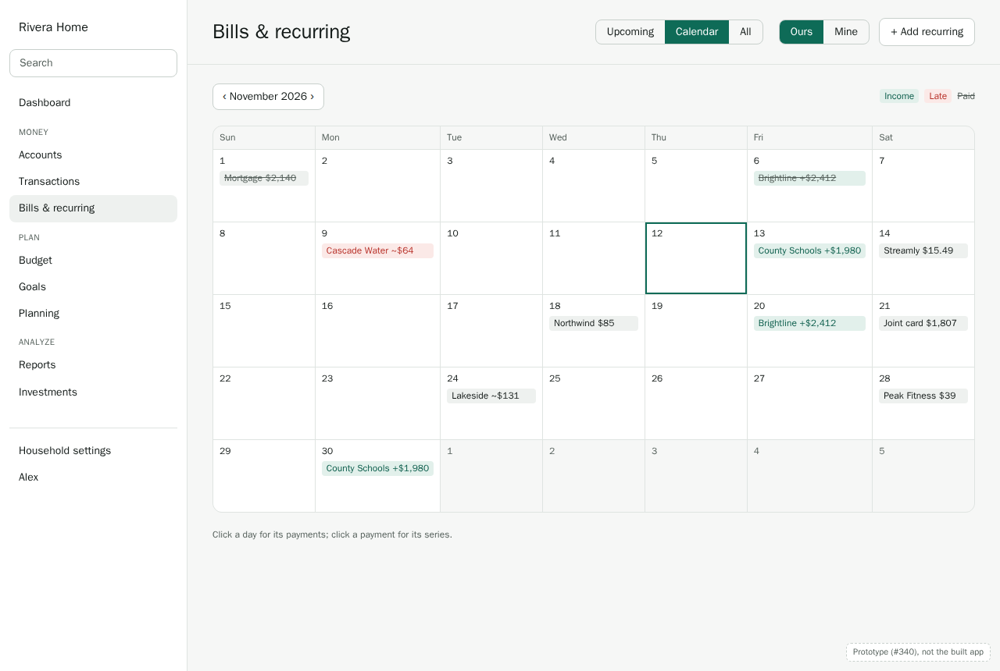

**Keep (as Monarch does).** The upcoming list and the calendar, the logos, and credit card
statements beside bills.

**Do better.**
- **D8. The estimate is a real one.** "About $131" for Lakeside Power comes from the same month
  last year and the last 3 months, not the last payment alone. A power bill in
  November is more like last November than like October. The drawer says how it was worked out
  (§6).
- **D9. Card statements come from the bank, not from detection.** For cards linked through
  Plaid, the statement balance, minimum and due date are already synced (#86). They show as soon
  as a card is connected (even before there's history to detect from), marked **From the bank**
  (#122).
  - A statement counts as paid when payments into the card reach the statement balance. With
    less, it says "minimum paid" or "partly paid".
  - A card payment is a transfer, so it isn't added to **Bills**. The bills on the card were
    already counted when they were paid with it: adding the statement would count them twice.
- **D10. What you see is what your accounts let you see.** A series is visible to whoever can
  see its account (ADR 0006): Sam's private card's subscriptions don't appear for Alex. **Ours**
  and **Mine** filter by who it's for, as budgets do: Mine is bills and income for you alone.

**States.**
- **Loading:** the totals and list as skeletons.
- **First visit with lots of history:** "Looking through 9 years of transactions…" while
  detection runs, then the suggestions. It takes seconds, and the page is usable meanwhile.
- **Empty:** fewer than 3 months of transactions. It says how much there is, offers to import
  older history or add one by hand, and shows card statements from the bank, which need no
  history.

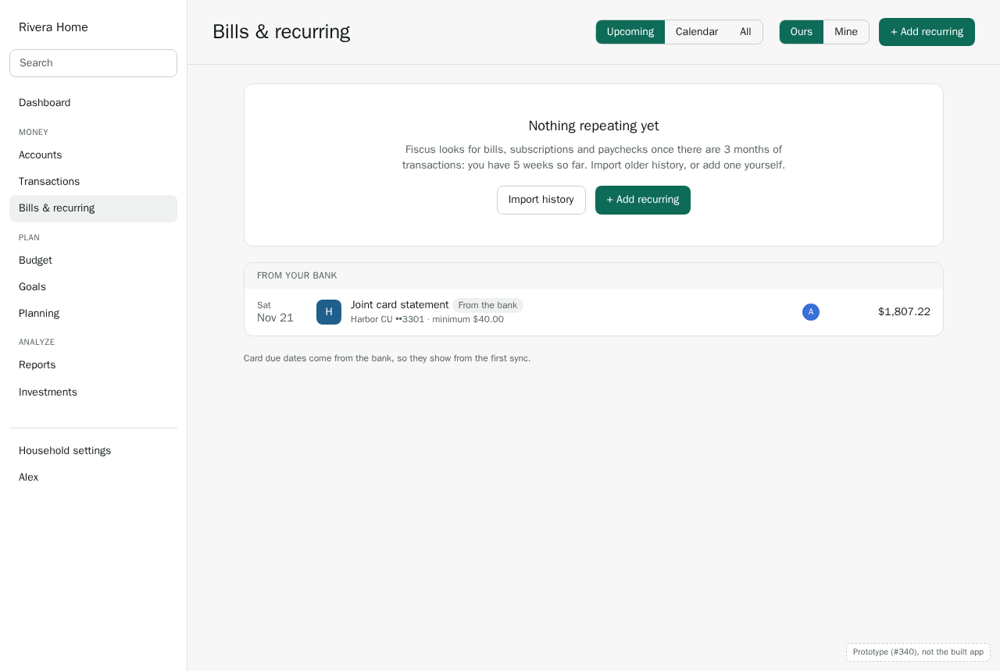

**Phone.** The month's two numbers that matter (bills left to pay, income still to come), then the
same list. Calendar and All are a tap away.

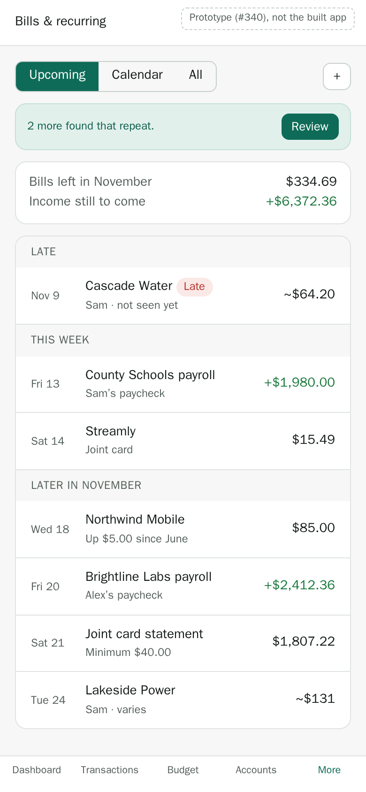

**The rest on a phone.** Opening a series is a full page, not a drawer: what's next and its
estimate, then who looks after it, what it matches and its reminders as rows to tap, then its
payments. **Make recurring…** is a full page too, with Save at the top. The calendar is a small
month with a dot per day (black for a bill, green for money in, red for late, grey once paid),
and tapping a day lists what's due under it. Notification rules are one row each, with the
channels it goes to as chips.

| A bill | Make recurring | Calendar | Notifications |
|---|---|---|---|
| 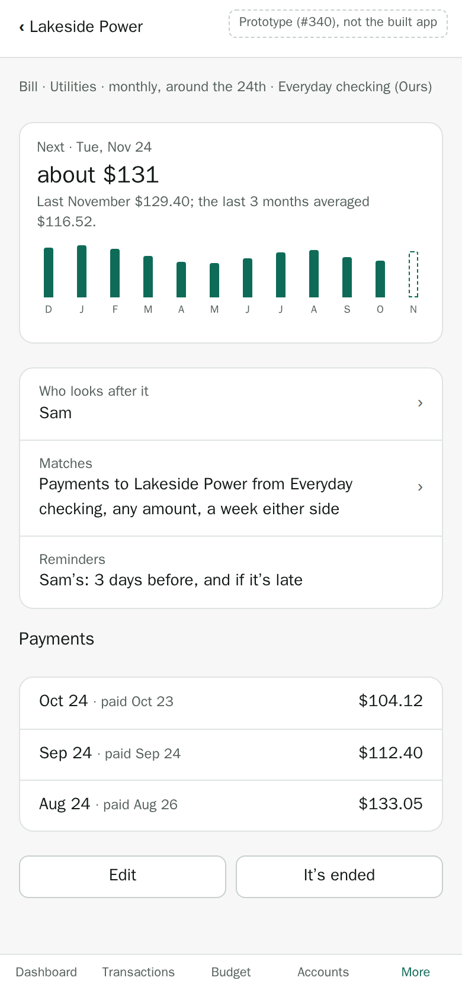 | 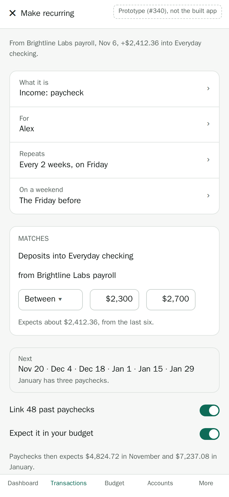 | 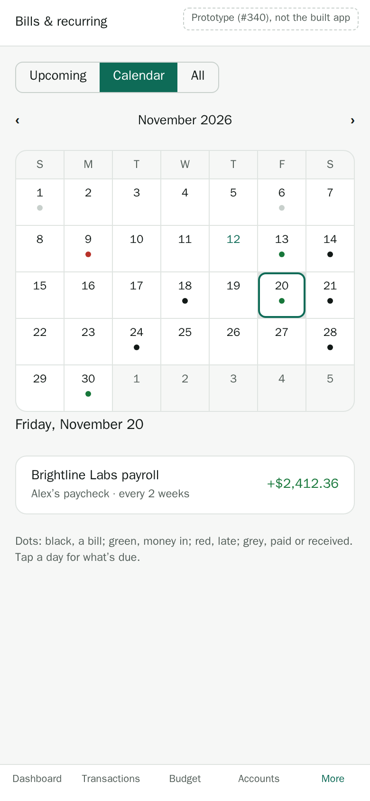 | 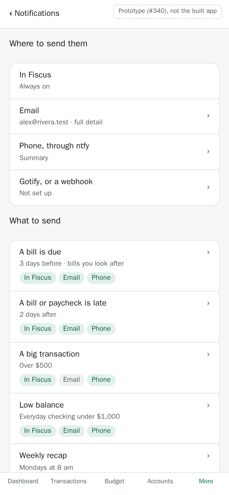 |

---

## 5. Paid, late, and matching

**D11. A payment is matched by conditions you can read, like a rule's.** An occurrence is paid
when a transaction comes in:
- through the series' account, from or to its merchant, or both, whichever it names. A
  paycheck can be "any deposit into Everyday checking from Brightline Labs"; a series can also be
  "any deposit of at least $1,000 into Everyday checking", for income with no steady name;
- in the same direction (money in, or money out);
- within its window: by default 3 days either side of its date, or a week for a monthly bill;
- with an amount that meets its condition: any, at least, at most, between, or about (within 5%).

The conditions use the rule editor's pieces, so they read the same. Each transaction pays at most
one occurrence. A matched transaction gets the series' category if it has none, and shows the
series in its drawer.

**D12. Late, and what to do about it.** An occurrence nobody's seen 2 days after its expected
date is **late** (Cascade Water above, due November 9). A payment that turns up afterwards still
matches it, until the next one is due, and clears it. A late row offers:
- **Mark paid**: pick the transaction that paid it (from another account, or under another
  name), or record that it was paid another way.
- **Skip this one**: nothing was due this time (a holiday from the gym, a bill credited away).
- **It's ended**: no more are expected. The series and its history stay, under All.

After two late occurrences in a row, the series asks if it has ended, instead of staying late
forever.

---

## 6. Who looks after a bill

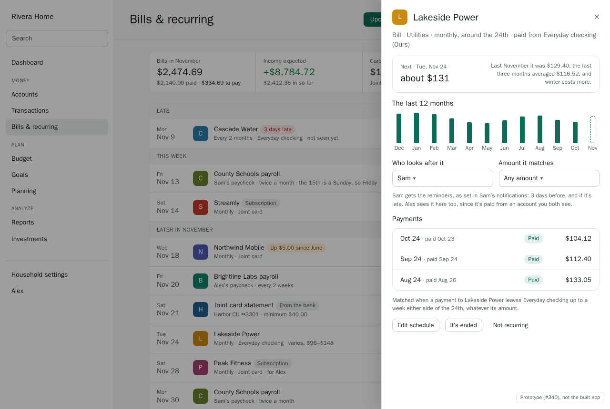

Clicking a series opens its drawer: what's next and how its amount was estimated, the last 12
months, who looks after it, its payments, and how it's matched.

**D13. One person looks after each bill, and gets its reminders** (ADR 0006 §6, #121). Everyone
who can see it still sees it; only that person is reminded.
- **Defaults:** the only owner of the account it's paid from. For a joint account, whoever
  confirms it, shown on the suggestion so it can be changed first.
- **Changing it:** anyone who can see the account can hand it to someone else in the household
  who can see it too.
- **When someone leaves the household:** their bills pass to the account's other owner, or to
  the household's owners (ADR 0012).
- **Income has "for" instead:** who it's for, from the transaction's attribution. There are no
  reminders to send, but a late paycheck is worth knowing about (§7).

**D22. Who, only when there's a choice.** The person on a series, and **Ours · Mine**, show only
where someone could answer differently. Otherwise Fiscus fills them in and says nothing, as a
household with one budget sees no scope (budgeting D21).
- **Someone on their own:** no person anywhere. No "who looks after it", no "for", no Ours · Mine.
  Every reminder is theirs.
- **Separate finances** (each person's own accounts, not shared): a series paid from or into
  your own account is yours, with no question asked. It shows no person, and nobody else sees it
  (D10).
- **Shared accounts:** the person shows, and can be changed, only for series on an account more
  than one of you sees: the joint card's Streamly, the checking account the power bill comes out
  of. On the review screen and in the drawer, the person picker is left out for the rest.
- **Ours · Mine** shows only when you can see both: some series for you alone, and some for more
  than one of you. A Separate household's members each see only their own, so it doesn't show.

The prototypes show the Riveras, a Hybrid household with joint accounts, so they show people
throughout. A Separate household, or someone on their own, sees the same screens without them.

**D14. Changes worth noticing.** Badges on the series, and insights (#129, #123):
- **Price went up** ("Up $5.00 since June"), when an "about" amount moves and stays.
- **New subscription**, when a new one is found.
- **Looks ended**, after two late occurrences.

---

## 7. Notifications: channels and rules

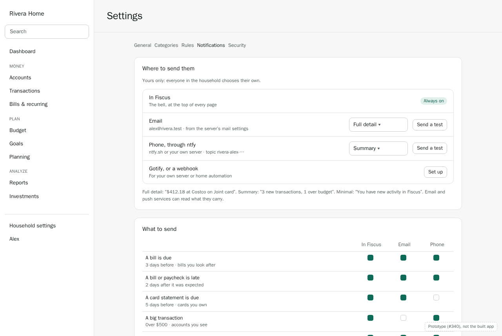

Settings → **Notifications** (yours; HH-10). Two parts:
- **Where to send them:** in Fiscus (always on), email, your phone through ntfy, and Gotify or a
  webhook. Each has a test button.
- **What to send:** one row per kind of notification, with its setting, and a tick for each
  channel.

**D15. Notifications are per person.** Each member chooses their own channels and rules, and is
only told about what they can see (SYS-02). Sam's private card's large purchases never reach Alex,
in any channel. Nothing is sent to "the household": a reminder goes to the person who looks after
the bill.

**D16. The channels.**
- **In Fiscus:** the bell, with a list of recent notifications (#130).
- **Email:** sent by the server. The instance admin sets it up once, on the Server page (or
  with `SMTP_URL` and `MAIL_FROM`, which win), with a test there. Without it, the email row says
  "Your server can't send email yet; ask whoever runs it." (#125)
- **ntfy, Gotify and webhooks:** set up by each person, with their own server address and topic
  or token, stored encrypted (#126). ntfy is the easiest way to get phone push without an app
  store app.

**D17. Detail levels, per channel.** Full detail by default (ADR 0014 §5): "$412.18 at Costco on
Joint card". Summary ("3 new transactions, 1 over budget") or minimal ("You have new activity in
Fiscus") for those who'd rather not have amounts in their email or push, which their providers
can read (#311).

**D18. The rules, and their defaults.**

| Rule | Setting | Default |
|---|---|---|
| A bill is due | Days before (3) · bills you look after | In Fiscus, email |
| A bill or paycheck is late | Days after (2) | In Fiscus, email |
| A card statement is due | Days before (5) · cards you own | In Fiscus, email |
| A big transaction | Over an amount ($500) · accounts you see | In Fiscus |
| Low balance | An account under an amount, now or in the next 2 weeks | Off until you pick an account |
| A budget category is nearly spent | At a percentage (90%) · your budgets | In Fiscus |
| A new subscription, or a price went up | | In Fiscus |
| A bank connection needs you | Connections you linked | In Fiscus, email |
| Transactions to review | Once a day, if there are any | In Fiscus |
| Weekly recap | Day and time (Monday, 8 am) | In Fiscus, email |

Email defaults apply once email works. Phone channels start off until they're set up.

**D19. Low balance looks ahead, a little.** "In the next 2 weeks" uses today's balance and the
confirmed series due before then: paychecks in, bills out. It's the first, small piece of the
short-term cash-flow forecast (ADR 0010), which later adds budgeted spending and goes out 90 days.

**D20. Reminders are sent once, on time, in the household's timezone.** The worker checks each
household's occurrences daily, in its timezone, and records what it sent. A reminder goes out
once per occurrence and rule, even if the worker restarts. A bill paid before its reminder isn't
reminded about at all.

**As built so far** (#125, #126, #130): Settings → Notifications, the bell, email (with Server →
Email's test), ntfy, Gotify and webhooks with their tests, detail levels, and the delivery the
worker does: [notifications](../notifications.md). The one notification sent so far is "A bank
connection needs you"; the other rules (#127) and the recap (#128) come next.

---

## 8. The weekly recap

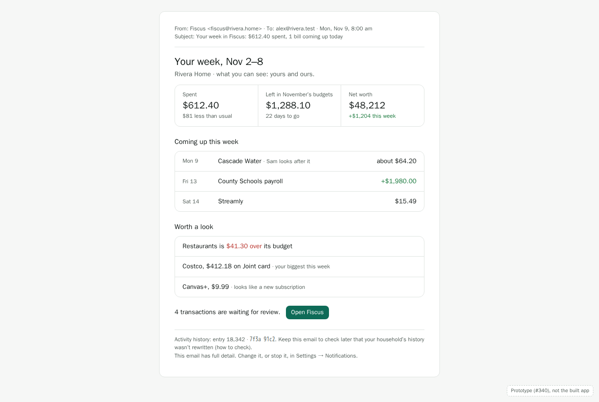

Every Monday morning (#128), on the dashboard as a card, and by email for those who want it:
- the week's spending, what's left in this month's budgets, and the change in net worth;
- what's coming up this week: bills, paychecks and card statements;
- a few things worth a look: a category over budget, the biggest purchase, a new subscription
  or price rise;
- how many transactions are waiting for review;
- the household's activity history head (#389), so a kept email can later show the history
  wasn't rewritten.

**D21. Each person's recap is their own.** It's built for the person reading it, from what they
can see (SYS-02). Alex's says "what you can see: yours and ours"; Sam's includes Sam's private
card, which Alex's doesn't. A quiet week still sends a short recap, so it's clear nothing broke.

**Built (#128).** `buildWeeklyRecap()` in `@fiscus/ledger` builds a person's recap in their own
context (never system context), so row-level security keeps it to what they see. The dashboard
shows last week's as a card (`GET /households/:id/recap`), and `renderWeeklyRecapEmail()` in
`@fiscus/shared` turns it into the email, at full, summary or minimal detail (D17), for the
Monday send. New subscriptions and price rises join "worth a look" with #123 and #129.

---

## Decisions

| # | Decision | Shapes |
|---|---|---|
| D1 | One model for bills, subscriptions, income and transfers | #118 |
| D2 | Schedules include twice a month and a weekend rule; no holiday calendar | #118 |
| D3 | Fiscus detects from all its own history, for every account, not Plaid's recurring endpoint | #119 |
| D4 | Found: 3+ at a steady pace, still coming; it proposes an amount condition to edit | #119 |
| D5 | Suggestions are reviewed on Bills & recurring; Not recurring is remembered | #119 |
| D6 | Any transaction can start a series, and its past payments are linked | #118, #119 |
| D7 | Recurring never sets or changes a budget's amounts | #118 |
| D8 | What's expected is estimated from last year's month and the last 3, apart from what matches | #120 |
| D9 | Card statements come from the bank, and aren't added to bills | #122, #86 |
| D10 | Series follow account visibility; Ours and Mine filter by who it's for | #118, ADR 0006 |
| D11 | Matching by conditions like a rule's: account and/or merchant, direction, a date window, an amount condition | #120, rules |
| D12 | Late 2 days after its date; mark paid, skip, or ended; two lates ask if it's ended | #120 |
| D13 | One person looks after each bill and gets its reminders | #121, ADR 0006 §6 |
| D14 | Price rises, new subscriptions and ended series are noticed | #123, #129 |
| D15 | Notifications are per person, and only about what they can see | #127, SYS-02 |
| D16 | In Fiscus, email (set up by the admin), ntfy, Gotify and webhooks | #125, #126, #130 |
| D17 | Full, summary or minimal detail, per channel | #311, ADR 0014 §5 |
| D18 | The rules and their defaults | #127 |
| D19 | Low balance looks 2 weeks ahead with confirmed series | #127, ADR 0010 |
| D20 | Reminders are sent once, on time, in the household's timezone | #127 |
| D21 | Each person's weekly recap is built from what they can see | #128, #389 |
| D22 | People and Ours · Mine show only where there's a choice: never on your own, or on your own accounts | #118, #121 |

## Open questions

- **Detection thresholds (D4).** 3 payments, 5% for "about", one and a half cycles for "still
  coming" are starting points. They should be checked against real histories, including one
  with nine years of Monarch imports, before #119 is done.
- **Reviewer assignment and review reminders (#45).** "Transactions to review" here is your own
  queue. Assigning someone else to review a shared card's transactions is #45, and isn't designed
  here.
- **Quiet hours** for phone notifications. Probably wanted; left for after the first version.
- **A subscription audit view** (#123): all subscriptions with their yearly cost and last use.
  The "Subscriptions" total links to All, filtered; a fuller view can come later.
