# Walkthrough: budgets and shared costs (design, M3)

This designs budgeting and shared costs before they're built (#339). It covers:
- which budgets a household gets, from how it handles money;
- setting up a first budget, in one step;
- a month in each of the four strategies;
- switching strategies;
- shared and personal budgets in one household;
- shared costs: split rules, who owes whom, and settling up.

Monarch is the reference: what to keep, and what Fiscus should do better.

When the features ship, this is updated to match the built screens and becomes their user guide,
as the [core ledger walkthrough](core-ledger.md) did.

**About the screens.** They're static HTML prototypes in
[`budgeting/prototypes/`](budgeting/prototypes/), styled with the app's tokens. Each one:
- is labeled as a prototype, and shows what Fiscus should do, not what it does yet;
- uses the same invented household as the earlier walkthroughs: the Riveras, Alex and Sam, a
  **Hybrid** household (ADR 0006 §8) seen by Alex;
- is set on October 26, 2026, with 5 days of the month to go.

The numbers agree from screen to screen: the October budget, the shared-costs statement, a
category's history and the annual view all come from the same transactions. To regenerate the
images after editing a prototype, see
[`budgeting/prototypes/README.md`](budgeting/prototypes/README.md).

Decisions are numbered (**D1**, **D2**, …) and collected [at the end](#decisions), with the
issues they shape.

**Simple by default.** Fiscus can do a lot here: four strategies, shared and personal budgets,
allowances, split rules. Very little of it is asked up front. A person on their own, or a couple
budgeting together, gets one budget in one click, as a list of categories with limits. The rest
is there when someone goes looking for it (D21–D24).

---

## 1. What a budget is, and what it counts

A **budget** belongs to a **scope** and runs a **strategy**:
- **Scope.** Either **Ours**, the household's shared budget, or **Mine**, one member's own. A
  household can have one Ours budget, and one Mine budget per member.
- **Strategy.** One of four (§3). Each budget picks its own, so the Riveras can run a shared
  zero-based budget beside Alex's own 50/30/20 (ADR 0006 §6).
- **Amounts.** Each month has an amount per category: what's budgeted or assigned. They're kept
  the same way whatever the strategy, which is what makes switching safe (§5).

**D1. A budget counts by attribution, as ADR 0006's spending views do.**
- **Ours** counts transactions attributed to two or more members, at their full amount.
- **Mine** counts transactions attributed to you alone.
- Attribution, not the account, decides which: groceries on Alex's own card, attributed to both
  of them, count in Ours. A split's parts count separately, so a Costco trip can be partly Ours
  and partly Alex's.
- **Never counted:** transfers, settle-ups (§9), and transactions marked excluded.
- An attributed transaction is shared with everyone it's attributed to (ADR 0006 F1). So in a
  two-person household, both see the same Ours budget.

**D2. Contributions connect the budgets.** Many couples are paid into their own accounts and
move money to joint ones.
- Ours counts as **money in**: its shared income, plus transfers from members' own accounts into
  joint accounts. These are **contributions**: "Contribution from Alex, $2,600".
- Mine counts your own income, and shows your contributions as money going **to Ours**. A
  contribution is neither income nor spending, so nothing is counted twice.
- Contributions are also what joint-account funding targets (#113) track. Budget and Shared
  costs read the same figure.

**D3. Your own budget is yours alone.** No one else in the household sees a Mine budget, or that
it exists. Your spending can come from private accounts (ADR 0006 §4), and a budget would reveal
it. The one exception is an allowance (§7): the household budget shows how much each member gets.

**D4. Who can change what.**
- Ours: owners and members change it, and viewers read it. Each change goes into the household's
  activity ("Alex moved $41.30 from Groceries to Restaurants").
- Mine: only you.
- Two people editing the same amount at once: the first save wins, and the second is told
  (API conventions §8).

### Which budgets a household gets

**D21. The finance style decides, so setup asks nothing about whose budget it is.** Creating a
household already asks whether it's just you, and if not, how you handle money together (ADR
0006 §8). Budgets follow the answer:

| Household | Budgets | What you see |
|---|---|---|
| **Just me** | One, yours | **Budget**. No Ours · Mine, no Shared costs |
| **Combined** ("it's all ours") | One shared budget | **Budget**, covering everything. No switch, no settle-up |
| **Hybrid** (yours / mine / ours) | The shared one first; each person can add their own | Ours · Mine, once someone adds their own |
| **Separate** | Each person's own | Your budget, and Shared costs for what you split |
| **Roommates** | Each person's own | Your budget, with shared bills in Shared costs |

- **On your own, your budget is a personal one** (`member_id` set), even though it's the only one.
  Ours counts what's attributed to two or more people, which is nothing in a household of one.
  When someone joins, your budget stays yours and stays private, and a shared one can be added
  for what you share (§7a).
- **One budget shows no scope at all.** The page is just **Budget**: no switch, no "Ours" or
  "Mine" label. The words appear only when there are two budgets to tell apart.
- The style is shown on setup in one line, with **Change**, so a couple who set up as Hybrid
  aren't surprised by a shared budget.

---

## 2. Setting up a budget

| One step | Then check the amounts |
|---|---|
| 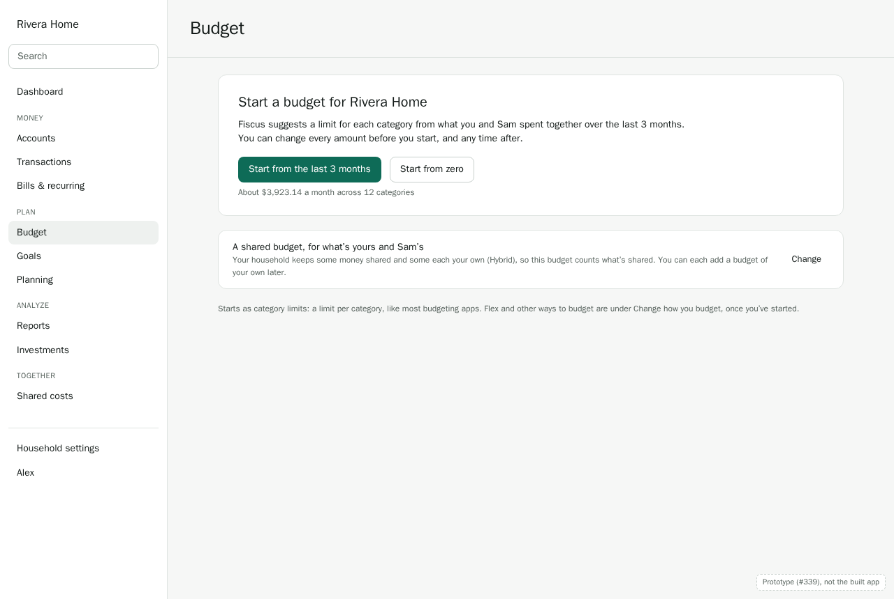 | 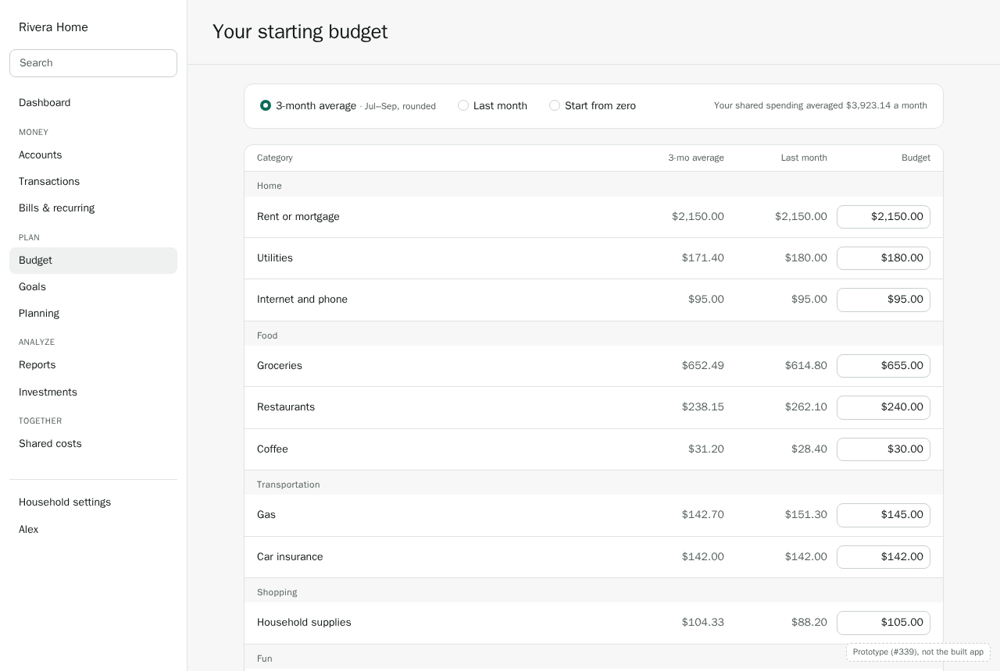 |

With no budget yet, the Budget page offers to start one in a single step:
- **Start from the last 3 months**, the main button, or **Start from zero**.
- One line says whose budget this is, from the finance style (D21), with **Change**.
- **Start from the last 3 months** opens the amounts to check before anything is saved.

**D5. Start from your history, as category limits, with no questions.**
- Most people arrive with months of imported or synced history, so the first budget shouldn't
  start at zero. Amounts are prefilled from the budget's **3-month average**: the last three full
  months, skipping empty ones as Fiscus's averages do, rounded to the nearest $5. Last month's
  figures, or zero, are a click away.
- Categories with no spending in those months are left out, and can be added any time.
- Nothing is saved until **Start budgeting**. Without enough history, setup starts from zero and
  says why.
- **The strategy isn't asked.** Every budget starts as **category limits**, the model most
  budgeting apps use and most people expect. The others are under **Change how you budget**
  once there's a budget, with the preview that shows what changes (§5). Asking someone to choose
  between four strategies before they've seen one is the fastest way to lose them.

---

## 3. A month in the budget

Every strategy has the same frame:
- **Header:** the period stepper (`‹ October 2026 ›`), the **Ours · Mine** switch, the strategy,
  and **Annual view**.
- **Summary strip:** four numbers that answer "how are we doing".
- **Rows by category group:** the category, its amount, what's been spent, and what's left, with
  a bar.

The bar has a thin mark for how far through the month you are. A category at 80% on the 26th is
on pace, and one at 80% on the 10th isn't. Selecting a row opens its drawer (§4).

**D6. Nothing spent goes missing.**
- Spending in a category with no budget shows under **Not budgeted**, with **Set budget**.
- Uncategorized spending shows with a count, and a link to Review.
- The summary's "Spent" includes both, so the budget always adds up to what actually left the
  household.

**D7. Card spending counts when you spend, not when you pay the card.** A purchase on a credit
card counts in its category on the day you make it. The card payment is a transfer, and isn't
counted. This is how Monarch and Fiscus's reports already work. Envelope tools that budget card
payments separately suit people who budget before they spend, and that's what zero-based is for.

### 3.1 Category limits

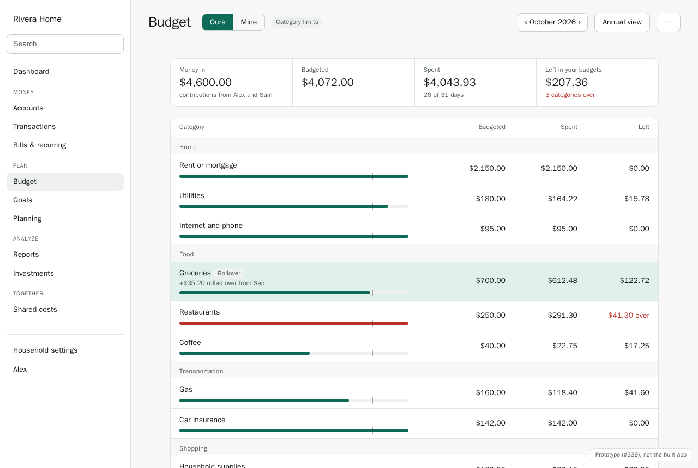

A limit per category, and what's left of it. The simplest strategy, and the default.

- **Rollover** is per category, off by default. When it's on, what's left at the end of the month
  is added to next month's limit: Groceries shows "+$35.20 rolled over from Sep". Overspending
  is carried too, as a smaller limit.
- **Left in your budgets** is the sum of every row's "left", so overspent rows count against it.
  "3 categories over" says how many.
- **Money in** is shown for context. Category limits doesn't plan it.

### 3.2 Zero-based

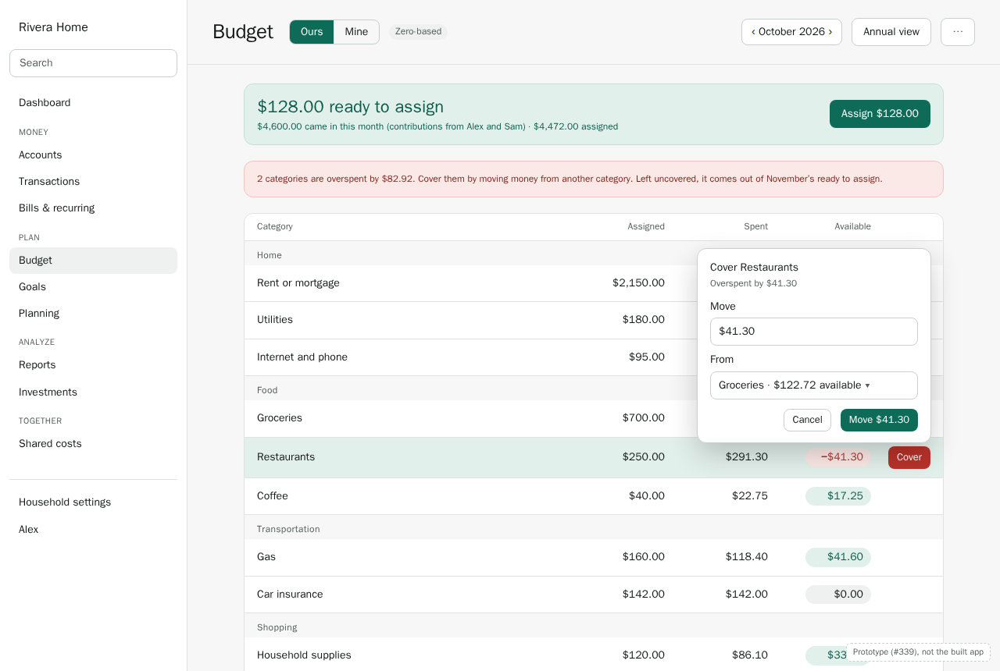

Every dollar that comes in gets a job. **Ready to assign** is what's come in, plus last month's
unassigned money, less what's been assigned. The goal is to bring it to $0.00.

**D8. Assign what has arrived.** Ready to assign counts money that has come in: income and
contributions this month (D2), plus what's carried. It doesn't include paychecks expected later.
Assigning money you don't have yet is how zero-based budgets go wrong. If you assign more than
you have, the banner turns red and says by how much.

**D9. Overspending is covered, or it comes out of next month.**
- An overspent category shows its negative balance, with **Cover**. Cover moves money from
  another category, suggesting the one with the most left.
- **Move money** works the same between any two categories, from either row's menu.
- Overspending still uncovered at the end of the month is taken from next month's Ready to
  assign, and the category starts the new month at $0.00. An envelope never carries debt
  silently, and the banner says this before it happens.
- In zero-based, every category keeps what's left: **all envelopes roll over**.

### 3.3 50/30/20 (percentage buckets)

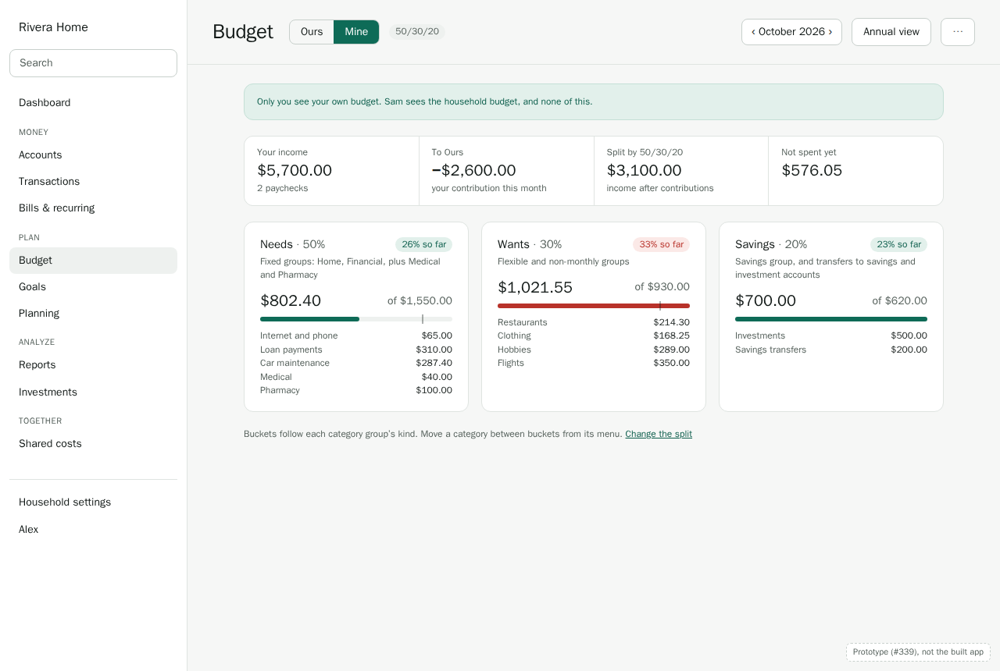

Income is split into **buckets** by percentage. 50/30/20 is the preset, and any split works,
with any number of buckets. Here it's Alex's own budget.

**D10. Buckets follow category groups' kinds, and can be changed.**
- **Needs:** groups of kind `fixed`, such as Home and Financial.
- **Wants:** groups of kind `flexible` and `non_monthly`.
- **Savings:** the `savings` group, plus transfers into savings and investment accounts in the
  budget's scope.
- Any category can be moved to another bucket from its menu.
- There are no per-category limits: a bucket shows its biggest categories, and that's all.

**D11. The base is income after contributions, by default.**
- A Mine budget takes contributions to Ours (D2) off your income first: "Split by 50/30/20:
  $3,100.00, income after contributions". What you send to Ours is budgeted there, and would
  otherwise count twice.
- The base can instead be the whole income, with contributions counted as Needs.
- It can be **actual** income this month, the default, or an **expected** monthly figure you
  enter. Expected is for people paid irregularly, whose month can't wait for the money to arrive.

A bucket over its share turns red. Savings is the exception: there, over is good.

### 3.4 Flex

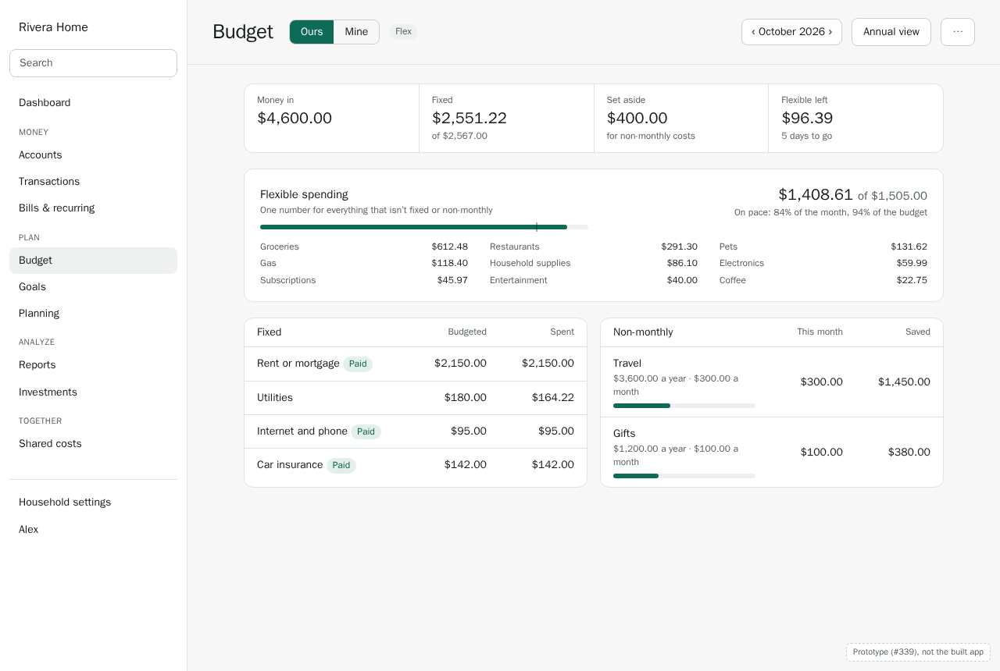

Monarch's model:
- **Fixed** costs are budgeted one by one, and usually match the bills.
- **Non-monthly** costs are saved for monthly.
- Everything else shares **one flexible number**.

**D12. Non-monthly categories save up.**
- A non-monthly category has a yearly figure, and sets aside a twelfth of it each month: Travel
  is "$3,600.00 a year · $300.00 a month".
- What's set aside accumulates, and spending draws on it, so a $1,200 flight in July doesn't
  break July.
- The **Saved** column is that running balance. It's the same in every strategy that uses the
  category (§5).

The flexible card says whether you're on pace ("84% of the month, 94% of the budget") and lists
what's been spent in each flexible category, without limits.

---

## 4. A category up close

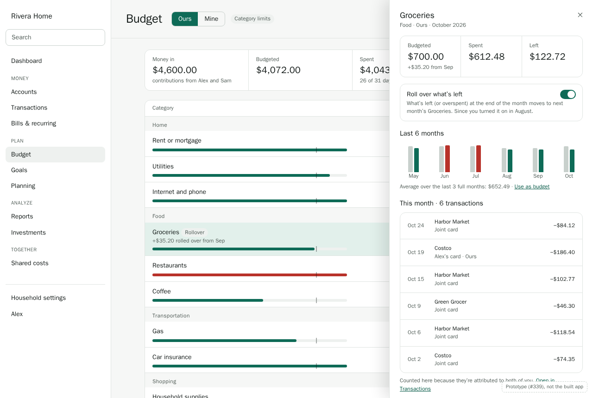

Selecting a row opens a drawer, as transactions do. It shows:
- the month's numbers, and the rollover switch with what it does;
- the last six months, budgeted against spent, with **Use as budget** for the average;
- this month's transactions, with why they're counted here ("attributed to both of you") and a
  link to the same list in Transactions.

**D13. Budgets are computed when you look, not stored.**
- Spent, left, rollover and Ready to assign are worked out from the amounts and the
  transactions each time, as reports are (data model §3, effective dates).
- Recategorizing a transaction, moving its date, or changing its attribution changes every month
  it touches, at once. There's no month-end close for budgets: past months can be edited, and
  rollovers after them follow.
- Ours edits to past months go into the household's activity like any other.

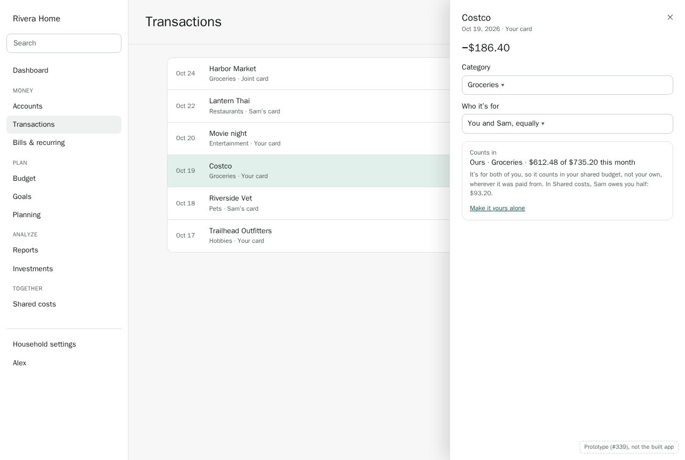

**D22. Every transaction says which budget it counts in.** Attribution decides where spending
counts (D1), which is right but invisible. So the transaction's drawer says it plainly:
- **Counts in:** the budget and category, with how that category stands this month.
- **Why:** "It's for both of you, so it counts in your shared budget, not your own, wherever it
  was paid from." And what it does in Shared costs, when it does something there.
- **One click to change it:** "Make it yours alone" sets the attribution, which moves it.

With only one budget there's nothing to choose between, and the line just names the category's
budget.

---

## 5. Switching strategies

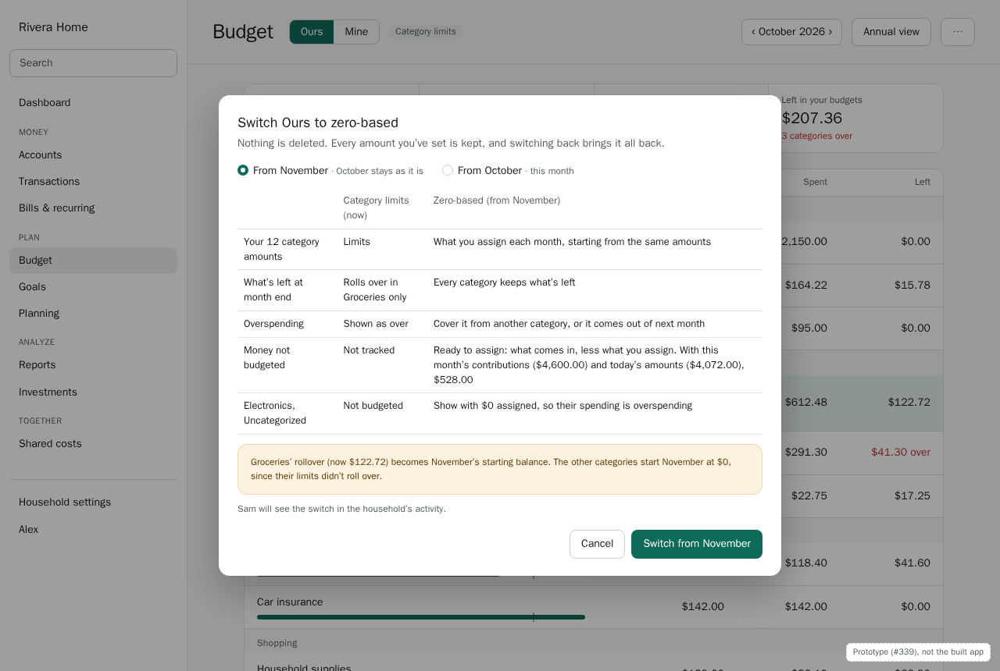

**D14. Switching keeps every number, and never rewrites the past.**
- A budget's strategy has a start month. Switching sets a new one, **next month by default** or
  this month, and earlier months keep the strategy they had.
- Amounts per category are kept whatever the strategy. Each strategy reads the ones it uses:
  - Flex ignores flexible categories' own amounts, and they come back if you switch away.
  - 50/30/20 ignores them all.
- Switching back finds everything where it was.

**The preview** shows, before anything changes:
- what each part of the budget becomes;
- this month's numbers under the new strategy: Ready to assign, buckets or the flexible number;
- how rollovers carry over. Balances that rolled over become the new strategy's starting
  balances, and categories that didn't roll over start at $0.00.

Switching an Ours budget appears in the household's activity, so the other members aren't
surprised.

---

## 6. The year at a glance

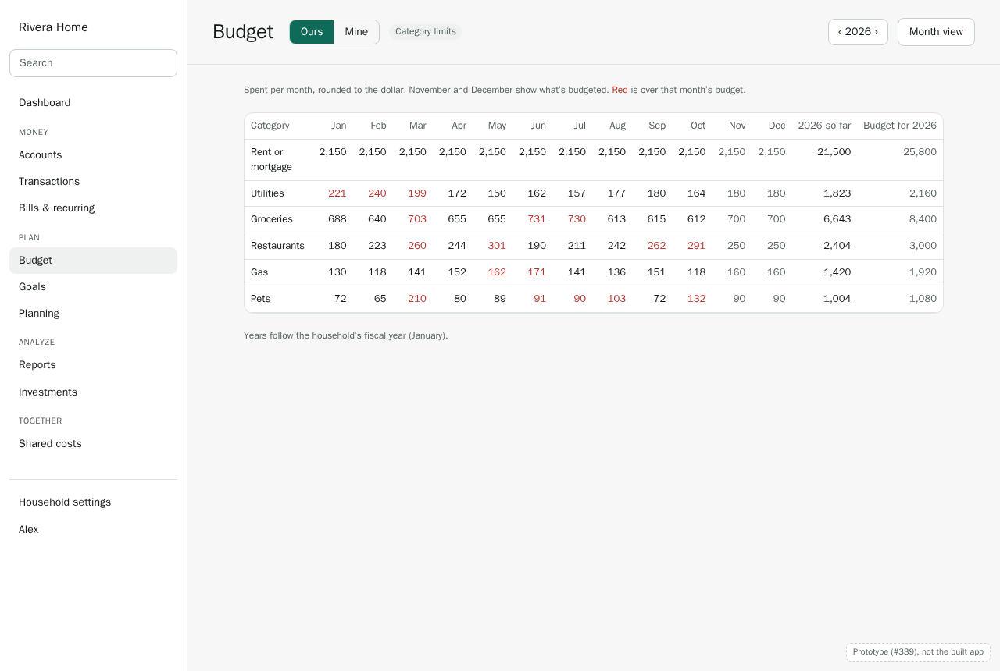

**Annual view** (#106) shows each category by month:
- past months show what was spent, in red when over that month's budget;
- future months show what's budgeted;
- the totals compare the year so far with the year's budget.

Years follow the household's fiscal year (ADR 0011). It's the place to see that Utilities runs
high every winter, and to plan for it.

---

## 7. Shared and personal budgets together

The Riveras run both:
- an **Ours** budget for the household: rent, groceries, the car and the pets, funded by
  contributions;
- and each their own **Mine** budget.

Alex sees Ours and Alex's own Mine. Sam sees Ours and Sam's own Mine. Neither sees the other's
(D3).

**D15. Allowances are a line in Ours that funds a Mine.**
- An allowance, or fun money (#114), is a category in the Ours budget with one line per member:
  "Fun money · Alex, $150.00".
- Others see the amount, and never how it was spent (ADR 0006 §7.4). In the member's own
  budget, it arrives as money in.
- **Setting one up says plainly what it can't hide.** Spending from a joint account stays
  visible to its co-owners, wherever the money came from (F5). For real privacy, pay the
  allowance into your own account, which can be a funding target (#113), and spend it from
  there.

**D16. One budget page, two scopes, and the switch only when there are two.**
- With two budgets, Budget has the **Ours · Mine** switch rather than following the global lens:
  a budget is either scope, never "all".
- The lens still applies elsewhere, and choosing **Ours** or **Mine** in the lens opens the
  matching budget.
- With one budget, whichever it is, there's no switch and no scope label (D21).

---

## 7a. When the household changes

**D23. Budgets adjust when the household does, and nothing is deleted.**
- **Someone joins a household of one.** Households of one skip the "how do you handle money
  together?" question, so it's asked when the first person joins: of the owner, when they
  invite, and confirmed by both once they're in. Your budget stays yours and private. If the
  answer is Combined or Hybrid, Budget offers to start a shared one for what you'll share,
  from zero, since there's no shared history yet.
- **The style changes later**, in Household settings. Budgets the new style doesn't use are
  hidden, not deleted: moving from Hybrid to Combined hides the personal budgets, and moving
  back brings them back as they were. A member's own budget is only ever deleted when they
  leave (BUD-05).
- **A second budget is added.** The **Ours · Mine** switch appears, and each budget's
  transactions say which one they count in (D22).

---

## 8. Shared costs: who owes whom

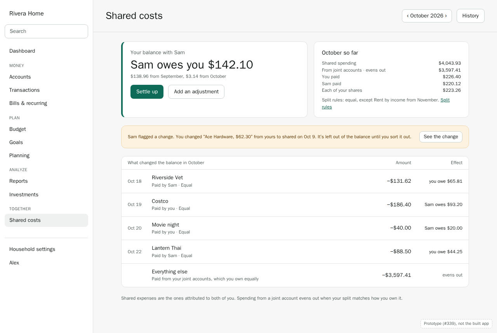

**Shared costs** (`/h/:id/shared`) answers one question first: **where do we stand?**
- **The balance:** "Sam owes you $142.10", worded from your side, with where it came from:
  $138.96 from September and $3.14 from October.
- **This month:** shared spending, and how much of it came from joint accounts, which evens out.
- **What changed the balance:** each shared expense one of you paid on your own account, what it
  cost, and its effect.

**D17. What each shared expense does to the balance.** For each transaction attributed to two or
more members:
- **What each person owes** comes from the split rule for its category (§9) and its attribution.
- **What each person paid** comes from the account's owners: who paid, not who it was for (ADR
  0006 §7.2).
- The difference goes into the running balance between each pair of members.

So spending from a joint account the Riveras own 50/50, split equally, **evens out**. It's
listed as one line, "Everything else", rather than dozens. What moves the balance is shared
spending on someone's own card, and splits that don't match ownership.

**D18. Disputed changes wait outside the balance.**
- When a change that moves money between you is **flagged** (ADR 0006 F6, #60), it's listed
  separately and left out of the balance until the person who made it sorts it out.
- Settling up never includes an amount one of you contests.
- The banner links to the change in the activity.

**Statements and late changes.**
- Each month is a statement. A month's statement **closes** when you settle up after it ends.
- A change afterward to a transaction in a closed month doesn't reopen it. It shows in the
  current statement as an **adjustment**: "October, adjusted: Costco recategorized, −$12.40".
- This settles an open question in the data model (§3, effective dates): what was settled stays
  settled, and the running balance is always exact.

**More than two members.**
- With three or more, the card shows a balance with each person.
- Roommates households get Shared costs first in the navigation (information architecture §5).
- Settling with the fewest transfers (#262) comes later.

---

## 9. Split rules, and consent for a split by income

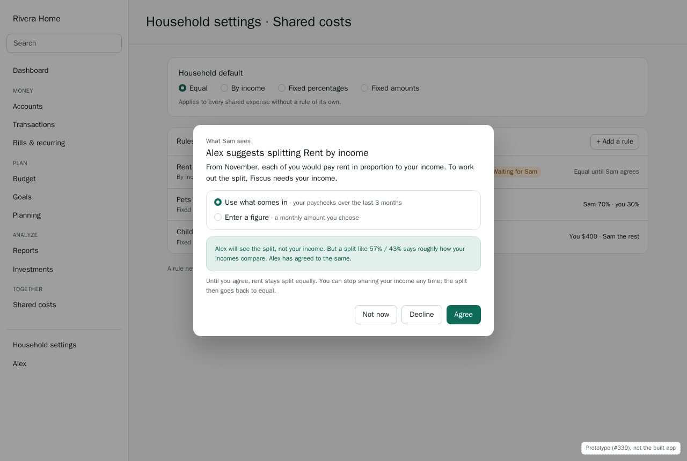

**Household settings → Shared costs** has the household's **default** split and **rules for
categories** (#109). The methods are equal, by income, fixed percentages and fixed amounts. Each
rule starts from a date, and a rule never changes a month that's been settled.

**D19. A split by income waits for everyone's agreement (F4, #110).**
- A split by income reveals roughly how incomes compare, so each person whose share depends on
  it must agree.
- Each chooses the income it uses: what comes in (their paychecks over the last 3 months), or a
  figure they enter.
- The request says exactly what the others will see: the split, such as 57% / 43%, never the
  income.
- Until everyone agrees, the rule shows **Waiting for Sam**, and the category is split by the
  household default.
- Anyone can withdraw later, and the split goes back to the default from that day.
- Requests expire after 14 days (#265).

---

## 10. Settling up

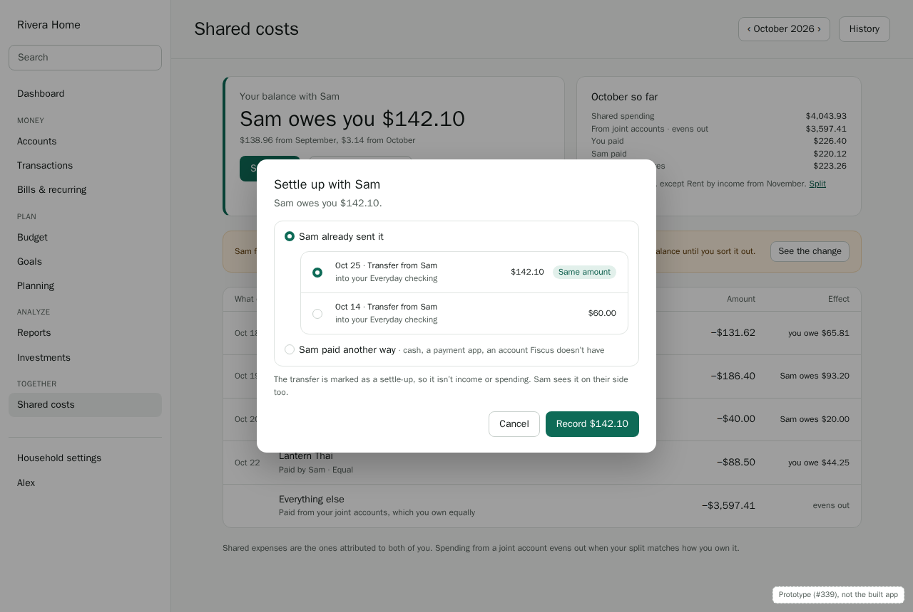

**Settle up** records that the balance has been paid.

**D20. A settle-up is usually a transfer already in Fiscus.**
- The dialog suggests transfers from the person who owes into an account of the person owed,
  closest to the amount first. One for exactly the balance is marked **Same amount**.
- Choosing one marks it a **settle-up** (`is_settlement`, category Settlement). It stops counting
  as a transfer or as income, and both of you see it in the statement.
- **Paid another way** records cash, a payment app, or an account Fiscus doesn't have, as an
  amount and a date.
- **Add an adjustment** records anything else, with a note: "Sam paid for the concert in cash".

**Auto-detect** (#112): a new transfer from one member's account to another's, close to the
balance, is suggested in Review → Transfers as "A settle-up with Sam?", one click to confirm.

As everywhere, the other side shows as the **person**, never their account (ADR 0006 F1):
"Transfer from Sam", into **your** Everyday checking.

---

## 11. On a phone

| Budget | Shared costs |
|---|---|
| 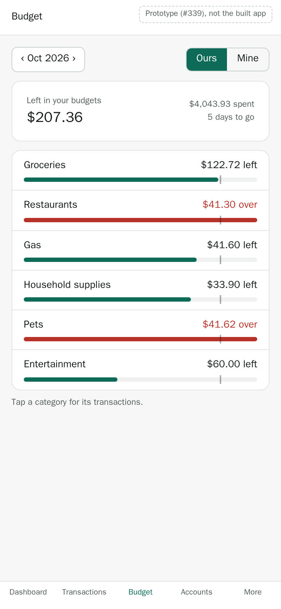 | 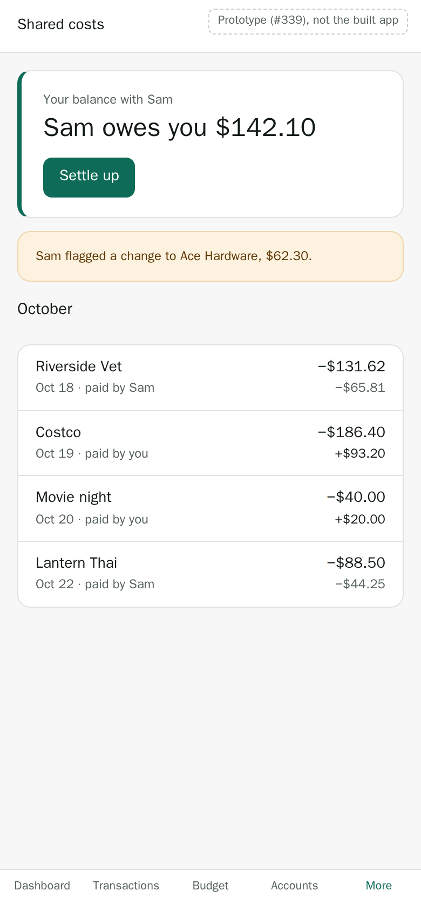 |

- **Budget:** one row per category, with what's left and a bar. Columns become a single "left"
  figure, and tapping a row opens its detail full-screen.
- **Shared costs:** the balance and **Settle up** first, then the month. It's under **More**,
  except for Roommates households, where it takes Accounts' tab (information architecture §9).

---

## 12. Empty, loading, and error states

| Where | State | What it says or does |
|---|---|---|
| Budget | No budget yet | The one-step start (§2): **Start from the last 3 months**, or **Start from zero** |
| Budget | No history to start from | Setup starts from zero: "There's no spending in this budget's scope yet to start from" |
| Budget | A month before the budget started | "This budget starts in August 2026." Spending is still shown, with no amounts |
| Zero-based | Nothing has come in yet | "$0.00 ready to assign. Money that comes in this month appears here." Last month's leftovers are still there to assign |
| 50/30/20 | No income this month, using actual income | The buckets show spending with no targets, and offer **Use an expected figure** |
| Budget, Shared costs | Loading | Rows keep their place, with grey bars, so nothing jumps when the numbers arrive |
| Budget | Couldn't load | "Couldn't load the budget." **Try again**. Amounts are never shown as $0.00 when they failed to load |
| Budget | Someone else changed the same amount | "Sam changed Groceries to $650.00 just now." Theirs is shown, with yours to apply again (API conventions §8) |
| Shared costs | Single-member household | Not shown (information architecture §5) |
| Shared costs | Nothing shared this month | "Nothing shared yet in October. Transactions attributed to both of you appear here" |
| Shared costs | All square | "You and Sam are square." No **Settle up** button |
| Split rules | Waiting for agreement | The rule shows **Waiting for Sam**, and the category uses the default split |

---

## 12a. What ships first

**D24. M3 ships in two parts: the simple path first, then the rest.** The model and engine take
everything in this walkthrough from the start (#98), so nothing is rebuilt later. What waits is
the screens.

| | First | Later |
|---|---|---|
| Budgets | Category limits (#99), the month view (#103), annual view (#106), budgets by finance style (#107), **Change how you budget** with the preview (#104), flex (#102) | Zero-based (#100), 50/30/20 (#101), templates (#105), budget month start day (#71) |
| Shared costs | Who owes whom (#111), settling up (#112), equal and fixed splits with rules per category (#109), the Shared costs page (#115), flagged changes (#60) | Split by income and its consent (#110, #265), allowances (#114), funding targets (#113), reminders (#116) |

Flex comes first among the other strategies because it's Monarch's, and the one people switching
from Monarch will look for. Zero-based and 50/30/20 follow once the first two have been used for
real.

---

## 13. Compared with Monarch

**Keep:**
- A calm monthly list of categories with bars, and rollover per category.
- Flex budgeting's one flexible number.
- Monthly and annual views.

**Do better:**
- **Simpler to start:** one click from your history, and the household's own answer about how it
  handles money, instead of a setup form (D5, D21).
- **Four strategies, chosen per budget**, instead of two, for those who look. Switching keeps
  everything (D14).
- **Shared and personal budgets side by side**, each with its own strategy, kept private where
  they should be (D1–D3).
- **Starting from history**, not zero (D5).
- **Every number explains itself.** The drawer shows the transactions behind a figure and why
  they count. Nothing spent goes missing (D6).
- **Shared costs built in:** split rules, consent for income-based splits, who owes whom and
  settling up (D17–D20). Monarch has none of these.

---

## Decisions

| # | Decision | Shapes |
|---|---|---|
| D1 | Ours counts what's attributed to two or more members; Mine what's attributed to you alone | #98, #107 |
| D2 | Contributions are Ours' money in and Mine's money out, never income or spending | #98, #107, #113 |
| D3 | A Mine budget is visible only to its member | #107 |
| D4 | Ours is changed by owners and members, with each change in the activity; Mine only by you | #98, #103 |
| D5 | Setup is one step: category limits, prefilled from the 3-month average; the strategy isn't asked | #103, #105 |
| D6 | Unbudgeted and uncategorized spending always shows | #103 |
| D7 | Card spending counts when it happens; card payments are transfers | #98 |
| D8 | Zero-based assigns only money that has arrived | #100 |
| D9 | Overspending is covered by moving money, or comes out of next month | #100 |
| D10 | 50/30/20 buckets follow group kinds, and categories can be moved | #101 |
| D11 | 50/30/20's base is income after contributions, actual or expected | #101 |
| D12 | Non-monthly categories set aside a twelfth a year and accumulate | #102 |
| D13 | Budgets are computed when read; past months can change | #98 |
| D14 | Switching keeps every amount and applies from a start month | #104 |
| D15 | Allowances are an Ours line funding a Mine, with F5's notice | #114 |
| D16 | With two budgets, an Ours · Mine switch; with one, no scope shown | #103, #107 |
| D17 | Shared expenses: owed by split rule and attribution, paid by ownership | #111 |
| D18 | Flagged changes wait outside the balance; closed statements take adjustments | #60, #111 |
| D19 | A split by income waits for everyone's agreement, and shows only the ratio | #109, #110, #265 |
| D20 | Settle-ups are matched transfers, payments made elsewhere, or adjustments | #112 |
| D21 | The finance style decides which budgets a household gets; one person's budget is a personal one | #107 |
| D22 | Every transaction says which budget it counts in, and why | #103 |
| D23 | Budgets adjust when the household changes; budgets a style doesn't use are hidden, not deleted | #107, #234 |
| D24 | M3 ships the simple path first: category limits, flex, and shared costs with equal and fixed splits | #97, #108 |

## Open questions

- **Ours with three or more members (D1).** "Attributed to two or more" means a purchase Alex
  and Sam share, but Jo doesn't, counts in the household budget, which Jo may not be able to
  see. Totals would then differ by viewer, labeled as ADR 0006 F3 requires. Alternatives: count
  only what's attributed to everyone, or let a household have more than one shared budget.
  Decide with #107, with a Roommates household to test against.
- **Budget month start day** (#71, P2). A month from the 15th to the 14th changes every
  boundary here. The model takes a start day from the beginning, and the setting comes later.
- **Over-budget alerts** belong to notifications in M4 (#127), not here.
- **Goals as budget lines** (M5). A goal's monthly contribution should appear as a budget line,
  like an allowance. Designed with goals.
- **Rounding a split's cents.** An equal split of $0.01 can't be even. The proposal is to give
  the odd cent to the payer, so totals always match: decide with #111.
