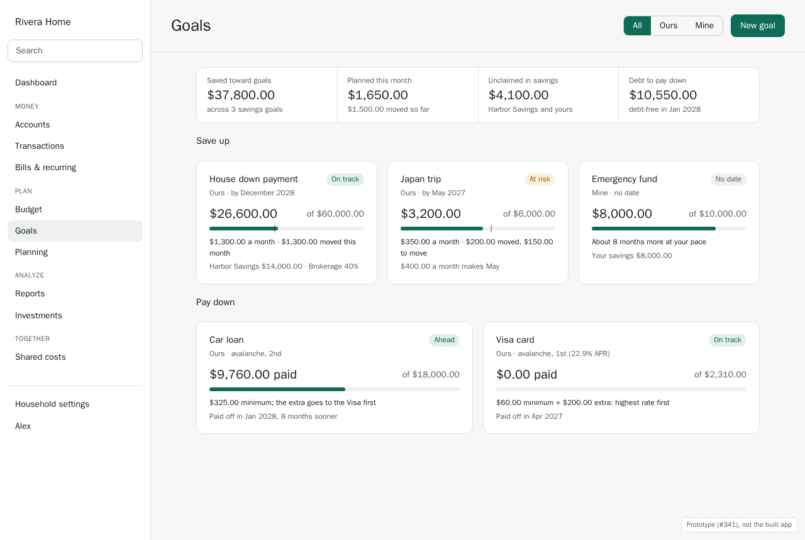
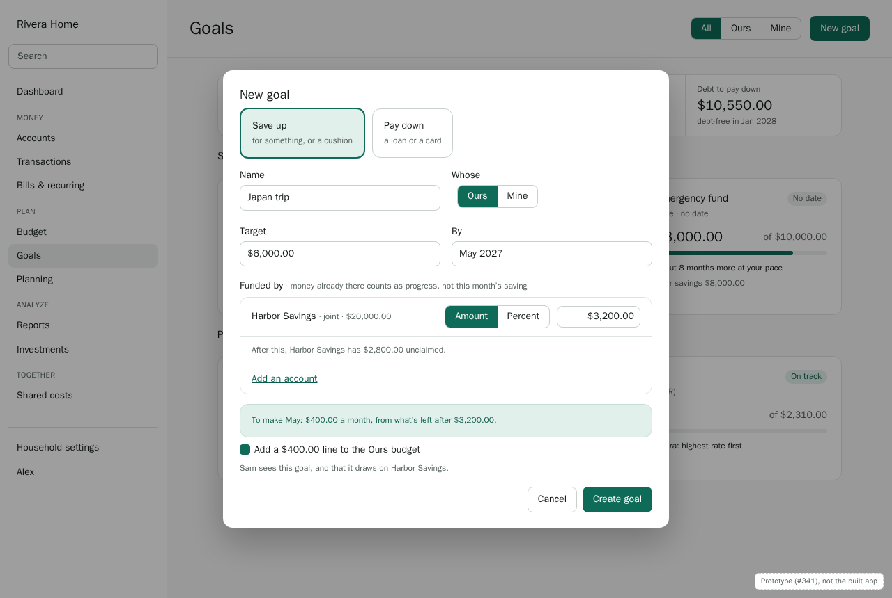
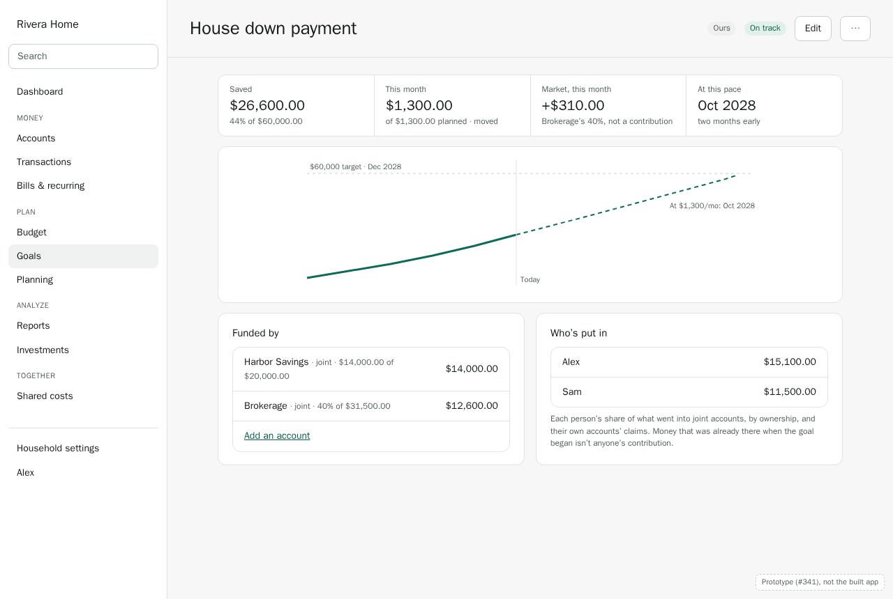
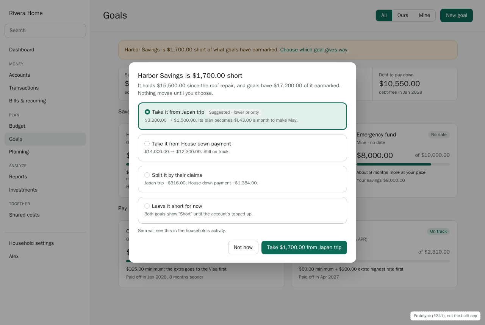
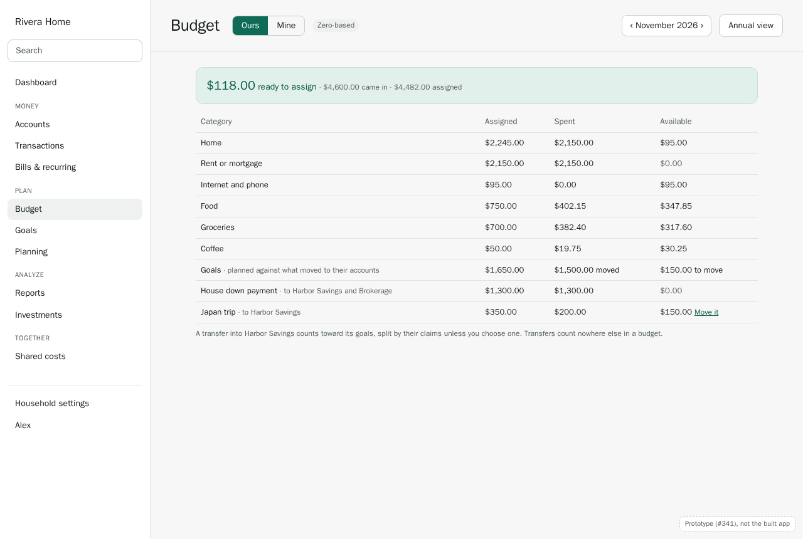
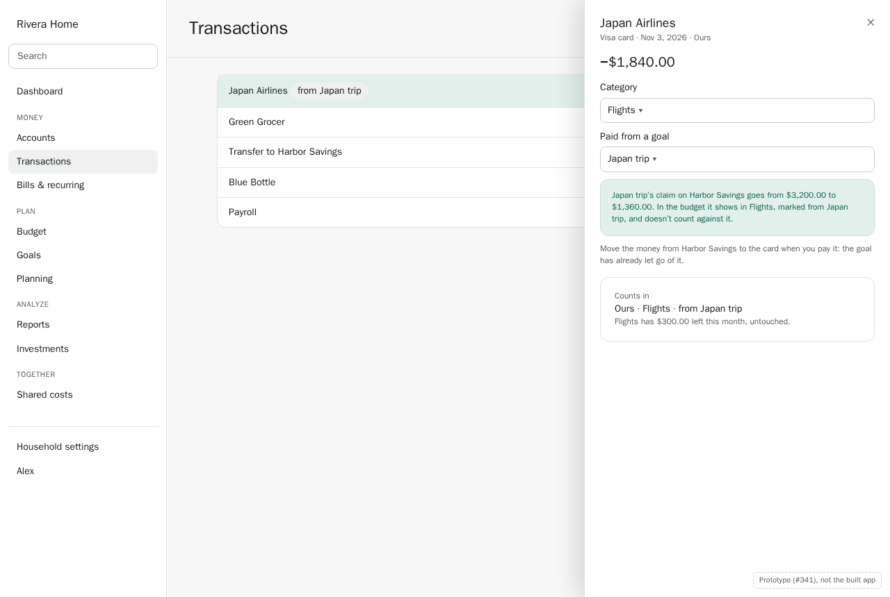
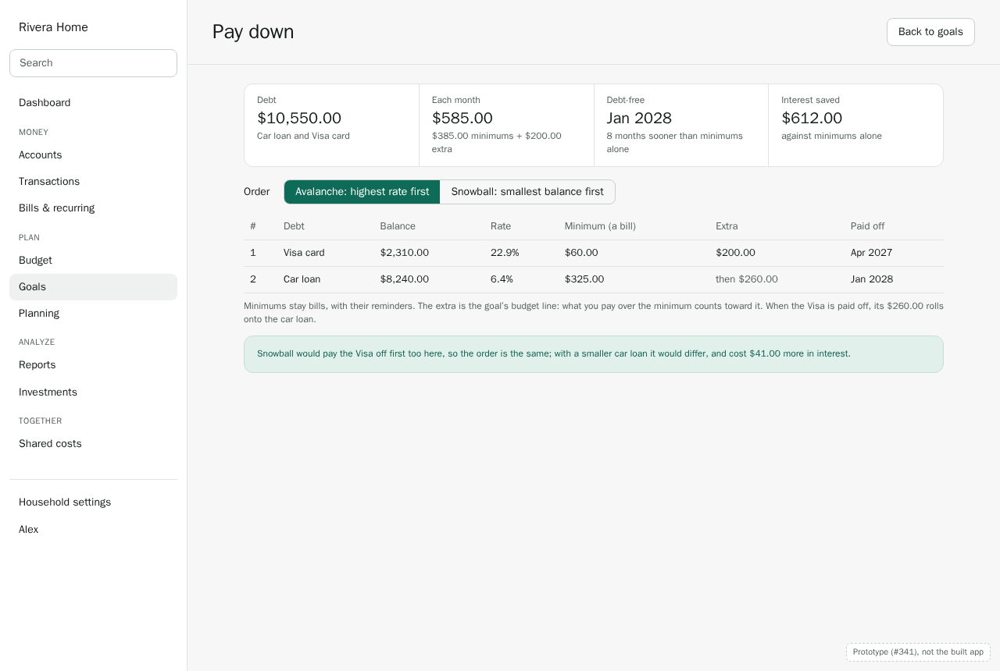
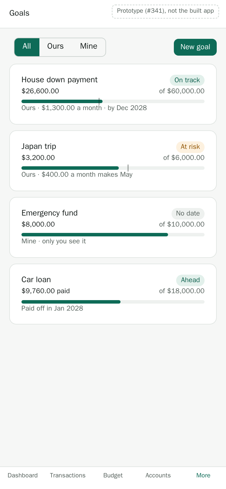
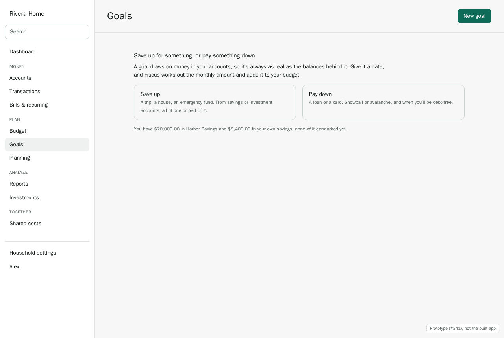

# Walkthrough: goals (design, M5)

This designs goals before they're built (#341). It covers:
- the Goals page, and creating a savings goal funded from accounts;
- a goal up close: progress, who's put in, and whether it's on track;
- when a balance falls short of what goals have earmarked;
- a goal in the budget, and spending from a goal;
- paying down debt, snowball or avalanche;
- a phone, and the empty, loading and error states.

How goals and budgets fit was settled first, in [Goals and budgets](../goals-and-budgets.md)
(decisions **G1–G14**). This walkthrough builds on it, and its own decisions continue from
**G15**, collected [at the end](#decisions). Monarch is the reference: what to keep, and what
Fiscus should do better.

When the features ship, this is updated to match the built screens and becomes their user guide,
as the [budgeting walkthrough](budgeting.md) will be.

**About the screens.** They're static HTML prototypes in [`goals/prototypes/`](goals/prototypes/),
styled with the app's tokens. Each one is labeled as a prototype, and shows what Fiscus should do,
not what it does yet. They use the same invented household as the earlier walkthroughs: the
Riveras, Alex and Sam, a **Hybrid** household seen by Alex, on November 4, 2026. Their accounts:

| Account | Whose | Balance |
|---|---|---|
| Harbor Savings | Ours (joint) | $20,000.00 |
| Brokerage | Ours (joint) | $31,500.00 |
| Alex's savings | Alex's own, private | $9,400.00 |
| Car loan | Ours | $8,240.00 owed, of $18,000.00 |
| Visa card | Ours | $2,310.00 owed |

---

## 1. The Goals page

Goals has two kinds, on two tabs:
- **Save up**: for something (a trip, a house) or a cushion (an emergency fund). Progress is
  money in accounts, by claims (G2).
- **Pay down**: a loan or a card. Progress is how far its balance has come down (G9).

Each goal is a row, as in Monarch: its **picture** (a photo, or an icon on a color), its name with
the logos of the banks it draws on, its status (§4) with when its pace gets there ("Apr 2030 (28
months behind)"), what it has and its share of the target, and a bar in the status's color. The
section's header adds up what's saved. A goal you're done with can be **archived**: its claims
end, so its money is unclaimed again, and it waits under "Show archived goals" with what it had,
until it's brought back (with no accounts) or deleted. A photo is shrunk in the browser to a small
square and served from Fiscus itself, never fetched from a stock-photo service.

The summary across the top: what's saved toward goals, this month's plans, **unclaimed** money in
savings (what no goal has earmarked yet), and debt left with the date it's gone.

**G15. Goals follow the lens, and a Mine goal is yours alone.** All · Ours · Mine filters the page,
as the lens does elsewhere (ADR 0006). Sam never sees Alex's emergency fund, or that it exists
(G7). With one person in the household, there's no switch and no scope.

---

## 2. A savings goal

**New goal** asks for:
1. **Save up**, on its tab. A debt is paid down from **Manage debts** on the Pay down tab (§8).
2. A **name**, and **whose**: Ours or Mine. Mine is the default when you're on your own.
3. A **target**, and optionally a **date**. Without a date there's no status, just progress and
   how long it would take at your pace.
4. **Funded by**: one or more accounts, each by a fixed amount or a percentage (G2). Only accounts
   you own are offered (G7). Turning an account on assumes the whole of it: 100%, or all that's
   still free when other goals have part of it. You change it from there. The row says what's left
   unclaimed after this, and won't go beyond the balance (G3).

Then it works out the monthly amount that makes the date, from what's left after the claims:
"To make May: $400.00 a month". If the goal's budget exists, **Add a $400.00 line to the Ours
budget** is ticked.

**G16. A goal's monthly plan and its budget line are the same number.** Changing the plan on the
goal, or the line in the budget, changes the other, from that month on (as amounts do). A goal
without a budget keeps its plan on the goal, and "on track" uses it.

A goal can start with no accounts at all: "Not funded yet", with **Add an account** as its only
action. Nothing is counted until it draws on something.

Earmarking money that's already there is progress, not this month's saving (G11): the Japan trip
starts at $3,200.00, 53% of the way, with nothing moved this month.

---

## 3. A goal up close

Selecting a goal opens its page:
- **Saved**, **this month** (planned against moved), **market** this month for percentage claims
  (G12), and the date at this pace.
- A chart of what's been saved, the target, and where the pace leads.
- **Funded by**: each account, its claim, and the balance behind it. A claim on someone's private
  account shows only the claim (G7).
- **Who's put in**, for a shared goal (#133): each person's share of what moved into joint
  accounts, by ownership, plus claims on their own accounts. Earmarks of money already there
  aren't anyone's contribution (G11).
- The goal's history: claims set and changed, money moved in, purchases paid from it, shortfalls,
  each with who and when.

**G17. A goal keeps the history of its claims.** Every change is kept with its reason: earmarked,
moved in, spent from, gave way to a shortfall, or the market. Progress on any date is the claims as
they stood then, so the chart, contributions and "on track" all read the same history, and nothing
is recomputed from balances after the fact.

---

## 4. Is it on track?

A goal with a date has a **status** (#137):

| Status | When |
|---|---|
| **On track** | At its pace, it reaches the target by the date |
| **Ahead** | It's a month's plan or more past where a steady pace would be by now |
| **At risk** | At its pace, it falls short by the date |
| **Short** | An account backing it holds less than its claims (§5, G3) |
| **Done** | It reached the target |

**G18. Pace is what moved, not what was planned.** A goal's pace is the average that moved in over
the last three months, or its plan while it's newer than that. A plan nobody follows doesn't keep
a goal on track. Percentage claims add the expected growth rate (#140), and a market fall never
counts as a missed month (G12).

**What to change.** An at-risk goal offers two fixes, each one click:
- **$400.00 a month makes May**: raises the plan, and the budget line with it (G16).
- **At $350.00 a month, it's done in June**: moves the date.

Without a date, the card says how long at this pace: "About 8 months more".

---

## 5. When a balance falls short

A roof repair takes Harbor Savings from $20,000.00 to $15,500.00, but goals have $17,200.00 of it
earmarked. Nothing moves on its own (G3):
- The Goals page, the account, and each goal it backs say **Short $1,700.00**.
- **Choose which goal gives way** offers: take it from one goal, split it by their claims, or leave
  it short until the account's topped up. The suggestion comes from priority.
- Members who see the goals are told once, as a notification (§10).

**G19. Priority is the goals' order, and the lowest gives way first.** Goals are listed in priority
order, which you change by dragging. The suggestion takes a shortfall from the lowest-priority goal
the account backs, then the next (#136). Nothing is taken without you.

---

## 6. A goal in the budget

A goal's plan is a line in its budget, in a **Goals** group (G4):
- **Assigned** (or budgeted) is the plan; **moved** is what reached the accounts it draws on this
  month; zero-based keeps what's not moved yet as **to move**, and it rolls over (G5).
- A transfer into an account backing two goals is split by their claims; its drawer lets you put
  it all toward one (G13).
- Category limits and flex show the line as planned against moved, never as spending. 50/30/20
  counts it in Savings, once.

An Ours goal's line is in the Ours budget, a Mine goal's in yours. Without that budget, the goal
keeps its plan to itself (G16).

---

## 7. Spending from a goal

The Riveras book flights for Japan: $1,840.00 on the Visa card. In the transaction's drawer,
**Paid from a goal: Japan trip**, or a rule does it ("Japan Airlines → paid from Japan trip"):
- The goal's claim drops by the amount: Harbor Savings' $3,200.00 for the trip becomes $1,360.00
  (G6).
- In the budget the flight shows in Flights, marked **from Japan trip**, and doesn't count against
  Flights or Ready to assign (G6).
- The drawer reminds you to move the money from Harbor Savings when you pay the card: the goal has
  let go of it, so it's unclaimed until then.

**G20. Spending from a goal comes off its claims, the most spendable account first.** With claims
on several accounts, a purchase comes off bank accounts before investments, and the largest claim
first. The drawer says which, and lets you choose. What the goal can't cover counts as ordinary
spending (G6). Only savings goals take purchases (G14).

---

## 8. Paying down debt

A **Pay down** goal is a loan or a card's balance reaching zero (G9, #134), one goal per debt:
- **Manage debts** lists the loans and cards whose balance you see. Turning one on makes its goal;
  turning it off archives it. A goal on a private account is yours (Mine): everyone sees the
  household's goals, and the balance with them.
- Its start is what was owed when the goal began (you can change it); progress is how far it's
  come down. The row shows what's owed, the share paid, and the rate and payments: "24.99% APR ·
  $130.00 minimum + $250.00 extra a month".
- The **minimum** is a bill (M4), with its reminders. The **extra** is the goal's plan and its
  budget line: what's paid over the minimum counts toward it.
- Rates and minimums come from the bank (Plaid liabilities), or are entered in the goal, which
  goes first. Without a rate, **Set up APR** asks for one and the projection leaves its interest
  out; without a minimum, 2% of what's owed (at least $25) is assumed, and said so.
- Across the top: owed now, projected interest, the total to pay, and when you're debt-free.
- A **payoff timeline** charts what's owed in all, month by month, against the minimums alone,
  with each debt's balance at the crosshair.
- A **strategy** picks the projection: **your plan** (each debt its minimum and its own extra),
  **avalanche** (highest rate first) or **snowball** (smallest balance first). The two pooled
  ones pay every minimum, put the rest on the first, and roll a paid-off debt's payment onto the
  next. Each says when you're debt-free, the interest, and how much sooner and cheaper than
  minimums alone. Choosing one changes the projection, not the goals.

**G21. A card you still use counts its balance, not your payments.** New spending on the Visa
raises its balance, and the goal shows that: progress is the balance against where it started.
The card's drawer says so, and suggests moving its everyday spending elsewhere while paying it
down. Payoff goals never take purchases (G14).

---

## 9. On a phone

One goal per card, in priority order: status, progress with the pace mark, and one line of what
matters (the plan, what makes the date, or when it's paid off). **New** is in the top bar. A goal's
page stacks its sections, the chart first.

---

## 10. Telling people

Goals use the notification rules from M4, each per person and per channel:
- **Reached**: when a goal hits its target, to everyone who sees it.
- **At risk**: once a month, when a goal first slips from on track, with what to change.
- **Short**: when a balance falls below its claims (§5).

A Mine goal only ever notifies you.

---

## 11. Empty, loading, and error states

| Where | State | What shows |
|---|---|---|
| Goals | No goals yet | Save up or Pay down, with how much is in savings and unclaimed |
| Goals | No savings or investment accounts | Save up says "Add a savings account first, or start a goal and fund it later" |
| Goals | Loading | Skeleton cards, the summary first |
| Goals | Couldn't load | "Couldn't load your goals. Try again in a moment." |
| A goal | Not funded yet | Its target and date, and **Add an account** |
| A goal | An account it drew on was closed or made someone else's | The claim ends (G8), with a notice, and the goal shows the shortfall |
| New goal | A claim beyond the balance | "Harbor Savings has $2,800.00 unclaimed" under the field |
| Pay down | No loans or cards | "Add a loan or a card to pay it down" |

---

## 12. What ships first

**G22. Goals ship in this order, each usable on its own.**

| Step | What | Issues |
|---|---|---|
| 1 | Savings goals: the Goals page, New goal, claims (fixed and percentage, many-to-many), shortfall and giving way | #132, #138, #136 |
| 2 | Progress and status: the goal page, its history, pace, what to change | #135, #137 |
| 3 | Shared goals: who's put in | #133 |
| 4 | Goal lines in budgets, moved by transfers (needs zero-based and 50/30/20, #511) | #132 |
| 5 | Spending from goals, by hand and by rule | #139 |
| 6 | Paying down debt | #134 |
| 7 | Growth rates on investment goals | #140 |

---

## 13. Compared with Monarch

**Keep:**
- Goals funded by accounts, more than one account per goal, and spending from a goal.
- A monthly contribution in the budget.
- Save up and pay down, side by side.

**Do better:**
- **Part of an account**, by amount or percentage, with unclaimed money always in sight (G2).
- **Shortfalls are shown, not hidden**: nothing quietly shrinks, and you choose which goal gives
  way (G3, G19).
- **Pace is what you actually saved**, and a market dip isn't a missed month (G12, G18).
- **What to change**, in one click: the amount that makes the date, or the date the pace makes.
- **Shared goals for couples**: who's put in, with private accounts kept private (G7). Monarch has
  no per-person view.
- **Payoff tied to bills**: minimums stay bills with reminders; the extra is the goal (G9).

---

## Decisions

| # | Decision | Shapes |
|---|---|---|
| G15 | Goals follow the lens; a Mine goal is visible only to you | #132, #133 |
| G16 | A goal's monthly plan and its budget line are the same number | #132, #100, #101 |
| G17 | A goal keeps the history of its claims, each change with its reason | #135, #137, #133 |
| G18 | Pace is what moved over the last three months, not what was planned | #137, #140 |
| G19 | Priority is the goals' order; the lowest gives way to a shortfall first, and only when you say | #136, #138 |
| G20 | Spending from a goal comes off bank-account claims first, the largest first, and can be chosen | #139 |
| G21 | A payoff goal on a card counts its balance, so new spending shows | #134 |
| G22 | Goals ship in seven steps, savings goals with claims first | #131 |

## Open questions

- **A goal on someone's private account, in a shared goal.** Only its owner can claim it (G7), and
  the others see the claim. Should the owner be able to hide even the account's name ("Alex's
  account: $8,000.00")? Proposal: yes, as an option on the claim. Decide with #133.
- **Goals in Planning (M8).** Forecasts and retirement will want goals' targets and dates. The
  history (G17) is enough for them; nothing more is designed here.
