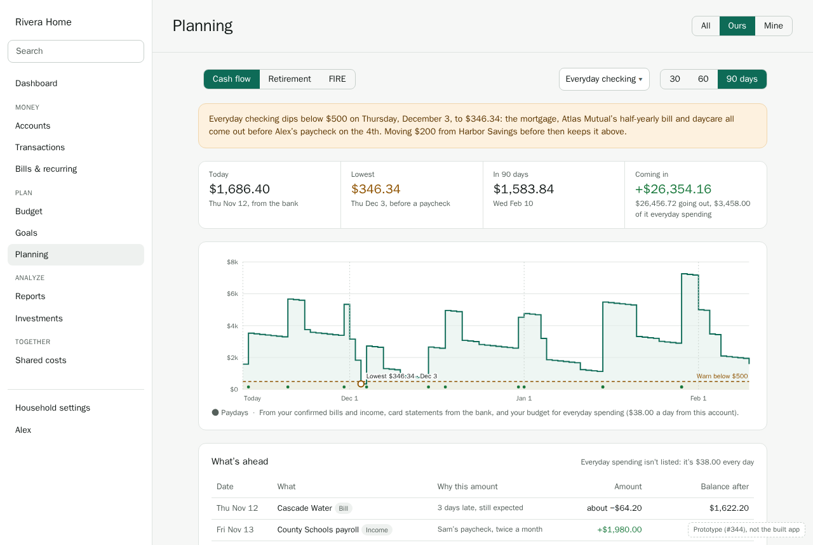
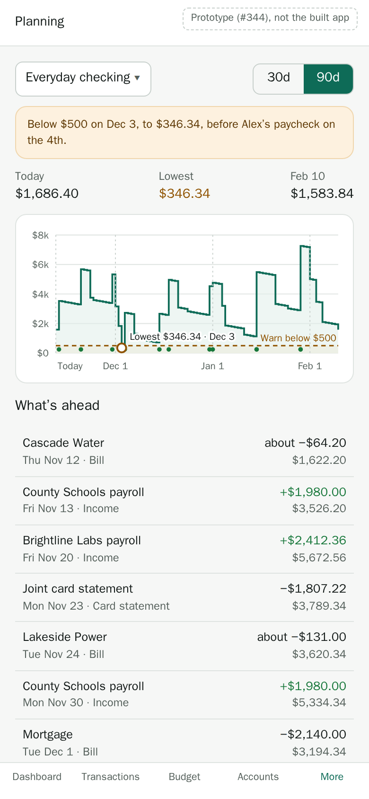
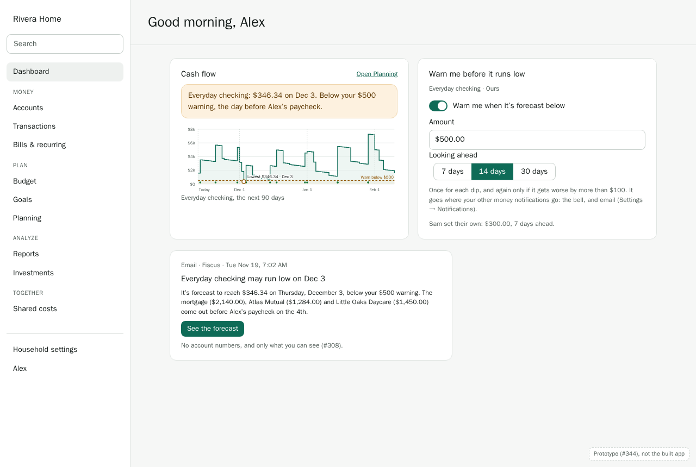
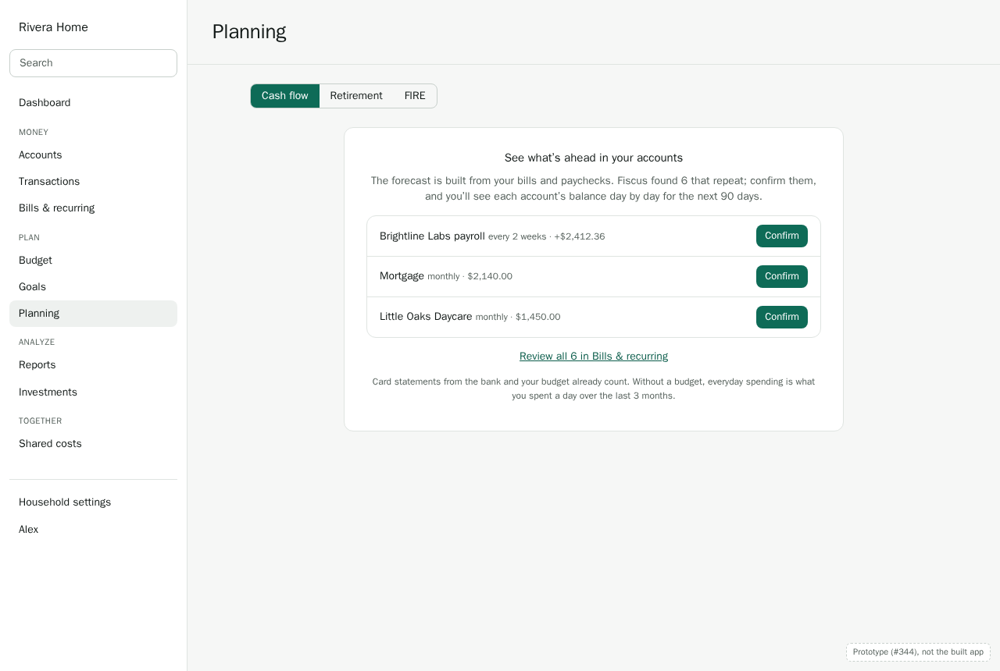

# Walkthrough: planning (design, M8)

This designs Planning before it's built (#344). M8 has five journeys, and this walkthrough grows
one journey at a time, each before its screens are built:

1. **The 90-day cash-flow forecast, and low-balance warnings** (#166): this part.
2. Building a retirement plan: members, accounts, assumptions (#167–#170). To come.
3. Life events, and comparing scenarios (#171, #172). To come.
4. FIRE: the FI number, savings rate, years to FI (#177–#181). To come.
5. Monte Carlo results, explained plainly (#182, #183). To come.

[ADR 0010](../../adr/0010-forecasting-retirement-fire.md) settled the engine: two horizons, one
engine, pure functions of a snapshot, assumptions and events. This walkthrough decides what people
see and do. Monarch is the reference: what to keep, and what Fiscus should do better.

When the features ship, this is updated to match the built screens and becomes their user guide,
as the [core ledger walkthrough](core-ledger.md) did.

**About the screens.** They're static HTML prototypes in
[`planning/prototypes/`](planning/prototypes/), styled with the app's tokens. Each one is labeled
as a prototype, and shows what Fiscus should do, not what it does yet. They use the same invented
household as the earlier walkthroughs: the Riveras, Alex and Sam, a **Hybrid** household seen by
Alex. The day is Thursday, November 12, 2026, as in the [bills walkthrough](bills.md), and the
bills and paychecks are the ones it found:

| | Account | Amount | When |
|---|---|---|---|
| Sam's paycheck (County Schools) | Everyday checking | +$1,980.00 | Twice a month; the Friday before when it's a weekend |
| Alex's paycheck (Brightline Labs) | Everyday checking | +$2,412.36 | Every 2 weeks, Fridays |
| Mortgage | Everyday checking | $2,140.00 | The 1st |
| Little Oaks Daycare | Everyday checking | $1,450.00 | The 3rd |
| Harbor CU car loan | Everyday checking | $325.00 | The 10th |
| Atlas Mutual (home insurance) | Everyday checking | $1,284.00 | Every 6 months; next on Dec 2 |
| Lakeside Power | Everyday checking | about $131, varies | Around the 24th |
| Cascade Water | Everyday checking | about $64 | Every 2 months; 3 days late now |
| To Harbor Savings (house down payment) | Everyday checking | $1,300.00 | The 5th |
| Joint card statement | Paid from Everyday checking | in full | Due around the 21st |

Everyday checking has $1,686.40 today. The amounts are invented; the arithmetic between screens
agrees.

Decisions are numbered **P1**, **P2**, … and collected [at the end](#decisions), with the issues
they shape.

**Simple by default.** The forecast needs nothing new from anyone: it's built from bills and
paychecks already confirmed, card statements from the bank, and the budget. Warnings are one
amount per account.

---

## 1. The cash-flow forecast

**Planning** opens on **Cash flow**. Retirement and FIRE are tabs beside it, for when they ship.

- **The account.** One account at a time, Everyday checking first: the account most bills come out
  of. The chooser lists cash accounts and cards; **All cash** adds up the cash accounts.
- **How far.** 30, 60 or 90 days. 90 is the default.
- **The warning**, when there's one (§3): which day, how low, what takes it there, and the
  smallest move that keeps it above. Here, Everyday checking falls to $346.34 on Thursday,
  December 3: the mortgage, Atlas Mutual's half-yearly bill and daycare all come out before Alex's
  paycheck on the 4th.
- **Four numbers.** Today's balance (from the bank), the lowest point and when, the balance at the
  end, and what's coming in and going out.
- **The chart.** The balance day by day, as steps: it changes on the day money moves, not in
  between. The warning amount is a dashed line, the lowest point is marked, and paydays are dots
  along the bottom. Hovering a day shows its balance and what moved that day.
- **What's ahead.** Every bill, paycheck, statement and transfer in order, with **why this
  amount** ("like last November", "paid in full, as the last 3 were") and the balance after it.
  The rows that end below the warning are tinted. Everyday spending isn't a row: it's the same
  amount every day, and it would bury the rest.

**P1. Only what you've confirmed.** The forecast counts:
- recurring series you've confirmed, at their estimates (bills D8: a power bill in December is
  like last December);
- card statements from the bank (bills D9);
- the budget, for everyday spending (P2).

What Fiscus has only suggested isn't counted until it's confirmed: a forecast built on guesses
would be wrong in ways nobody chose. A late bill (Cascade Water) still counts, today, until it's
paid or skipped.

**P2. Everyday spending comes from the budget, spread over the days.**
- **What's left of each category's budget** this month is spread evenly over the days left in it.
  Later months use their budgets. A category with no budget uses what was spent in it a day over
  the last 3 months.
- **Bills aren't counted twice.** Where a category's budget includes a bill that's in the forecast
  on its own (Utilities includes Lakeside Power), only the rest of the budget is spread.
- **From the account it's usually paid from**, by the last 3 months: groceries mostly on the joint
  card, gas mostly from checking. Spending on a card shows up in checking when the statement is
  paid (P3).
- Goal lines (goals G16) aren't spending. A goal's monthly transfer counts when it's a confirmed
  recurring transfer, as To Harbor Savings is.

**P3. Cards are paid the way you pay them.**
- **The statement** is paid on its due date, from the account it's usually paid from: in full if
  the last 3 were paid in full, the minimum if they were the minimum, or the usual amount.
- **Later statements** are what the card will owe when they close: its balance today, plus the
  spending forecast on it, less what's been paid.
- **The card's own forecast** (choose it in the chooser) is what it will owe day by day, and shows
  its limit when the bank has one.

**P4. Cash accounts and cards, day by day.** Checking and savings, and cards. Loans and
investments aren't forecast here: a loan's payment is a bill on the account it comes from, and
investments belong to the long-term plan (ADR 0010 §1). Balances are in the account's currency;
**All cash** converts at today's rate, and says so.

**P5. What you see is what your accounts let you see.** The lens filters accounts, as elsewhere:
**Ours** is joint accounts, **Mine** is yours. A private account is forecast only for its owners,
and its bills don't appear for anyone else (bills D10). Sam's private card isn't in Alex's
forecast, or in its totals.

**P6. One line, with its reasons.** No bands or percentages. A forecast this short is mostly known
amounts on known days; what varies (a power bill, everyday spending) is said in words ("about
$131") and explained in **why this amount**. A range would make every day look uncertain to show
that one bill is.

---

## 2. On a phone

The account and 30 or 90 days at the top, then the warning, the three numbers that matter (today,
lowest, at the end), the chart, and what's ahead as a list: each row its name, day and kind, with
the amount and the balance after it. Tapping a row shows why this amount. Planning is under
**More**.

---

## 3. Warnings before it runs low

Each person can ask to be warned before an account they can see runs low:
- **The amount**: warn below $500.
- **How far ahead**: 7, 14 or 30 days. 14 is the default: enough time to move money or call
  someone.

It's set on the account (its drawer, **Warn me before it runs low**) or from the forecast's chooser.
Alex's warning is Alex's: Sam set their own on the same joint account, $300 and 7 days ahead, and
neither sees the other's.

**P7. Warned once for each dip.**
- The worker works out the forecast each morning and sends a warning when an account is forecast
  to fall below the amount within the days asked.
- It's sent **once for each dip**, and again only if the dip gets worse by more than $100 or comes
  3 days sooner.
- When the dip is gone (money moved in, a bill moved), nothing more is sent. The dashboard stops
  showing it.

**P8. Through the notification rules people already have.** A warning is a notification like a
bill reminder (bills §7): it goes to the bell and the channels the person chose for money
notifications, with the amount and the day. It names the bills that take it there, but no account
numbers, and only what that person can see (#308). On the dashboard, a **Cash flow** card shows
the chart and the warning while there is one.

**P9. Computed when asked, not stored.** Ninety days of a household's bills is a few hundred
numbers: the api works it out when the page asks, from the same pure function the worker uses
each morning (ADR 0010 §1). Nothing is stored but which warnings were sent, so a changed bill or a
new budget shows at once.

---

## 4. Empty, loading, and error states

- **Nothing confirmed yet.** The forecast needs bills and paychecks. It lists the ones Fiscus has
  found, to confirm right there, and links to Bills & recurring for the rest. Card statements and
  the budget already count, so a household with only those gets a forecast; it says what's
  missing ("No paychecks yet: confirm one, or the forecast only goes down").
- **No balance from the bank yet** (a manual account without a starting balance): it asks for
  today's balance.
- **Loading:** the numbers and chart as skeletons.
- **Error:** "Couldn't work out the forecast", with Retry; the rest of Planning still works.

---

## 5. What ships first

**P10. The forecast ships in three steps, each usable on its own.**

| Step | What | Issues |
|---|---|---|
| 1 | The engine and the Cash flow page: confirmed series, card statements, budget spreading (P1–P6) | #166 |
| 2 | Low-balance warnings: the setting, the morning check, the notification (P7, P8) | #166 |
| 3 | The dashboard's Cash flow card, and a forecast line on each account's chart | #166, #343 |

---

## 6. Compared with Monarch

**Keep:**
- Bills, subscriptions and paychecks in one list of what's coming, with logos.
- Card statements from the bank, beside bills.

**Do better:**
- **Day by day, per account.** "Will checking dip below $500 before payday?" needs a daily balance
  for one account, not a month's totals.
- **Warnings before it happens**, with the bills that cause the dip and the smallest move that
  fixes it, rather than after the balance is already low.
- **Why each amount**, in words, so a surprising number can be checked and corrected where it comes
  from (the bill's estimate, the budget).
- **Each person's own warnings**, on accounts they share.

---

## Decisions

| # | Decision | Shapes |
|---|---|---|
| P1 | The forecast counts only confirmed series, card statements from the bank, and the budget | #166 |
| P2 | Everyday spending is the budget left, spread over the days, from the account it's usually paid from; bills aren't counted twice | #166 |
| P3 | A card's statement is paid the way the last 3 were; later statements are what it will owe | #166 |
| P4 | Cash accounts and cards, day by day; not loans or investments | #166 |
| P5 | The forecast follows the lens and account visibility | #166 |
| P6 | One line with reasons in words; no bands | #166 |
| P7 | A warning is sent once per dip, again only if it gets worse | #166 |
| P8 | Warnings go through the notification rules people already have | #166, #127 |
| P9 | Computed when asked, from the same function the worker uses; only sent warnings are stored | #166 |
| P10 | The forecast ships in three steps, the page first | #165 |

## Open questions

- **What if.** Moving a bill a few days, or skipping one, to see the dip go away. Useful, but it's
  the scenario work of journey 3. Proposal: not in the first version; decide with #172.
- **Pending transactions.** The bank's balance usually already counts them. Proposal: start from
  the balance the bank reports, and don't subtract pending ones again; revisit if a bank turns out
  not to count them.
- **Paychecks that vary.** A commission or hourly pay forecast at its estimate may be too
  hopeful. Proposal: use the lower of the estimate and the last 3 paychecks' average, and say so
  in why this amount.
