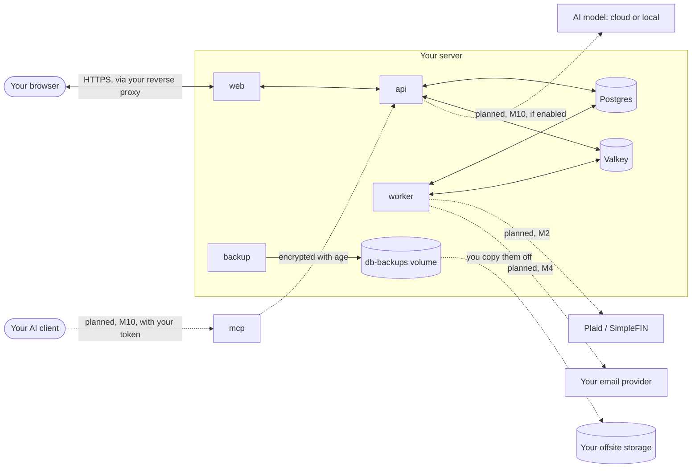

# Security

What Fiscus protects, from whom, and what it doesn't; where your data goes; and how to report a
problem. Design: [ADR 0014](../adr/0014-verifiable-confidentiality.md) (#310). Fiscus is
self-hosted today: there's no hosted service, so whoever runs the server is you, or someone you
chose to trust.

## In short

- **You run the server, so only you can read your data.** Fiscus sends nothing anywhere unless you
  connect something that needs it (a bank, email, an AI model), and each of those is listed below.
- **Disks and backups are protected** when you follow the install guide: backups are encrypted
  before they're written, sensitive fields are encrypted in the database, and the keys are kept
  apart from both.
- **Releases are verifiable.** Every image is signed, publicly logged, and rebuilds from its tag to
  the same digest ([verifying a release](verify-releases.md)).
- **Household members see only what's shared with them**, enforced by the database itself, and
  every change is in a tamper-evident activity history.

What it doesn't protect against is just as important: [what isn't protected](#what-isnt-protected).

## Threat model

From [ADR 0014](../adr/0014-verifiable-confidentiality.md#threat-model). "Tier 1" is what every
deployment gets; "Tier 2" is for hosted deployments (confidential VMs, #305) and isn't built yet.

| Who | Example | Protected by | Status |
|---|---|---|---|
| Thief of disks, backups, or database dumps | A leaked backup bucket, a discarded drive | Encrypted backups and disk ([backups](backups.md)), field encryption ([encryption](encryption.md)), keys kept apart | In place |
| Other household members | A partner reading a private account | Row-level security in Postgres ([ADR 0005](../adr/0005-tenancy-and-trust-model.md), [ADR 0006](../adr/0006-shared-finances-yours-mine-ours.md)), tested per role ([permissions](../design/permissions.md)) | In place |
| Someone rewriting history | Deleting the record of a change | Hash-chained activity history ([ADR 0013](../adr/0013-tamper-evident-activity-history.md)); a check in your browser follows (#264) | Partly |
| A malicious release | A backdoor in a published image | Reproducible, signed images in a public log ([verifying a release](verify-releases.md)): a changed image is visible | In place |
| A SQL-injection bug in the api | Injected SQL claiming to be a background job | Parameterized queries. Row-level security will hold even then: only the worker's database role will be able to act for a whole household ([data model §4.3c](../design/data-model.md#43c-system-context-is-the-workers-271-376)) | Partly: the api no longer needs it; the database stops allowing it in the release after 0.3.0 (#376) |
| Logs and error reports | A log shipped to a third party | No financial data in logs or errors, enforced by a test (#308) | In place |
| The instance operator | Whoever runs a server for others | Self-hosted: that's you. Hosted: Tier 2, so the operator never holds the key | Tier 2 not built |
| Host, hypervisor, or cloud staff | Root on the machine, a memory dump | Tier 2 | Not built |
| Anyone who takes a running server | A seizure, a stolen unlocked machine | Not protected, by choice: background sync, rules, and alerts need the data readable while nobody is signed in | Disclosed |
| Plaid, banks, email providers, cloud AI providers | | Not protectable: they see what they send or receive | Disclosed |

The full threat model, attack by attack with its mitigation, what remains, and the test that
holds it: [threat model](../design/threat-model.md).

## Where your data goes

Solid lines exist today; dashed ones are planned or up to you. **Today nothing leaves your server
on its own**: no telemetry, no analytics, no fonts or scripts from other sites, no update checks.
Your browser talks only to your server.

| Destination | What it gets | When | Status | Turn it off |
|---|---|---|---|---|
| Your offsite storage | Backups, encrypted to your public key: unreadable without your private key | When you copy them | Today | Don't copy them (but do keep backups) |
| GitHub Container Registry | A request for the image, from your server, when you pull | When you upgrade | Today | Mirror the images yourself |
| Plaid or SimpleFIN | Your bank login, entered in the provider's own window, not Fiscus's; Fiscus stores only an access token, encrypted. They send you transactions and balances, which they see | Each sync (every 4 h by default) | Planned, M2 ([ADR 0008](../adr/0008-plaid-credentials-and-webhooks.md)) | Don't link banks; import files instead |
| Your email provider | Notification contents, at the detail level each person chooses (full, summary, or minimal) | When an alert fires | Planned, M4 (#311) | Choose minimal, or no email |
| A cloud AI provider | The data the assistant looks up to answer you, as you, and only what you can see. Never account numbers or encrypted fields | While you use the assistant | Planned, M10 ([ADR 0009](../adr/0009-ai-assistant-and-mcp.md)) | Off unless the admin and household enable it; or use a local model, which sends nothing |
| Your own AI client over MCP | The same, through a token you create | While you use it | Planned, M10 | Don't create a token |

## What isn't protected

Every claim above has these exceptions:

- **Anyone who controls the running server can read the data.** It's decrypted while Fiscus runs.
  For a self-hosted server that's you; protect the machine and who can log in to it.
- **Whoever ships the code can read the data the next time it runs.** That's true of any software
  you update. Verifiable releases make a malicious release visible, not impossible.
- **Banks, Plaid, and SimpleFIN** see your transactions; that's where they come from. **Email** is
  readable by the sender's and recipient's mail services. **Cloud AI providers** see what the
  assistant sends them.
- **Metadata**: that you run Fiscus, when you use it, and roughly how much data you have, is
  visible to whoever runs your network and hardware.
- **A lost encryption key loses the encrypted data.** Keep `APP_ENCRYPTION_KEY` and your backup
  private key somewhere other than the server and its backups ([encryption](encryption.md)).

## How it's built

| Control | Where |
|---|---|
| Encryption at rest: field encryption, key wrapping, rotation, crypto-shredding | [encryption](encryption.md) |
| Encrypted backups, encrypted disks, restore drill | [backups](backups.md) |
| Keys from a `KeyProvider` that fails closed (an environment variable or a secret file) | [encryption](encryption.md#where-keys-come-from) |
| Tenancy, row-level security, and the trust model | [ADR 0005](../adr/0005-tenancy-and-trust-model.md), [permissions](../design/permissions.md) |
| Tamper-evident activity history | [ADR 0013](../adr/0013-tamper-evident-activity-history.md) |
| No financial data in logs or errors (enforced by a test) | #308 |
| Reproducible, signed releases with SBOMs | [verifying a release](verify-releases.md) |

## Reporting a vulnerability

Report it privately through [GitHub's advisory form](https://github.com/ahanel13/fiscus/security/advisories/new);
please don't open a public issue. [SECURITY.md](../../SECURITY.md) has what to include, what's in
scope, and what to expect. Every Fiscus server also publishes this at
`/.well-known/security.txt` ([RFC 9116](https://www.rfc-editor.org/rfc/rfc9116)).

That address is for problems in Fiscus itself. Something wrong with a particular server, such as
one that's misconfigured, goes to whoever runs it.

## Keeping dependencies current

- **[Renovate](https://docs.renovatebot.com)** opens update PRs weekly, and security fixes as soon
  as GitHub flags them, at any time and labeled P0 ([`renovate.json5`](../../renovate.json5)).
- **Nothing brand new is installed.** pnpm and Renovate both wait until a version is at least 7
  days old ([`pnpm-workspace.yaml`](../../pnpm-workspace.yaml)), long enough for most hijacked
  releases to be caught and pulled.
- **Install scripts are off** except for packages allowed by name (`allowBuilds`).
- **Everything is pinned**: npm packages to exact versions in the lockfile (installed with
  `--frozen-lockfile`), GitHub Actions to commit SHAs, base images to digests, and Alpine packages
  to versions. Renovate updates each pin as a reviewed change.
- **Only low-risk updates merge on their own**, once CI passes: development tools and GitHub
  Actions. Runtime dependencies, images, and anything touching the database get human review.
- **Major versions wait** for approval on the dependency dashboard, and are upgraded deliberately.
- **Licenses are checked** in CI (`pnpm licenses:check`): nothing that conflicts with the AGPL.
- **Each release lists its contents**: an SBOM per image, signed, so you can scan what you run for
  known vulnerabilities ([verifying a release](verify-releases.md#4-the-sbom)).
